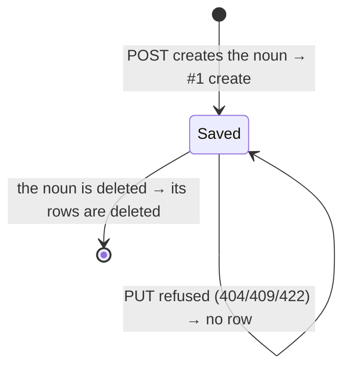

# Definition history — every saved definition of a query, dashboard or workflow

**Concept**: a query, a dashboard and a workflow each store one **definition** (its
`definition_json`), and its **version** is the 12-hex hash of that definition (decision 14,
[`_noun-model.md` § Versions](../_noun-model.md#versions--what-each-noun-was-at-a-given-moment)).
Until now a save replaced the definition and the previous one was gone. The **definition
history** keeps one row per definition change — its own sequence number, the version, the
definition itself, when, and who when the change carried a writer token — written in the same
transaction as the change. A reader lists a noun's history and opens any past definition,
read-only; **restore is an ordinary save of an old definition**, which becomes a new version at
the top of the list. Nothing is ever rewritten: restoring #3 over #5 leaves #5 in the list.

**Status**: Draft (R200 design)
**Round introduced**: [`Round_200`](../../../plan/cycles/Round_200.md) — item 4.4,
[rc4.md § 4.4](../../../plan/programs/release-rc2-rc5/rc4.md).
**Domain folder**: `data-management/_shared/` — the drawer lives in
`apps/builder/src/features/history/` (a top-level feature, beside `metadata/`), because it is
mounted by two data-management clusters (queries, workflows) **and** the dashboard feature.
This doc owns the table, the wire shape, the write rule and the drawer; each host page owns
only where it mounts the button.

**Sibling docs**: [`../_noun-model.md`](../_noun-model.md) (§ Versions — the hash a row
records), [metadata.md](metadata.md) (the writer tokens reused for `changedBy`; notes anchored
to a version), [queries/queries.md](../queries/queries.md),
[workflows/workflows.md](../workflows/workflows.md),
[../../dashboards/dashboard-filters.md](../../dashboards/dashboard-filters.md) (control ids a
restored dashboard brings back).

> **Why restore is a save, not a rollback.** A rollback would make the list lie — the versions
> after the restored one would vanish, and a note or a link made in between would point at
> nothing. A save keeps the record append-only: the list says what was saved, in order, and
> "same as #3" says which past version a save brought back. The save runs every check a manual
> edit runs, so a version that can no longer work (a column a refresh dropped) is refused for
> the same reason an edit would be.

---

## Surfaces — layer / reuse / purity declaration

| Surface                                                                                    | Layer                                                           | Reusability  | Purity             | Allowed peer deps                             |
| ------------------------------------------------------------------------------------------ | --------------------------------------------------------------- | ------------ | ------------------ | --------------------------------------------- |
| `DefinitionHistoryButton` + `DefinitionHistoryDrawer` (list · view · restore)              | `apps/builder/src/features/history/DefinitionHistoryDrawer.tsx` | feature      | feature            | react, antd, @ant-design/icons, react-i18next |
| `sameAsOf` (each entry → the newest OLDER entry with its version)                          | `apps/builder/src/features/history/sameAs.ts`                   | feature      | pure               | none                                          |
| `useHistoryQuery` · `useHistoryVersionQuery`                                               | `apps/builder/src/features/history/hooks.ts`                    | feature      | glue (server-data) | @tanstack/react-query                         |
| `historyApi.list` / `historyApi.version` (read only — restore goes through the noun's PUT) | `apps/builder/src/api/historyApi.ts`                            | builder-only | glue               | (fetch — no extra peer dep)                   |
| `HistoryKind` / `HistoryEntry` / `HistoryList` / `HistoryVersion` types                    | `apps/builder/src/features/history/types.ts`                    | feature      | data type          | none                                          |
| `GET /{queries,dashboards,workflows}/{id}/history[/{version}]`                             | `apps/backend/app/routers/history.py`                           | backend      | feature            | (FastAPI — backend native)                    |
| `record` · `sweep` · `entries` · `version_row` · `writer_of`                               | `apps/backend/app/history.py`                                   | backend      | feature            | (stdlib `sqlite3`)                            |
| `DefinitionHistory` SQLModel table (`definition_history`, Alembic `0011`)                  | `apps/backend/app/db_models.py`                                 | backend      | data type          | sqlmodel                                      |

**Boundary check**: no row lives in `@mdd/ui`. The drawer carries history-specific copy and
the restore confirm per kind, so it is feature code; like `metadata/` it sits in its own
top-level folder because two feature trees mount it. Restore reuses each noun's existing
update mutation (`useUpdateQueryMutation`, `useUpdateDashboardMutation`,
`useUpdateWorkflowMutation`), so the cache invalidation a manual save does is the one a restore
does.

---

## Token map

All surfaces are AntD primitives (`<Drawer>`, `<List>`, `<Tag>`, `<Typography>`, `<Button>`,
`Modal.confirm`) styled by the `<ConfigProvider>` tokens derived from the seeds in
[`themeTokens.ts`](../../../../workspace/packages/ui/src/themeTokens.ts). **No new token is
introduced.** `Value` is informational.

| Surface                                  | AntD token (themeTokens.ts)                      | Value (informational) |
| ---------------------------------------- | ------------------------------------------------ | --------------------- |
| Drawer background                        | `colorBgElevated`                                | derived               |
| Row divider                              | `colorBorderSecondary`                           | derived               |
| `#seq`, time · writer line, version text | `colorTextSecondary`                             | derived               |
| _Current_ `<Tag>`                        | `colorPrimary` (AntD `processing` status preset) | `#1677ff`             |
| _Same as #k_ / _History started_ `<Tag>` | `colorFillQuaternary` (default `<Tag>`)          | derived               |
| Definition block (`<pre>`, read-only)    | `colorFillAlter` background, `fontFamilyCode`    | derived               |
| Restore button                           | `colorPrimary` (link button)                     | `#1677ff`             |
| Border radius (tags, definition block)   | `borderRadius`                                   | `6`                   |

---

## Layout — ASCII intent

The page header gains a **History** button (`HistoryOutlined`) beside the page's other
actions — on the query page only in view mode (not while editing: a restore would discard the
working copy), on the workflow page beside Edit, on the dashboard page in the header actions.
It opens a right-hand `<Drawer>` (width 520).

```text
┌ History — Weekly ─────────────────────────────────────────────── ✕ ┐
│ Every saved change of this dashboard's definition, newest first.   │
│ Renaming is not a change. Restoring saves the old definition as a  │
│ new version; nothing is removed.                                   │
│ ────────────────────────────────────────────────────────────────── │
│ #5  [Current]                       Oct 19, 2026 14:02 · aicowork  │
│     Version 3f1c9a0b7d2e                                  [View]   │
│ ────────────────────────────────────────────────────────────────── │
│ #4  [Same as #2]                    Oct 19, 2026 13:40             │
│     Version 9a0b7d2e3f1c                       [View] [Restore]    │
│ ────────────────────────────────────────────────────────────────── │
│ #3                                  Oct 19, 2026 11:15             │
│     Version 7d2e3f1c9a0b                       [View] [Restore]    │
│   ┌ Definition of #3 (read-only) ──────────────────────────────┐   │
│   │ {                                                          │   │
│   │   "widgets": [ … ],                                        │   │
│   │   "controls": [ … ]                                        │   │
│   │ }                                                          │   │
│   └────────────────────────────────────────────────────────────┘   │
│ ────────────────────────────────────────────────────────────────── │
│ #1  [History started]               Oct 19, 2026 09:00             │
│     The definition when history began; earlier changes were not    │
│     recorded.                                     [View] [Restore] │
└────────────────────────────────────────────────────────────────────┘
```

- **One row**: `#seq`; the tags — _Current_ on the newest row whose version is the noun's
  current version, _Same as #k_ when an older row has the same version (a restore, or an edit
  undone by hand), _History started_ on a `baseline` row; then the local date-time and, when
  recorded, `· <writer>` (no placeholder when it is not); below, `Version <12 hex>`.
- **View** expands the row in place with the stored definition as pretty-printed JSON in a
  read-only `<pre>` (one row open at a time; a second click closes it). It is the definition as
  it was saved — an older shape than today's model is shown as stored.
- **Restore** is absent on the _Current_ row (restoring it would change nothing). It opens a
  confirm:

  ```text
  Restore version #3?
  The definition of #3 is saved as a new version. The current definition stays in the
  history; nothing is removed.
  <kind line>
                                                      [Cancel] [Restore]
  ```

  The kind line: **query** — "Dashboards and workflows that use this query will read the
  restored definition."; **dashboard** — "Viewer links that name filters added since #3 will
  open without those selections."; **workflow** — "The workflow's output is cleared; run it
  again to rebuild it." On success: a toast "Restored #3 as #6", the list refreshes, the page
  shows the restored definition. On a refusal: an error toast with the save's own message
  (e.g. the 422 naming a column that no longer exists) and nothing changes.

States: loading (skeleton rows), error (an `<Alert>` with the error text; the page keeps
working), the list. An empty list is not reachable for a live noun (the upgrade seeds a
baseline, every create writes #1); if the server ever answers `entries: []` the drawer says
"No saved changes yet."

---

## Behaviour

### The write rule (server, inside the noun's own transaction)



- **Create** (`POST /workspaces/{id}/queries|dashboards|workflows`) inserts the noun and `#1`
  (`change: create`) on the same connection before the one `commit`. A create refused for a
  name collision rolls both back.
- **Update** (`PUT /queries|dashboards|workflows/{id}`) compares `definition_version` of the
  new definition with that of the stored one. Different → the `UPDATE` and `#n+1`
  (`change: update`, `seq = MAX(seq) + 1` for that noun) commit together. Equal → no row, even
  when the body renamed the noun (dashboard `name` / `slug`, workflow `name`; a query has no
  rename) or re-sent the same definition with `null` members spelled out.
- **What is stored** is exactly the `definition_json` written to the noun's table, and
  `version` is `definition_version` of it — the value a metadata note records as
  `definitionVersion` and a run stamp as `definitionHash`. One hash, three readers.
- **Who** — `changed_by` is the `author` of the `backend.metadata_tokens` entry whose token
  the request carried as `Authorization: Bearer <token>`; no header, a malformed one, or an
  unknown token → `null`. The token labels; it never refuses or authorizes a definition save
  (those stay open, as before). The request body has no field for it.
- **When** — `changed_at` is the server's UTC time, ISO-8601 with `Z`.
- **Delete** — deleting a query, dashboard or workflow (its route), the queries a dataset
  delete removes, and every noun a workspace delete removes, delete their rows in the same
  transaction (one orphan sweep beside the metadata sweep: rows whose noun is gone).

### Reads

- `GET /{kinds}/{id}/history` → `{kind, id, current, entries}`: `current` is the noun's
  version now; `entries` newest first by `seq` (`ORDER BY seq DESC`), each
  `{seq, version, change, changedAt, changedBy}` — `changedBy` always present, `null` when
  not recorded. No definitions in the list (it stays light); no paging (named trigger below).
- `GET /{kinds}/{id}/history/{version}` → the newest row with that version, plus its stored
  `definition` (parsed JSON, as stored). Read-only: there is no write route.
- `404 not_found` when the noun does not exist (deleted, never existed, or its kind is the
  wrong prefix), or when the version is not in its history. A malformed id or version (not 12
  hex) is FastAPI's `422`.

### Restore (client)

The drawer reads `GET …/history/{version}` and sends the noun's ordinary update with the
**current** name (and slug) and the **old** definition: `PUT /queries/{id}` `{definition}`,
`PUT /dashboards/{id}` `{name, slug, definition}`, `PUT /workflows/{id}` `{name, definition}`.
The server writes `#n+1 update` with the restored version; the client never sends a version or
a "restore" flag. What follows is what any save of that definition does: dashboards and
workflows reading a restored query read it; a restored workflow's output is cleared (R133); a
restored dashboard's old control ids are back, so a link's `f.<id>` / `p.<name>` naming a
control added since is ignored and dropped from the URL (R199 BA-C1, R195); metadata notes
anchored to the restored version read _current_ again.

### The migration (`0011_definition_history`)

- **Upgrade** creates the table and seeds one row per existing query, dashboard and workflow:
  `seq 1`, `change: baseline`, its current `definition_json`, `version` computed by the
  migration's own copy of the hash (a migration does not import the app; a test pins the copy
  to `app.metadata.definition_version`), `changed_at` = the upgrade time, `changed_by` NULL.
- **Downgrade** drops the table. Every noun keeps its current definition; the history is lost
  (the 0010 schema has nowhere to keep it). Upgrading again seeds fresh baselines.

---

## Data model

```sql
CREATE TABLE definition_history (
    kind            TEXT NOT NULL CHECK (kind IN ('query', 'dashboard', 'workflow')),
    noun_id         TEXT NOT NULL,               -- qr_ / dsh_ / wf_ id
    seq             INTEGER NOT NULL CHECK (seq >= 1),   -- per noun, from 1
    version         TEXT NOT NULL,               -- 12 hex, definition_version(definition_json)
    definition_json TEXT NOT NULL,               -- as written to the noun's table
    change          TEXT NOT NULL CHECK (change IN ('create', 'update', 'baseline')),
    changed_at      TEXT NOT NULL,               -- ISO-8601 UTC
    changed_by      TEXT,                        -- a writer token's author, else NULL
    PRIMARY KEY (kind, noun_id, seq)
);
```

No foreign key — the three kinds live in three tables (as `metadata_entries`). The rc4 spec's
`id` column is spelled `noun_id` (the metadata table's name for the same thing); `seq` is the
spec's "own sequence number"; `change` says how the row came to be.

## Data contract

Contracts: `workspace/packages/contracts/{queries,dashboards,workflows}/history-get.contract.yaml`
(rationale: `queries/history-get.contract.md`) + `_shared/history.yaml` (schemas and the
`WriterToken` header the six create / update contracts reference).

| Route                                 | Success                                                          | Errors                                                       |
| ------------------------------------- | ---------------------------------------------------------------- | ------------------------------------------------------------ |
| `GET /{kinds}/{id}/history`           | `200` `{kind, id, current, entries[]}`                           | `404 not_found` (noun absent) · `422` (malformed id)         |
| `GET /{kinds}/{id}/history/{version}` | `200` `{seq, version, change, changedAt, changedBy, definition}` | `404 not_found` (noun or version absent) · `422` (malformed) |

`{kinds}` ∈ `queries` (`qr_`), `dashboards` (`dsh_`), `workflows` (`wf_`). No new error code.

---

## Acceptance criteria (Design gate exit)

**User journey** — as an analyst I open a dashboard that reads differently from last week,
open **History**, see that an agent changed it this morning and what it looked like before, and
put the earlier definition back with one confirmed click — without losing what the agent saved,
which stays in the list.

1. **Create writes #1** _(pytest)_ — creating a query, a dashboard and a workflow each leaves
   exactly one row: `seq 1`, `change: create`, `version` = the noun's definition version.
2. **Every definition change writes one row** _(pytest)_ — a PUT that changes the definition of
   each kind adds exactly one row (`seq` + 1, `change: update`, the new version and definition).
3. **Rename writes none; an unchanged re-save writes none** _(pytest)_ — a dashboard name / slug
   change and a workflow name change with the same definition, and a query PUT of the same
   definition (also with `null` members spelled out), leave the history as it was.
4. **A refused save writes none** _(pytest)_ — a 422 (bad definition), a 404, and a 409
   (dashboard / workflow name taken) leave no row — the row and the change share one
   transaction.
5. **Restore creates a new version** _(pytest)_ — PUT of #1's definition after #2 adds #3 whose
   `version` equals #1's; the version read returns #3; the noun's GET returns that definition;
   a metadata note written against #1's version reads current again.
6. **One hash** _(pytest)_ — a row's `version` equals `definition_version` of its definition and
   the `definitionVersion` a metadata note written at that moment records.
7. **Reads** _(pytest)_ — the list is newest first by `seq` with `current` = the noun's version;
   the version read returns the stored definition; 404 for an unknown noun, a version not in
   this noun's history (including another noun's version), and a `dsh_` id under `/queries`;
   422 for a malformed version; the noun's own GET and the lists are byte-identical to before.
8. **Who** _(pytest)_ — a create / update carrying a configured writer token records its
   `author`; no token, an unknown token, or a body field cannot set it; the save itself is never
   refused for a token.
9. **Delete takes the history** _(pytest)_ — deleting a query, a dashboard, a workflow, a
   dataset (with its queries) and a workspace leaves no row for any removed noun and every other
   noun's rows intact.
10. **Migration both ways** _(pytest)_ — on a populated 0010 database the upgrade seeds one
    `baseline` per query, dashboard and workflow with the app's hash; `downgrade -1` drops the
    table and keeps every noun byte-identical; upgrading again works; the schema matches the
    models (parity test).
11. **The drawer** _(FE)_ — the History button on the query (view mode), dashboard and
    workflow pages opens the drawer; rows show `#seq`, time, writer when present, _Current_,
    _Same as #k_ and _History started_ as defined above; View shows the stored definition
    read-only; Restore is absent on the current row.
12. **Restore in the UI** _(FE)_ — Restore asks with the kind's line, then sends the noun's
    normal PUT with the current name / slug and the old definition (nothing else); success shows
    "Restored #k as #n" and the refreshed list; a refusal shows the save's message and changes
    nothing; EN and VI.

---

## Scope boundary

### IN scope

- History of the three nouns that store a definition: queries, dashboards, workflows.
- The table, the write rule on create / update, the delete sweep, migration 0011 with a
  baseline backfill, two read routes per kind, the writer-token label.
- The History drawer (list, view, restore through the existing PUT) on the three detail pages.

### OUT of scope (deferred with named triggers)

- **A diff between two versions** ("what changed") — View shows a whole definition. _Trigger: a
  user cannot tell two versions apart from the JSON._
- **Paging or a cap on the list / retention** — unbounded while the noun lives. _Trigger: a noun
  past 1 000 rows, or a database-size complaint._
- **History of a deleted noun / undelete** — the rows go with the noun. _Trigger: a "recently
  deleted" request._
- **Names in the history** — a rename is not a definition change and is not listed. _Trigger: a
  user needs "who renamed it"._
- **An AI badge on a change** — `changed_by` stores the token's author only, not its `source`.
  _Trigger: agent edits need to stand out in the list the way agent notes do._
- **Datasets, relationships, widgets** — a dataset has a schema and data versions, not a
  definition; a relationship has no update; a widget is part of its dashboard's definition.
- **Notes per version** ("2 notes were written for #3") — the metadata panel already says
  "earlier definition". _Trigger: writers ask which version a note was about._

---

## Reference materials (read-only)

- [`_noun-model.md` § Versions](../_noun-model.md#versions--what-each-noun-was-at-a-given-moment)
  — the hash, shared with metadata notes and workflow run stamps.
- [metadata.md § Writers](metadata.md) — the tokens `changed_by` reads.
- [`Round_199.md` § Feeds into](../../../plan/cycles/Round_199.md) — control ids a restored
  dashboard brings back; R197 for the version a note anchors to.
