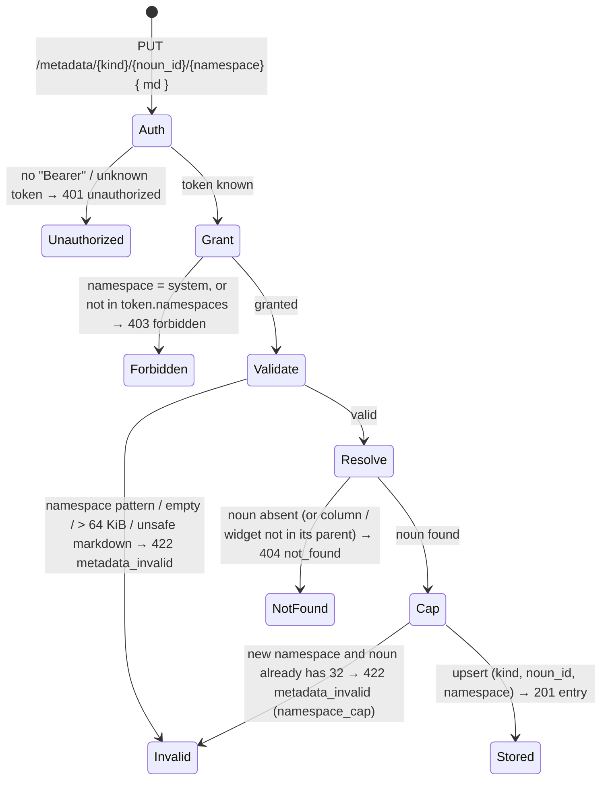

# Metadata — read-only notes on any noun, written through the API

**Concept**: a **metadata entry** is one writer's statement about one noun — a dataset, a
column, a relationship, a query, a workflow, a dashboard or a widget — in one **namespace**.
It is markdown text (the same safe subset as a `note` widget) that may open with a YAML
frontmatter block the product does not interpret. The server stamps **who** wrote it
(`author`, `source`), **when** (`writtenAt`) and **what the noun looked like** at that moment
(`definitionVersion`), so a reader can tell an agent's note from a person's and can see when
the subject has changed since ("may be out of date"). The builder **only reads**: there is no
edit affordance anywhere, and a writer changes an entry by writing it again through the API
with its token. Writes are **off** on a fresh install.

**Status**: Accepted — shipped. Seven noun kinds, three routes, token-gated writes, a
read-only `MetadataPanel` mounted on the dataset, query, workflow and dashboard detail pages
and in the relationship check drawer. **R202 (rc.5, item 5.2)**: read by layer — badges, a
side-by-side dock, At a glance, reserved keys `title` / `summary` / `severity`, a GFM viewer
(§ Reading by layer); the inline panel remains in the relationship drawer only.

**Domain folder**: `data-management/_shared/` — the feature code lives in
`apps/builder/src/features/metadata/` (a top-level feature, beside `dashboard/` and
`data-management/`), because its consumers span the data-management clusters **and** the
dashboard feature. This doc owns the entry model, the wire shape, the token rules and the
panel; each host page owns only where it mounts the panel.

**Sibling docs**: [`../_noun-model.md`](../_noun-model.md) (the nouns an entry attaches to,
and § Versions — the `definitionVersion` hash an entry anchors to),
[datasets/dataset-detail.md](../datasets/dataset-detail.md),
[queries/queries.md](../queries/queries.md), [workflows/workflows.md](../workflows/workflows.md),
[workspaces/relationships.md](../workspaces/relationships.md) (the host surfaces),
[crud-hygiene.md](crud-hygiene.md) (the code-first error envelope this feature reuses).

> **Why read-only in the UI.** An entry is a statement with an author. If the UI could edit
> it, the author stamp would stop meaning anything — a human tweak to an agent's note would
> still read as the agent's. Keeping every write behind a token makes `author` / `source`
> true by construction, and the **AI** badge then tells a reader not to take an agent's note
> as the official definition.

---

## Surfaces — layer / reuse / purity declaration

| Surface                                                                                                            | Layer                                                         | Reusability  | Purity             | Allowed peer deps                             |
| ------------------------------------------------------------------------------------------------------------------ | ------------------------------------------------------------- | ------------ | ------------------ | --------------------------------------------- |
| `MetadataPanel` (collapsible page-level panel: own entries + children)                                             | `apps/builder/src/features/metadata/MetadataPanel.tsx`        | feature      | feature            | react, antd, @ant-design/icons, react-i18next |
| `MetadataEntryView` / `MetadataEntriesList` (one entry / a namespace-sorted list; exported for the widget popover) | `apps/builder/src/features/metadata/MetadataPanel.tsx`        | feature      | plain-UI (i18n)    | react, antd, @ant-design/icons, react-i18next |
| `splitFrontmatter` (leading `---` block → `key: value` pairs + body)                                               | `apps/builder/src/features/metadata/frontmatter.ts`           | feature      | pure               | none                                          |
| `useMetadataQuery`                                                                                                 | `apps/builder/src/features/metadata/hooks.ts`                 | feature      | glue (server-data) | @tanstack/react-query                         |
| `metadataApi.get` client (read only — no write method)                                                             | `apps/builder/src/api/metadataApi.ts`                         | builder-only | glue               | (fetch — no extra peer dep)                   |
| `MetadataKind` / `MetadataEntry` / `MetadataEntries` / `MetadataRead` types                                        | `apps/builder/src/features/metadata/types.ts`                 | feature      | data type          | none                                          |
| `SafeMarkdown` (reused, owned by the dashboard `note` widget)                                                      | `apps/builder/src/features/dashboard/SafeMarkdown.tsx`        | feature      | plain-UI           | react, antd                                   |
| `WidgetMetadataButton` + `WidgetMetadataPopover` (per-widget info affordance)                                      | `apps/builder/src/features/dashboard/DashboardDetailPage.tsx` | feature      | feature            | react, antd, @ant-design/icons                |
| `GET /metadata/{kind}/{noun_id}` · `PUT` / `DELETE /metadata/{kind}/{noun_id}/{namespace}`                         | `apps/backend/app/routers/metadata.py`                        | backend      | feature            | (FastAPI — backend native)                    |
| `resolve_noun` · `definition_version` · `validate_entry` · `entries_for` · `children_for`                          | `apps/backend/app/metadata.py`                                | backend      | feature            | (stdlib `hashlib` / `json` / `sqlite3`)       |
| `markdown_problems` (safe-subset check, shared with the `note` widget)                                             | `apps/backend/app/markdown_safe.py`                           | backend      | pure               | (stdlib `re`)                                 |
| `MetadataToken` / `backend.metadata_tokens` settings                                                               | `apps/backend/app/_config/settings.py`                        | backend      | data type          | pydantic                                      |
| `MetadataEntry` SQLModel table (`metadata_entries`, Alembic `0005_metadata_entries`)                               | `apps/backend/app/db_models.py`                               | backend      | data type          | sqlmodel                                      |
| `ApiErrorUnauthorized` / `ApiErrorForbidden` / `ApiErrorMetadataInvalid` envelopes                                 | `apps/backend/app/models/common.py`                           | backend      | data type          | pydantic                                      |

**Boundary check**: no row lives in `@mdd/ui`. The panel encodes metadata-specific copy, the
AI badge and the stale flag, so it is feature code; it lives in its own top-level feature
folder because two feature trees (`data-management/*` and `dashboard/`) mount it. It reuses
the dashboard's `SafeMarkdown` renderer rather than carrying a second markdown parser, and
the backend reuses `markdown_problems` — one safe subset for every text users or agents write
into the product.

---

## Token map

All metadata surfaces are AntD primitives (`<Collapse>`, `<Tag>`, `<Typography>`, `<Empty>`,
`<Popover>`, `<Button>`) styled by the `<ConfigProvider>` tokens derived from the seeds in
[`themeTokens.ts`](../../../../workspace/packages/ui/src/themeTokens.ts) (the source of
truth). **No new token is introduced.** `Value` is informational.

| Surface                                    | AntD token (themeTokens.ts)                       | Value (informational) |
| ------------------------------------------ | ------------------------------------------------- | --------------------- |
| Panel header background                    | `colorFillAlter`                                  | derived               |
| Panel / popover border                     | `colorBorder`                                     | derived               |
| Author · time line, frontmatter keys, hint | `colorTextSecondary`                              | derived               |
| "May be out of date" `<Tag>`               | `colorWarning`                                    | `#faad14`             |
| **AI** badge `<Tag>`                       | AntD preset colour `purple` (palette, not a seed) | preset                |
| Namespace `<Tag>`                          | `colorFillQuaternary`                             | derived               |
| Widget info button (icon)                  | `colorTextSecondary`                              | derived               |
| Border radius (panel, tags, popover)       | `borderRadius`                                    | `6`                   |
| Font family                                | `fontFamily`                                      | system stack          |

The frontmatter key colour is read through AntD's CSS variable for `colorTextSecondary` with
a hard-coded fallback; it introduces no value of its own.

---

## Layout — ASCII intent

### Page-level panel (dataset / query / workflow / dashboard detail; relationship drawer)

Collapsed `<Collapse size="small">`, open by default when anything is written. Renders
**nothing** while loading or when there are no entries — except in the relationship drawer
(`alwaysShow`), where an empty panel shows the empty state.

```text
┌ ▾ Metadata   3 entries · 2 by AI ──────────────────────────────────────────┐
│  [aicowork] [🤖 AI] [⚠ May be out of date]   aicowork · Oct 15, 2026 08:00 │
│    source   export 2026-10-12            ← frontmatter as key/value table  │
│    ## Leads                              ← body via SafeMarkdown           │
│    One row per lead.                                                       │
│                                                                            │
│  won_at                                  ← a child (column name / widget   │
│  [aicowork] [🤖 AI]   aicowork · Oct 15, 2026 08:00     title) group       │
│    Date the deal closed; blank while open.                                 │
│                                                                            │
│  Read-only — written through the API; the author changes it by writing     │
│  again.                                                                    │
└────────────────────────────────────────────────────────────────────────────┘
```

- **Header**: "Metadata" + the total count (own + children) + "· N by AI" when any entry is
  `source: ai`.
- **One entry**: namespace `<Tag>`, the **AI** badge (`RobotOutlined`, purple) iff
  `source === 'ai'`, the stale `<Tag>` (`WarningOutlined`, "May be out of date") iff
  `stale`, then `author · writtenAt` (locale date-time). Below: the frontmatter as a
  two-column table (lines that are not `key: value` show with an empty key), then the body.
- **Children**: a dataset's columns and a dashboard's widgets, each under a bold label — the
  column name, or the widget's title via `childLabel` (falls back to the id).
- Entries are sorted by namespace; children by child id.

### Per-widget affordance (dashboard)

A widget whose id has entries gets an `InfoCircleOutlined` text button in its header
(`WidgetMetadataButton`, tooltip "Metadata on this widget", `data-count` = entry count). Click
opens a `<Popover>` (max 420 × 360, scrolls) with the same `MetadataEntriesList`. No button
when the widget has nothing written.

_Superseded on dashboard, dataset, query and workflow pages by § Reading by layer (R202); the
page-level panel above stays in the relationship check drawer only._

### Reading by layer (R202, item 5.2)

Owner's call (2026-10-23, confirmed 2026-10-28): metadata is read **by layer** and **beside the
data it explains**. Four layers, each optional to the reader:

1. **Badge** on the noun — what kind of note, how serious.
2. **Notes** — one card per namespace: title, one-line summary, a few properties.
3. **Read** — the full note (all pairs, the body), next to the numbers.
4. _(Step 2, not built)_ structured data behind a "technical" toggle.

**Reserved frontmatter keys** — the builder reads three keys and only these; every other key is
an uninterpreted pair as before (the R180 rule, kept for them). The server does not validate them.

| Key        | Valid value                             | Used for                                      | Invalid →       |
| ---------- | --------------------------------------- | --------------------------------------------- | --------------- |
| `title`    | 1–80 characters                         | card / Read heading (else the summary — R206) | shown as a pair |
| `summary`  | 1–200 characters                        | the card's line, At a glance                  | shown as a pair |
| `severity` | `info` \| `warn` \| `error` \| `decide` | chip, badge, order, At a glance filter        | shown as a pair |

A frontmatter **key** may be written in any script and hold inner spaces (`Dữ liệu đến: 18/10`),
≤ 40 characters (R202; R180 accepted ASCII keys only and showed others with an empty key).
A card without `summary` shows the body's first line (plain, ≤ 200 chars; a table row reads as
its cells joined by `·`). The Read view does not repeat a `summary` the body already says.
**Title fallback (R206):** `title`, else the `summary`, else the body's first line; the namespace only
when the note has no text; a line used as the title is not printed again under it. One rule
(`displayTitle` / `displayLine`) serves cards, Read, glance rows and the widget / column tooltips.
Heading and title are compared like the summary rule: marks and spacing aside, case-insensitive. The Read
view does not render a **leading heading whose text equals the title** (the rest of the body is
unchanged). Order everywhere:
`error` → `decide` → `warn` → `info` → none, then namespace.

```text
┌ Dashboard (≥ 1200 px: the pane beside) ──────────────────┐┌ Notes & insights · Dashboard ─ × ┐
│ ┌ Notes & insights 11 notes · 11 by AI [Decide 1][Warn 1]││ ‹ All notes (11)                 │
│ │                 Showing all notes          ⌃ Collapse ┐ ││ Sign-ups fell in region North    │
│ │ [Decide] Title — summary…               (being read)  │ ││ [Decide] [AI] agent · 28/10      │
│ │ [Warn]   Title · Widget B — summary…      Details ›   │ ││ body, tables…                    │
│ └────────────────────────────────────────────────────────┘ ││                                  │
│ ┌ Widget A ─ [Decide][Warn] +1 ⋯ ┐ ┌ Widget B ─ ⓘ ┐       ││                                  │
│ └──────────────────────────────────┘ └─────────────┘       ││                                  │
│                      the grid narrows; nothing covered     │└──────────────────────────────────┘
└─────────────────────────────────────────────────────────────┘
768–1199 px: the same pane as a 400 px drawer over the page (the grid keeps its columns);
< 768 px: a bottom sheet (85 % of the height).
```

- **Badges (widget)** — up to two chips, one per distinct severity among `error`, `decide`, `warn`
  (highest first), then `+N` = the entries not represented; no severity anywhere → the shipped
  `InfoCircleOutlined` button with its count. The group is one button (`WidgetMetadataButton`,
  `data-count`) that opens the dock on the widget. **Dots (dataset column header)** — one dot in
  the colour of the column's highest severity (grey when none); click opens the dock on the column.
- **Notes & insights bar** (R206; was "Metadata … Open") — one line on dataset, query and workflow
  pages: "Notes & insights" / "Ghi chú & nhận định", the count ("11 notes" / "11 ghi chú"), the AI
  count, up to two severity counts and a **"View all ›" link** (`MetadataBarOpen`) that opens All
  notes. While All notes is showing, the same element reads "Showing all notes" / "Đang xem tất cả ghi
  chú" and is `aria-disabled` (one element, so focus returns to it when the dock closes); while one note
  is being read the link reads "View all ›" again and goes to All notes. The bar never closes the dock
  (no toggle): × or `Esc` does. Nothing written → no bar. The renamed label also heads the dock and the
  relationship drawer's panel. **On a dashboard** the bar is one
  bordered block (`aria-label` = the label): the header line, then the At a glance rows (below), with
  **Collapse / Expand** in the header — shown only when there is at least one row.
  On the dataset page, when at least one **column** has entries, a second secondary-text line under
  the bar explains the header dots (R205): "Dots on column headers mark notes; the colour shows
  severity. Click a dot to read." / VI "Dấu chấm trên tiêu đề cột cho biết cột có ghi chú, màu thể
  hiện mức độ; bấm vào dấu chấm để đọc." Only columns on screen count (a hidden column draws no dot).
  The bar takes it as an optional `hint`; other pages pass none.
- **Dock** (`MetadataDock`) — beside the page content from the **`xl`** breakpoint (≥ 1200 px; R206,
  was `lg`), 400 px wide, sticky, scrolls on its own, as tall as its content up to the page height
  (beside a growing page: up to the viewport's bottom from where it sits — R207);
  from `md` to `xl` a 400 px `Drawer` **over** the page from the right; below `md` a bottom sheet (85 %
  of the viewport height). Over the page means the grid never re-flows on a small screen (R206, owner's
  design C). Over the page the drawer / sheet has a light mask; a click on the mask closes it (the
  usual drawer gesture, not a page control); beside it there is no mask and the page stays usable. In
  all three placements focus moves to the dock's heading on open, `Esc` closes and focus returns to the
  control that opened it. **Cards** (Notes view): severity and AI chips, title,
  the summary line, up to three pairs, a footer "author · when" and **"View details ›"**
  (`MetadataCardRead`, `aria-label` "View details: <title>"); a pointer click anywhere on the card
  opens it, except a click on a link inside it or one that ends a text selection; no namespace id on the
  card.
  Views: **Notes** (the noun's cards; on a dashboard opened from the bar: **All notes** —
  the dashboard's own, then each widget with entries, under its title) and **Read** (back to
  Notes, title + chips, the R197 banner — written-for summary, definition warning, assumed values
  — all non-reserved pairs as a table, the body through `SafeMarkdown`, author · when, the
  read-only hint). `Esc` or × closes. The URL carries the open note: `?note=<target>` where
  target is `<namespace>` (the noun itself), `<namespace>@<childId>` (a widget / column) or
  `*` (All notes); the parameter is written through the page's raw URL writer so no other
  parameter is re-serialised (R199).
- **At a glance** (dashboard) — entries of the dashboard and its widgets with `severity` ≥ `warn`
  and `state` `current` or `refreshed`, ordered by severity then widget order, at most three;
  **rows inside the bar's block** (R206; was a separate strip): each row is one `button`
  (`AtAGlanceItem`) — chip, title, the widget's title, a two-line summary, "Details ›" (decorative,
  `aria-hidden`); the list is labelled "Most serious notes" / "Ghi chú quan trọng nhất"; the row being
  read is marked (`aria-current`); click → the dock's Read view. Collapsible from the block's header; the choice is remembered per viewer in this browser
  (`localStorage` `mdd.atAGlance.collapsed.<id>`, guarded). No qualifying entry → the header line only.
- **Charts stay still** (R206) — a note action (open, read, back, close) changes the URL's `note`
  only; it re-renders no chart view: the widget's derived chart data is memoised on its fetched
  results, the widget and its filters (the parameter context reaches it only through the fetched
  results), and every chart view — the eight recharts views and the lazy heatmap and gauge — is
  `React.memo`. R207: the widget **cards** stay still too — each card is memoised, its callbacks are one function
  each calling the page's latest handlers, and the drag-and-drop context no longer changes on a page
  render; a note action that does not change the grid's columns re-renders no card. Only a width change (the
  pane opening beside the grid) re-lays a chart out.
- **Markdown viewer** — `SafeMarkdown` renders through `react-markdown` + `remark-gfm`: headings,
  paragraphs, emphasis, strikethrough, inline + fenced code, nested lists, task lists, quotes,
  rules, tables, http(s) links (new tab, `noopener`). A remark step turns raw HTML, images and
  non-http(s) links back into their **source text** before rendering — the R179 invariant ("shown
  as the text it is") is kept, and `markdownProblems` / the server rule are unchanged.

---

## Data model

```sql
CREATE TABLE metadata_entries (
    kind               TEXT NOT NULL
        CHECK (kind IN ('dataset','column','relationship','query','workflow','dashboard','widget')),
    noun_id            TEXT NOT NULL,          -- see the id table below
    namespace          TEXT NOT NULL CHECK (length(namespace) BETWEEN 1 AND 32),
    md                 TEXT NOT NULL,          -- safe-subset markdown, ≤ 64 KiB UTF-8
    source             TEXT NOT NULL CHECK (source IN ('ai','human','system')),
    author             TEXT NOT NULL,
    written_at         TEXT NOT NULL,          -- ISO-8601 UTC
    definition_version TEXT NOT NULL,          -- the noun's version at write time
    PRIMARY KEY (kind, noun_id, namespace)
);
CREATE INDEX idx_metadata_entries_noun ON metadata_entries(kind, noun_id);
```

The schema of record is the SQLModel `MetadataEntry` table
([db_models.py](../../../../workspace/apps/backend/app/db_models.py)), created by Alembic
`0005_metadata_entries`; handlers use raw `sqlite3`. **There is no foreign key**: the seven
kinds live in five tables, so the write path resolves the noun before writing instead.

### Targets — the seven kinds

| `kind`         | `noun_id`               | What `definitionVersion` hashes (the part a note is _about_)                     |
| -------------- | ----------------------- | -------------------------------------------------------------------------------- |
| `dataset`      | `ds_<8hex>`             | the schema: `[{name, dtype}]` of every column (visibility and data do not count) |
| `column`       | `<ds_id>:<column name>` | that column's `{name, dtype}`                                                    |
| `relationship` | `rel_<8hex>`            | its ends + label: left/right dataset id, left/right column, cardinality          |
| `query`        | `qr_<8hex>`             | the stored query definition                                                      |
| `workflow`     | `wf_<8hex>`             | the stored workflow definition                                                   |
| `dashboard`    | `dsh_<8hex>`            | the stored dashboard definition (widgets included — any widget change moves it)  |
| `widget`       | `<dsh_id>:<wdg_id>`     | that widget's own config object                                                  |

A compound id uses a **colon** because no id contains one and it keeps the id a single path
segment (the client URL-encodes it, so a column name with spaces or slashes works). The hash
is the definition version defined in [`_noun-model.md` § Versions](../_noun-model.md#versions--what-each-noun-was-at-a-given-moment):
the first 12 hex of a sha256 over the payload's canonical JSON with `null` members dropped.
**Data refreshes do not move it** — an entry is about a noun's definition, not its rows.

### The entry on the wire

```ts
// features/metadata/types.ts — hand-aligned to contracts/_shared/metadata.yaml
type MetadataKind = 'dataset' | 'column' | 'relationship' | 'query' | 'workflow' | 'dashboard' | 'widget';
type MetadataSource = 'ai' | 'human' | 'system';

type MetadataEntry = {
  md: string; // safe-subset markdown; may open with `---` frontmatter
  source: MetadataSource; // from the writing token — server-stamped
  author: string; // the token's author (1–120 chars) — server-stamped
  writtenAt: string; // ISO-8601 UTC, `Z` — server-stamped
  definitionVersion: string; // 12-hex — the noun's version at write time
  stale: boolean; // computed on every read: definitionVersion ≠ the noun's current version
};
type MetadataEntries = Record<string, MetadataEntry>; // keyed by namespace

type MetadataRead = {
  entries: MetadataEntries;
  children?: Record<string, MetadataEntries>; // dataset → by column NAME; dashboard → by widget id
};
```

### Writers — `backend.metadata_tokens`

Writers are **configuration, not data**: a list in `values.yaml` / `MDD_CONFIG_FILE`, or the
JSON env `MDD_BACKEND__METADATA_TOKENS`. Each `MetadataToken` (`extra="forbid"`) carries:

| Field        | Rule                                                                                |
| ------------ | ----------------------------------------------------------------------------------- |
| `token`      | the bearer secret, **≥ 16 chars**                                                   |
| `author`     | 1–120 chars — stamped on every entry the token writes                               |
| `source`     | `ai` \| `human` \| `system` (default `human`) — stamped on every entry              |
| `namespaces` | the **closed** list this token may write; `system` is never writable even if listed |

The default is an empty list — **every write is `401`** until an operator adds a token.

---

## Behaviour

### Write (`PUT`) — the gate, in the order the handler applies it



- The body is **only** `{ md }` (`extra="forbid"`) — a client cannot send an author. The
  server stamps `author` / `source` from the token, `writtenAt` now, and `definitionVersion`
  from the noun as resolved in the same connection.
- **Upsert**: writing an existing namespace replaces it (still `201`); other namespaces on the
  noun are untouched.
- `422 metadata_invalid` carries a `reason` — `namespace` (not `^[a-z][a-z0-9_]{0,31}$`),
  `empty`, `too_large` (over 65 536 UTF-8 bytes), `markdown_unsafe` (with `problems` ⊆
  `html` · `image` · `link_scheme`), `namespace_cap`. Unsafe text is **refused, never
  silently cleaned** — the writer should know.
- An unknown `kind` (not one of the seven) is FastAPI's generic `422 detail[]`.

### Delete

`DELETE /metadata/{kind}/{noun_id}/{namespace}` follows the same token rules (`401` / `403`),
removes exactly that row (`204`), and answers `404 not_found` when there is no such entry. It
does not resolve the noun, so a writer can retract an entry on a noun that no longer exists.

### Read

`GET /metadata/{kind}/{noun_id}` needs no token. It resolves the noun (`404` if absent), returns
every entry keyed by namespace with `stale` computed against the noun's **current** version,
and — for a `dataset` or `dashboard` — every child's entries under `children`, so a detail page
needs one request. A child whose column / widget no longer exists is skipped.

### The panel

- `useMetadataQuery(kind, nounId)` — key `['metadata', kind, nounId]`, enabled only with an id,
  `retry: false`, `staleTime` 30 s. A `404` or an unreachable API reads as "no entries": the
  panel is informative, never blocking, and never shows an error.
- The dashboard page reads `('dashboard', id)` once; the page panel and every widget's info
  button share that cache entry (widgets read `children[widgetId]`).
- There is no write path in the builder (`metadataApi` has only `get`), so nothing
  invalidates the key; a newly written entry appears on the next fetch after `staleTime`.

### Where it is mounted

| Host (R202)                                  | Read                                       | Layer 1 (badges)                          | Bar + dock                                                                                                                       |
| -------------------------------------------- | ------------------------------------------ | ----------------------------------------- | -------------------------------------------------------------------------------------------------------------------------------- |
| `DashboardDetailPage`                        | `useMetadataDock('dashboard', id, viewer)` | `WidgetMetadataBadges` in a widget header | the **Notes & insights** block (bar + glance rows) above the grid; dock beside it ≥ 1200 px (grid − 1 col), over it below (R206) |
| `DatasetDetailPage`                          | `useMetadataDock('dataset', id)`           | `ColumnNoteDot` in a column header        | bar in the header strip; dock beside the card (`fill`)                                                                           |
| `QueryDetailPage` (read view)                | `useMetadataDock('query', id, urlParams)`  | —                                         | bar; dock beside the card; closed while editing                                                                                  |
| `WorkflowDetailPage` (read view)             | `useMetadataDock('workflow', id)`          | —                                         | bar; dock beside the card; closed while editing                                                                                  |
| `RelationshipCheckDrawer` (below the result) | `MetadataPanel kind="relationship"`        | —                                         | the R180 inline panel (the drawer is already a side panel)                                                                       |

`column` and `widget` are never read directly by the builder; they arrive as children of
their parent.

### Lifecycle of an entry when its noun changes

- **Definition changes** (a query re-saved with a different definition, a column retyped, a
  widget edited, a relationship's ends changed): the entry stays and reads `stale: true` —
  "may be out of date" — until its writer writes it again.
- **Re-saving an unchanged definition** does not flag it: `null` members are dropped before
  hashing, so a definition re-serialized under a newer model with more optional fields hashes
  the same.
- **The noun is deleted** (R197): its entries move to `metadata_entries_swept` in the same
  transaction (`app.metadata.sweep` — archived, not dropped): a dataset (with its columns'),
  query, workflow, dashboard, relationship, workspace or saved copy, and a widget removed from its
  dashboard. A **column that leaves** its dataset in a refresh is kept, unreadable while absent,
  and **reappears** if a column of the same name returns (flagged if its dtype differs).
- **A widget that comes back** (R200, as built): a dashboard save that re-adds a widget id —
  a definition restore, or any PUT — moves that widget's newest archived entry per namespace
  back from `metadata_entries_swept` (`app.metadata.unsweep_widgets`, after the sweep, in the
  same transaction), anchor unchanged; a newer live entry for the same key, if any, is kept.
  A widget's notes are set aside with it and return with it — the column rule, for widgets.

### The triple anchor (R197, item 3.8)

- **Stamped at write** by the server: `anchor {definitionVersion, dataVersions?, queryVersions?,
  runId?, params?, assumedParams?}` — the noun's definition, the data behind it (a dataset /
  column: its own version; a relationship: both ends; a query: its plan's; a widget: its query's;
  a dashboard: all its widgets'), the queries behind a widget or dashboard, a workflow's current
  run, and the parameter values (a query / widget: as it reads; a dashboard: its controls as the
  bar shows them). The writer may name the values it read under (`params`); a used parameter with
  no value at any level is refused (`param_unbound`); a value it did not give is stamped from the
  saved / default value and listed in `assumedParams`. A relative default is stamped as the date
  it meant.
- **Read** under the reader's `p.<name>` values: `current` (and `childrenCurrent`) is the reader's
  anchor; each entry gets `state` — `other_definition` (the definition or a query behind it
  changed, or that query is gone) → `other_period` (a parameter both carry differs) → `refreshed`
  (a dataset version both carry, or the run, differs; an R197 entry written before the first run
  counts) → `current`. A reader without a value for a parameter is not compared on it. An rc.2
  entry (no anchor) compares the definition only. `stale` keeps its rc.2 meaning.
- **Panel**: `refreshed` carries a small flag; `other_period` and `other_definition` collapse to
  "Written for <label value> · viewing <label value>" / "Written for an earlier definition.",
  opened on click (a definition change warns); "written under the saved or default value of …"
  and "written before periods were recorded" when they apply. A dashboard widget's footer reads
  "Data: refreshed <when> · run #N" for the datasets at the versions it read.

---

## Data contract

Contracts: [`workspace/packages/contracts/metadata/`](../../../../workspace/packages/contracts/metadata/)
(`get` · `put` · `delete` `.contract.yaml`) + `_shared/metadata.yaml` (the entry / read
schemas) + `_shared/api-error.yaml` (`unauthorized`, `forbidden`, `metadata_invalid`).

| Route                                           | Auth         | Success                          | Errors                                                                                      |
| ----------------------------------------------- | ------------ | -------------------------------- | ------------------------------------------------------------------------------------------- |
| `GET /metadata/{kind}/{noun_id}`                | none         | `200` `{ entries, children? }`   | `404 not_found` (noun absent)                                                               |
| `PUT /metadata/{kind}/{noun_id}/{namespace}`    | Bearer token | `201` the stored `MetadataEntry` | `401 unauthorized` · `403 forbidden` · `422 metadata_invalid` (+`reason`) · `404 not_found` |
| `DELETE /metadata/{kind}/{noun_id}/{namespace}` | Bearer token | `204`                            | `401 unauthorized` · `403 forbidden` · `404 not_found` (no such entry)                      |

Path limits: `noun_id` 1–400 chars, `namespace` 1–64 chars at the path layer (the 32-char
pattern is enforced as `422 metadata_invalid` `reason: namespace`, after the `403` grant check —
token `namespaces` lists are not pattern-validated in settings).

---

## Acceptance criteria (Design gate exit)

**User journey** — as an analyst I open a dataset (or query, workflow, dashboard, or a
relationship's check drawer) and see what people and agents have written about it — who wrote
each note, whether an AI did, and whether the thing has changed since — without being able to
alter anyone's words; as an operator I give an agent a token limited to its own namespaces so
it can write notes the product will attribute to it.

1. **Writes off by default** _(pytest)_ — with no configured token every `PUT` / `DELETE` is
   `401 unauthorized`.
2. **Server-stamped authorship** _(pytest)_ — a stored entry carries the token's `author` /
   `source`, `writtenAt` and the noun's `definitionVersion`; a client-sent author is refused
   by the body schema.
3. **Namespace rules** _(pytest)_ — a namespace outside the token's list, or `system`, is
   `403`; a granted namespace that breaks the pattern is `422 reason: namespace` (the grant is
   checked first, so an ungranted malformed name is `403`).
4. **Entry validation** _(pytest)_ — empty, over 64 KiB, and unsafe markdown (HTML, images,
   non-http(s) links) are `422 metadata_invalid` with the matching `reason` / `problems`;
   nothing is stored.
5. **Namespace isolation** _(pytest)_ — writing or deleting one namespace leaves the noun's
   other namespaces untouched.
6. **All seven kinds resolve; children ride with the parent** _(pytest)_ — each kind accepts
   its id format; a dataset read returns column entries and a dashboard read widget entries
   under `children`.
7. **Stale on definition change, not on re-save** _(pytest)_ — changing the noun's definition
   flips `stale` to `true`; re-saving an unchanged definition keeps it `false`.
8. **Namespace cap** _(pytest)_ — a new namespace beyond the per-noun cap is `422 reason:
namespace_cap`.
9. **Read-only panel** _(FE)_ — `MetadataPanel` shows namespace, AI badge for `source: ai`,
   the stale tag, author · time, frontmatter as a key/value table and the safe-markdown body;
   it offers no control that edits; it renders nothing when empty or failing (unless
   `alwaysShow`).
10. **Mounted where the nouns live** _(FE)_ — dataset, query, workflow, dashboard detail and
    the relationship check drawer; a dashboard widget with entries shows the info button and
    popover.
11. **One block, a link, cards, still charts** _(FE, R206)_ — the bar's "View all ›" opens All notes
    and reads "Showing all notes" (`aria-disabled`) while it shows, with no control that closes the dock;
    a dashboard's glance rows live in the bar's block; a card opens on click and via "View details",
    without the namespace id, titled by its summary when it has no title; the Read view drops a
    leading heading equal to the title; the dock is beside at ≥ 1200 px, a right drawer at 768–1199 px,
    a bottom sheet below; a note action re-renders no chart view.

---

## Scope boundary

### IN scope

- Entries on seven noun kinds, keyed by namespace; three routes; token-configured writers
  with closed namespace lists; server-stamped authorship and definition version; the 64 KiB
  and per-noun namespace caps; the shared safe-markdown rule.
- The read-only `MetadataPanel`, the widget info popover, and their five mounts.

### OUT of scope (deferred with named triggers)

- **Editing in the UI** — out by design (authorship must stay true). _Trigger: none planned;
  a writer re-writes through the API._
- **Anchoring to dashboard filters** (not parameters) — a note written while filtered to one team
  reads `current` next to another team's numbers. _Trigger: a writer anchors notes to filtered
  views (R197 BA P2-5)._
- **A note that is about no period** (how to read a dashboard) still ages with a relative default.
  _Trigger: writers complain of evergreen notes folding daily (R197 BA P2-2)._
- **Read authorization / workspace scoping of reads** — reads are open to anyone who can call
  the API, like the nouns themselves.
- **Column- or widget-level panels outside their parent** — children are shown only inside
  the parent's panel.
- **Interpreting frontmatter** — the product shows `key: value` lines as a table and nothing
  more; nested YAML stays text.

---

## Reference materials (read-only)

- [`_noun-model.md` § Versions](../_noun-model.md#versions--what-each-noun-was-at-a-given-moment)
  — the definition version an entry anchors to, shared with workflow run stamps.
- [dataset-detail.md](../datasets/dataset-detail.md),
  [workflows.md](../workflows/workflows.md), [relationships.md](../workspaces/relationships.md)
  — host pages.
- `apps/backend/tests/test_metadata.py` — the behaviour the acceptance criteria map to.
