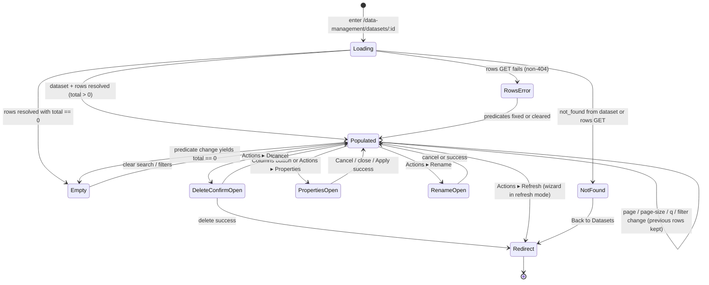

# Dataset detail — feature design

**Concept**: a per-dataset inspector page at
`/data-management/datasets/:id`. Shows the dataset's headline
metadata (workspace, rows, columns, size, uploaded, data version,
format) and what period its date columns cover, and renders its row
contents as a paged data table with a substring search bar above it
for Cmd-F-style row lookup. Reached by clicking a row in the Datasets
list. Carries the Refresh / Rename / Delete affordances (rename +
delete inherited from [crud-hygiene.md](../_shared/crud-hygiene.md)) in
the page header's `Actions ▾` menu, plus the Properties drawer (schema
view + column-visibility editor).
**Status**: Accepted.
**Sibling docs**:
[datasets.md](datasets.md) (the noun this page inspects — model, data
identity, date coverage, column-visibility contract),
[upload.md](upload.md) (the verb that produced — and refreshes — the rows),
[crud-hygiene.md](../_shared/crud-hygiene.md) (rename + delete affordances
reused here),
[dataset-filters.md](dataset-filters.md) (per-column typed
filters layered on this page),
[advanced-query.md](advanced-query.md) (the DNF query input layered on
this page),
[saved-query.md](../queries/queries.md) (the **second consumer** of this
page's paged-rows body, which it shares via the extracted `<PagedRowsView>`;
also the destination of this page's **Save filters as Query** action),
[query-construction.md](../queries/query-construction.md) (the **Join with
related dataset** action in the `Actions ▾` menu),
[metadata.md](../_shared/metadata.md) (the read-only `MetadataPanel` shown on
this page),
[workspace-shell.target.md](../../_platform/workspace-shell.target.md) (the chrome
this page renders inside).

---

## Why this exists separately from datasets.md

[datasets.md](datasets.md) covers the **noun and its collection** — the
model, the list page, the workspace filter, the workspace-card handoff.
This doc covers the **per-dataset** surface.

The detail page exists because the user needs to **see** their
uploaded data outside the upload wizard's preview step — which
disappears the moment they commit. The detail page is the durable
readout, and the place a reader checks _which_ rows they are looking at
(data version) and _what period_ they cover (date coverage) before
trusting a number built on them.

---

## Surfaces — layer / reuse / purity declaration

| Surface                                                                                                                                                                                  | Layer                                                                     | Reusability                                | Purity                | Allowed peer deps                                                                                                               |
| ---------------------------------------------------------------------------------------------------------------------------------------------------------------------------------------- | ------------------------------------------------------------------------- | ------------------------------------------ | --------------------- | ------------------------------------------------------------------------------------------------------------------------------- |
| `DatasetDetailPage` route component (contains `MetadataStrip`, the `datasetMetaItems` helper, `SourceIcon`, the `<Input.Search>` row-search bar and the `relativeTime` formatter inline) | `apps/builder/src/features/data-management/datasets`                      | feature                                    | feature               | react, antd, @ant-design/icons, @phosphor-icons/react, @tanstack/react-query, react-router-dom, react-i18next, i18next, @mdd/ui |
| `DateCoverageStrip` component                                                                                                                                                            | `apps/builder/src/features/data-management/datasets` (`DateCoverage.tsx`) | feature                                    | plain-UI              | react, antd, react-i18next                                                                                                      |
| `formatCoverage` + `temporalColumns` helpers                                                                                                                                             | `apps/builder/src/features/data-management/datasets` (`DateCoverage.tsx`) | feature                                    | pure                  | none                                                                                                                            |
| `PropertiesDrawer` (right-side `Drawer`: Dataset + Columns sections; file-private `SectionHeader` helper)                                                                                | `apps/builder/src/features/data-management/datasets`                      | feature                                    | plain-UI (controlled) | react, antd, react-i18next                                                                                                      |
| `<PagedRowsView>` (paged rows body — shared with query-detail)                                                                                                                           | `apps/builder/src/features/data-management/_shared`                       | feature (shared across datasets + queries) | plain-UI              | react, antd, react-i18next, i18next                                                                                             |
| `useDatasetQuery(id)` hook                                                                                                                                                               | `apps/builder/src/features/data-management/datasets`                      | feature                                    | glue (server-data)    | @tanstack/react-query                                                                                                           |
| `useDatasetRowsQuery(id, page, pageSize, q?, filters?, advanced?)` hook                                                                                                                  | `apps/builder/src/features/data-management/datasets`                      | feature                                    | glue (server-data)    | @tanstack/react-query                                                                                                           |
| `useSetColumnVisibilityMutation` hook                                                                                                                                                    | `apps/builder/src/features/data-management/datasets`                      | feature                                    | glue (server-data)    | @tanstack/react-query                                                                                                           |
| `datasetsApi.get` / `.getRows` / `.setColumnVisibility`                                                                                                                                  | `apps/builder/src/api/`                                                   | builder-only                               | glue                  | (fetch — no extra peer dep)                                                                                                     |
| `GET /datasets/{id}` backend route                                                                                                                                                       | `apps/backend/app/routers/datasets.py`                                    | backend                                    | feature               | (FastAPI — backend native)                                                                                                      |
| `GET /datasets/{id}/rows` backend route                                                                                                                                                  | `apps/backend/app/routers/datasets.py`                                    | backend                                    | feature               | (FastAPI — backend native; DuckDB `read_parquet` via `ingest/rows_reader.py`)                                                   |
| `PATCH /datasets/{id}/columns` backend route                                                                                                                                             | `apps/backend/app/routers/datasets.py`                                    | backend                                    | feature               | (FastAPI — backend native)                                                                                                      |
| `Dataset` + `RowsPage` types (FE)                                                                                                                                                        | `apps/builder/src/features/data-management/datasets/types.ts`             | feature                                    | data type             | none                                                                                                                            |

**Boundary check**: no surface of this page lives in `@mdd/ui`; the page
only _consumes_ `PageContainer` / `PageHeader` / `PageCard` from it. The
metadata strip stays inline in `DatasetDetailPage`. The coverage strip
and the Properties drawer are feature-local files because both render
the same coverage text (`formatCoverage` is the one formatter). The
paged data table is **extracted** into the shared **`<PagedRowsView>`**
because a second consumer exists — query-mode detail
([saved-query.md](../queries/queries.md)) renders the same paged-rows
body. Per the build-first rule (feature-local until two consumers exist,
[memory/2026-05-22-ui-boundary-build-first.md](../../../memory/2026-05-22-ui-boundary-build-first.md)),
two concrete consumers justify the extraction.

`<PagedRowsView>` owns the loading skeleton, the scroll-container table
(sticky header, dtype badge per header, dtype-aware cells) and the
`<Pagination>` bar. It takes `columns` (carrying `dtype` and `hidden`) +
the current page of `rows` + paging props + an optional per-column
header extra (the filter popover) + an `emptyState` slot + `scrollMode` and
`showHiddenColumns`; it owns no router, query, or fetch, so each
consumer supplies the rows via its own hook and keeps its own
empty-state copy. It lives in `data-management/_shared/` (the lowest
common ancestor of its two consumers, `datasets/` and `queries/`) rather
than `@mdd/ui`, because it depends on the builder-domain `formatCell`
helper + the dataset `Column`/`Dtype` types and `@mdd/ui` is
dependency-free.

The **`MetadataPanel`** (`features/metadata/`) is rendered on this page
with `kind="dataset"` — the dataset's own entries and its columns'
entries, read-only. It is not a surface of this concept; see
[metadata.md](../_shared/metadata.md).

The **standard detail layout** is `<PageContainer fill="bounded" width="data">`
with a `PageHeader` (title / subtitle / actions), a `PageCard variant="fill"`
and `<PagedRowsView>`. Dataset-detail and query-detail both instantiate it;
each adds its own sections (this page the metadata + coverage strips;
query-detail a read-only predicate summary).

---

## Reference materials

- [datasets.md § Read/write boundary](datasets.md#readwrite-boundary)
  — the collection-side read/write split this page complements.
- [crud-hygiene.md](../_shared/crud-hygiene.md) — rename + delete modals
  reused unchanged. This page only adds a _placement_ (the header
  `Actions ▾` menu) for the same affordances.
- [workspace-shell.target.md](../../_platform/workspace-shell.target.md) — the
  master-layout chrome (sidebar + topbar + page-card) this page
  renders inside.
- [upload.md](upload.md) — defines `Dataset.columns[].dtype`, which
  drives this page's cell rendering.

External reference (none — Parquet-paged-reads + AntD `<Pagination>` are
stock patterns; no novel UX research input).

---

## Layout — ASCII intent

The detail page renders inside the master-layout chrome — sidebar shows
"Data Management → Datasets" active; PageHeader shows breadcrumb +
title + subtitle + actions; PageCard wraps the strips, the toolbar and
the data table.

### Populated state (≥1 row)

```text
                                                  ┌──────── PageHeader.actions ────────┐
Home ▸ Data Management ▸ Datasets ▸ q1_pipeline_Deals  [+ Save filters as Query] [Actions ▾]
▣ q1_pipeline_Deals  [Excel · Deals]                                                  │
2,481 rows · 12 columns · 84 KB · Uploaded 14:02  ─────────────────────────────────────┘
       Actions ▾ = Join with related dataset │ Properties · Refresh · Rename · Delete

┌───────────────────────────────────────────────────────────────────────────────────────┐
│  PageCard                                                                              │
│   ┌─ Metadata strip ─────────────────────────────────────────────────────────────┐   │
│   │ WORKSPACE  ROWS   COLS  SIZE   UPLOADED     DATA VERSION        FORMAT        │   │
│   │ Marketing  2,481  12    84 KB  3 days ago   v4 · 14:02          Excel · Deals │   │
│   └──────────────────────────────────────────────────────────────────────────────┘   │
│   ┌─ Coverage strip ─────────────────────────────────────────────────────────────┐   │
│   │ DATE COVERAGE  won_at 2026-03-01 → 2026-05-14 · 25% blank                     │   │
│   │                created_at 2026-02-28 14:02 → 2026-05-08 15:22                 │   │
│   └──────────────────────────────────────────────────────────────────────────────┘   │
│   ▸ Metadata  2 entries · 1 by AI                    (only when entries exist)        │
│                                                                                        │
│   [🔍 Search rows…            ⊗]  Matched 2,481 / 2,481              [▥ Columns 9/12]  │
│   [ Advanced query…                                                              ]     │
│   (active filter chips — only when ≥1 chip filter)                                     │
│                                                                                        │
│   ┌──────────────────────────────────────────────────────────────────────────────┐   │
│   │ deal_id [str] ▾ │ amount [int] ▾ │ won_at [date] ▾ │ stage [str] ▾ │ ...      │   │
│   ├──────────────────────────────────────────────────────────────────────────────┤   │
│   │ D-0001          │        12,400  │ 03/01/2026      │ won           │ ...      │   │
│   │ D-0002          │             —  │       —         │ open          │ ...      │   │
│   │ D-0003          │       102,000  │ 04/12/2026      │ negotiating   │ a-very…  │   │
│   └──────────────────────────────────────────────────────────────────────────────┘   │
│   ‹ 1 2 3 … 50 ›   [50 / page ▾]   Go to [  ]                                         │
└───────────────────────────────────────────────────────────────────────────────────────┘
```

- **Header title**: source-format icon (`FileExcelOutlined` green /
  `FileTextOutlined` blue) + dataset name + a `<Tag>` with the format
  (`Excel · <sheet>` or `CSV`). **Subtitle**:
  `<rows> rows · <cols> columns · <size> · Uploaded <relative time>`.
- **Header actions**: `[+ Save filters as Query]` (see § Save filters as
  Query) and an `Actions ▾` dropdown: **Join with related dataset**
  (disabled unless the dataset has ≥1 `valid` relationship involving
  it), a divider, **Properties** (opens the Properties drawer),
  **Refresh** (`navigate('/data-management/datasets/:id/refresh')` —
  the wizard in refresh mode, see
  [datasets.md § Refresh affordance](datasets.md#refresh-affordance-r145)),
  **Rename**, **Delete** (danger).
- **Metadata strip** (`MetadataStrip`): a grid of label/value pairs from
  the shared `datasetMetaItems` helper — Workspace · Rows · Cols ·
  Size · Uploaded (`createdAt`, relative) · **Data version**
  (`v<dataVersion> · <relative refreshedAt>`, i.e. "which rows, and when
  they last changed" — equal to Uploaded until the first refresh) ·
  Format. Labels are small uppercase secondary text; values bold.
- **Coverage strip** (`DateCoverageStrip`): a bordered strip titled
  "Date coverage" with one item per column that carries
  `Column.coverage` (see
  [datasets.md § Date coverage](datasets.md#date-coverage--columncoverage)):
  the column name in bold, then `min → max`, then `· N% blank` when the
  rounded share is above 0. An all-blank column reads `all blank`; a
  `datetime` value drops its seconds (`2026-02-28 14:02`). Hidden
  columns are listed too. **Renders nothing** when no column carries
  coverage (no temporal columns, or a dataset committed before
  profiling existed and not refreshed since).
- **Metadata panel**: the read-only `MetadataPanel kind="dataset"`, a
  collapsible panel that renders only when the dataset or one of its
  columns has entries ([metadata.md](../_shared/metadata.md)).
- **Toolbar row**: the row-search input, the "Matched X / Y" counter,
  and — right-aligned — a `[Columns N/M]` button (N visible of M total)
  that opens the Properties drawer.
- **Advanced query input** and **active filter chips** sit between the
  toolbar and the table — specified in
  [advanced-query.md](advanced-query.md) and
  [dataset-filters.md](dataset-filters.md).
- **Column headers**: column name + dtype badge (`str` · `int` ·
  `float` · `bool` · `date` · `datetime`) + the per-column filter
  trigger. The header row is sticky.
- **Cells** (`formatCell(raw, dtype, locale)` — cells arrive as
  `string | null`):
  - **numeric** (`integer`, `float`) — right-aligned, tabular figures,
    `Intl.NumberFormat(locale)` with thousand separators; integers show
    no decimals, floats up to 6 fraction digits. Non-numeric text is
    passed through.
  - **date** / **datetime** — `Intl.DateTimeFormat(locale)` with
    2-digit month/day (+ 24-hour `HH:MM:SS` for datetime); an
    unparseable value is passed through.
  - **boolean** / **string** — passed through as received
    (`true` / `false` for booleans).
  - every non-null cell is capped at 240 px with an ellipsis and a
    browser-native `title` tooltip showing the full text.
  - **null** — a muted `—` (em-dash), same glyph regardless of dtype.
- **Pagination**: AntD `<Pagination>` under the table — prev/next,
  numbered pages, page-size changer (10 / 25 / 50 / 100, from the
  generated `PAGE_SIZES`), quick jumper. Shown whenever `total > 0`.

### Loading state (first load)

- Before the dataset resolves: the PageHeader shows the breadcrumb and
  the title "Loading dataset…"; the PageCard shows a 10-row
  `<Skeleton>`.
- Once the dataset resolves but the first rows page has not:
  `<PagedRowsView>` shows its own 10-row skeleton in the table area; the
  header and strips are already real (served from the TanStack cache
  when entered from the list).
- Subsequent page / page-size / search / filter changes keep the
  previous page's rows on screen (`placeholderData: (prev) => prev`)
  until the new page arrives — no skeleton flash.

### 404 / deleted state

```text
Home ▸ Data Management ▸ Datasets ▸ ?
This dataset no longer exists

┌──────────────────────────────────────────────────────────────────────────────────┐
│                          (DatabaseOutlined)                                       │
│                     This dataset no longer exists                                 │
│                It may have been deleted from another tab.                         │
│                        [ ← Back to Datasets ]                                     │
└──────────────────────────────────────────────────────────────────────────────────┘
```

- Triggered when `GET /datasets/{id}` **or** the rows GET fails with
  `{ code: "not_found" }`.
- `← Back to Datasets` (primary) navigates to
  `/data-management/datasets`.

### Rows error state

A non-404 failure of the rows GET (e.g. a `422` for a malformed filter)
shows an error `<Alert>` "Couldn't load rows" with the error message
above the table; the header and strips stay.

### Empty rows states (`total === 0`)

`<PagedRowsView>` renders the page's `emptyState` centered in the table
area and hides the pagination. The copy depends on which predicates are
active; an active advanced query is checked first (R191):

| Active predicates               | Title                                                                                          | Recovery                                     |
| ------------------------------- | ---------------------------------------------------------------------------------------------- | -------------------------------------------- |
| advanced query (± any others)   | "No rows match the advanced query" + "Change or clear the advanced query to see more results." | `[Clear advanced query]`                     |
| row search **and** chip filters | "No rows match “<q>” with these filters"                                                       | `[Clear]` (search) + `[Clear all]` (filters) |
| chip filters only               | "No rows match these filters"                                                                  | `[Clear all]`                                |
| row search only                 | "No rows match “<q>”" + "Try a shorter substring or clear the search."                         | `[Clear]`                                    |
| none                            | "No rows in this dataset" + "Re-upload the file to replace the data."                          | —                                            |

A dataset with 0 rows is legitimate (every parsed row empty after parse
options); its schema (column headers) is still meaningful and the
metadata strip still renders.

---

## Layout shell

This page is a **bounded view table**: the card is capped at the
viewport, the table body owns the vertical scroll (so the sticky `<th>`
has a real scroll container), and the pager pins at the **viewport
bottom** at every realistic height. Use the shared
`PageContainer fill="bounded"` + the `PageCard variant="fill"` recipe:

- Outer page wrapper: `<PageContainer fill="bounded" width="data">`
  (`@mdd/ui`). `fill="bounded"` applies **`height: calc(100svh - 88px)`**
  (WorkspaceShell chrome math = Layout.Header 56 + Content padding 16×2)
  and a flex column — a **hard cap**, so a short viewport is absorbed by
  the table body's inner scroll (it shrinks) rather than growing the page
  and pushing the pager below the fold. (Contrast: forms/wizard/builder
  use `fill` = grow / `min-height` — they have content below the fold,
  not an inner scroll.) `width="data"` caps + centers on wide screens,
  gutters on the shell `colorBgLayout`.
- `<PageCard variant="fill">` — fills the rest as a flex column.
- Metadata strip + coverage strip + metadata panel + toolbar + advanced
  query input + filter chips + (optional) error alert — each
  `flex: 0 0 auto`, stacked at the top of the bounded card.
- `<PagedRowsView>` `scrollMode="contained"` (default) — table body
  `flex: 1 1 auto; minHeight: 0; overflow: auto` (the sticky `<th>`
  sticks here) + pagination bar `flex: 0 0 auto`, pinned at the bottom =
  viewport bottom. **Not** CSS `position: sticky; bottom: 0` (which
  occludes rows).
- **Known limit** (accepted): a _genuinely tiny_ viewport where the
  fixed chrome alone exceeds the screen overflows the bounded card —
  fine for a desktop analytics app. Many coverage lines or metadata
  entries eat into the table's height the same way.

> The **builder preview** (Query Edit) is the _other_ surface and uses
> the opposite knob — `<PagedRowsView scrollMode="flow">` (no inner
> scroll, pager at the natural end, "scroll to the end"). See
> [query-construction.md](../queries/query-construction.md).

Anti-patterns documented in
[2026-05-26-pagecard-fill-pattern-for-fixed-controls.md](../../../memory/2026-05-26-pagecard-fill-pattern-for-fixed-controls.md):
do **not** cap the table with `maxHeight: Xvh`, do **not** use
`position: sticky` without a bounding scroll container, and do **not**
paint the sticky header with `var(--ant-color-fill-quaternary)` (it
resolves to `rgba(0,0,0,0.02)` — rows bleed through). The header is a
solid `#fafafa`.

---

## Token map

All cells are AntD `<ConfigProvider>` tokens derived from the six seeds
in [`themeTokens.ts`](../../../../workspace/packages/ui/src/themeTokens.ts)
(the source of truth). Values are informational (resolved via
`theme.getDesignToken()`, antd 6.x). The sticky table header is a solid
`#fafafa` literal on purpose (the fill tokens are translucent — see §
Layout shell), and the source-format icon colours are inline icon
colours; neither is a themed token.

| Surface                                     | AntD token                                   | Value (informational) |
| ------------------------------------------- | -------------------------------------------- | --------------------- |
| Page background                             | `colorBgLayout`                              | `#f5f5f5`             |
| Page card background                        | `colorBgBase`                                | derived               |
| Page card border / shadow                   | `colorBorderSecondary` + `boxShadowTertiary` | derived               |
| Header title text                           | `colorText`                                  | derived               |
| Header subtitle text                        | `colorTextSecondary`                         | derived               |
| Breadcrumb text / active                    | `colorTextTertiary` → `colorTextSecondary`   | derived               |
| Metadata strip background                   | `colorFillQuaternary`                        | derived               |
| Metadata / coverage strip border            | `colorBorderSecondary`                       | `#f0f0f0`             |
| Metadata / coverage strip label             | `colorTextSecondary`                         | derived               |
| Metadata strip value · coverage column name | `colorText`                                  | derived               |
| Coverage range text                         | `colorTextSecondary`                         | derived               |
| Table header text                           | `colorTextSecondary`                         | derived               |
| Table row border                            | `colorBorderSecondary`                       | `#f0f0f0`             |
| Cell text                                   | `colorText`                                  | derived               |
| Null cell glyph                             | `colorTextTertiary`                          | derived               |
| Dtype badge (`<Tag>`) background / border   | `colorFillQuaternary` / `colorBorder`        | derived               |
| Pagination active page                      | `colorPrimary`                               | `#1677ff`             |
| Search input border / focus                 | `colorBorder` → `colorPrimary`               | `#d9d9d9` / `#1677ff` |
| Search match counter text                   | `colorTextSecondary`                         | derived               |
| Properties drawer section header            | `colorTextSecondary`                         | derived               |
| Properties drawer guard text                | `colorError`                                 | derived               |
| Border radius (cards, strips, badges)       | `borderRadius`                               | `6`                   |
| Font family                                 | `fontFamily`                                 | system stack          |

No new token is introduced. Identifier parity against the live AntD
registry is enforced by
[`design-token-parity.mjs`](../../../../scripts/lint/design-token-parity.mjs).

---

## Behavior



### URL state

- Route: `/data-management/datasets/:id` (`:id` is a `ds_<8 hex>` id;
  the BE validates the pattern).
- Query params: `?page=N&page_size=M` — `page` 1-indexed, `page_size` ∈
  `PAGE_SIZES` {10, 25, 50, 100}. A missing or invalid value falls back
  to `page=1` / `page_size=50` (`DEFAULT_PAGE_SIZE`). Page 1 is written
  as "no `page` param".
- Page-size change resets `page` to 1. Page changes push a history entry
  (`setSearchParams(params)`), so browser back returns to the previous
  page.
- Search: `?q=<substring>` (trimmed) once the input is non-empty; an
  empty input strips the param. Changing `q` resets `page` to 1 and uses
  `{ replace: true }` so history is not cluttered with one entry per
  keystroke.
- Chip filters (`f<N>_*`) and the advanced query (`aq`) are URL state
  too — owned by [dataset-filters.md](dataset-filters.md) and
  [advanced-query.md](advanced-query.md).

### Back navigation

- The breadcrumb segments are clickable: `Home` → `/`,
  `Data Management` → `/data-management/workspaces`, `Datasets` →
  `/data-management/datasets`; the last segment is the dataset name
  (current page, not clickable).
- Browser back is the list-state-preservation lever — if the user
  clicked a row from a filtered list, browser back returns to the
  filtered list. There is no `?from=` referrer param; promote one if
  `history.back()` proves flaky.

### Rename / delete (inherited from crud-hygiene.md)

- Rename: opens the `<RenameModal>` with `resourceLabel="dataset"`, the
  current name pre-filled and `maxLength = NAME_LENGTHS.DATASET_MAX`.
  Mutation: `useRenameDatasetMutation()`. Success → toast "Dataset
  renamed to <name>." and the header title updates from the re-fetched
  dataset. A rename does not change `dataVersion` / `refreshedAt`.
- Delete: opens the `<DeleteConfirmModal>` with `resourceLabel="dataset"`
  and the current name in the body. Mutation:
  `useDeleteDatasetMutation()`. Success → toast "Dataset <name>
  deleted." + `navigate('/data-management/datasets', { replace: true })`
  (so back doesn't re-enter the deleted page's 404 state).

### Save filters as Query (placement only; spec in saved-query.md)

- A header action, **`[+ Save filters as Query]`**, sits left of the
  `Actions ▾` dropdown. It is **enabled iff ≥1 predicate is active** on
  this page — chip `filters` ([dataset-filters.md](dataset-filters.md)),
  the `advanced` DNF ([advanced-query.md](advanced-query.md)), or the
  `?q=` row search — and **disabled** otherwise with a tooltip asking
  for a filter or search first.
- Clicking it opens the `SaveQueryModal` (name suggestion: the first
  chip's text, else the search text, else a generic name), which saves
  the **current** predicate state as a Query rooted on this dataset
  (`sourceId = ds_…`, `definition { q, filters, advanced }`) and
  navigates to the new query. This page only **hosts the action**; the
  modal, the persisted entity, the Queries catalog, and the query-mode
  detail view all live in [saved-query.md](../queries/queries.md).

### Row search (`?q=`)

- **Affordance**: a single `<Input.Search>` above the table, placeholder
  "Search rows…". A clear icon appears inside the field while it has
  text; **Escape** also clears. (AntD `allowClear` is deliberately not
  used — its Escape path emitted a literal `"null"` value.)
- **Match semantics**: case-insensitive substring against the
  **stringified cell value** of any column in the row; a row matches if
  any cell does. No regex, no per-column scoping — Cmd-F-style "find
  anywhere in this dataset." It AND-composes with chip filters and the
  advanced query.
- **Where it runs**: server-side. The FE sends `?q=<value>` (1–200
  chars); the BE filters before paginating so `total` reflects the
  matched row count. The counter reads "Matched X / Y" where `Y` is
  `Dataset.rowCount` and `X` is the rows-GET `total` (under all active
  predicates). The counter appears once the rows have been fetched (or
  immediately when `q` is set).
- **Debounce**: keystrokes are debounced 300 ms (`setTimeout`) before the
  URL — and therefore the rows GET — updates. The input keeps its own
  typing buffer and re-syncs when the URL changes from outside (clear,
  back/forward, deep link).
- **Cleared state**: clearing restores the unfiltered view (counter
  `Y / Y` when no other predicate is active).
- **Matched-substring highlighting** is not built (see § Read/write
  boundary).

### Concurrent delete (404 race)

If the dataset is deleted from another tab while this page is open, the
next refetch of the dataset or its rows returns `not_found` and the page
switches to the 404 state. No optimistic rollback — the page simply
re-renders. If the dataset is deleted _before_ the initial GET, the page
opens directly in the 404 state.

---

## Folding sections (R204)

The context above the table — **Details** (the metadata strip, the
published-from line and the date-coverage strip) and the **Advanced
query** input — folds, so the table keeps its height on short screens.
At 1366 × 768, or 1920 × 1080 at 125 % scale (~620–740 CSS px of
viewport), the open sections took ~230 px and the table showed one or two
rows (R202 visual gate; the first user's screen).

- **Toggles** — two text buttons in the toolbar row, left of
  `[Columns N/M]`: `▸ Details` / VN **Thông tin thêm** and `▸ Advanced
query` / VN **Truy vấn nâng cao**; `▾` when open; `aria-expanded`.
  No extra row: the toolbar already exists.
- **Default** — open on a viewport at least `SHORT_VIEWPORT_PX` (760 CSS
  px) tall, folded below it (`matchMedia('(max-height: 759px)')`,
  follows resizes). The subtitle already carries rows · columns · size ·
  uploaded, so a folded Details hides no headline number.
- **Remembered** — a click records the viewer's choice per section in
  `localStorage` (`mdd.datasetDetail.open.details|advancedQuery` = `1`
  / `0`); a recorded choice wins over the viewport default on every
  dataset. Blocked storage → the choice lasts the visit.
- **Never folded** — the frozen-copy band (a state, not context), the
  one-line Metadata bar (the dock's entry point), the row search, the
  active filter chips and an **active advanced query**: while `?aq=` is
  set the input shows whatever the choice, and its toggle is not offered
  (a filter that governs the rows is never hidden).
- **Out of scope** — the query and workflow pages (same pattern if a
  walk shows the need); a one-line digest of the folded strip.

---

## Column visibility (R152)

> The editing surface is the **Properties drawer** (schema view +
> visibility editor). The **model field, the honor/ignore surface split,
> and the `PATCH` contract** live in
> [datasets.md § Column visibility](datasets.md#column-visibility-r152);
> this section owns the **editing surface** + how the row-preview honors
> the hint.

Wide tables scroll off-screen. A per-column **`hidden`** view-hint
(presentation-only —
[never touches the parquet](datasets.md#column-visibility-r152)) lets the
user focus the row-preview on what matters, while every query / join /
relationship picker keeps **all** columns (an overridable default, not a
projection).

### Row-preview default

`<PagedRowsView>` renders only the visible columns **by default** — it
**skips** each column whose `hidden` is true **in place** (not by
filtering the array), so every remaining column keeps its **original
index**: `row[ci]` cell alignment and the per-column filter key
(`renderHeaderExtra(col, ci)`) are unchanged. `showHiddenColumns`
overrides the skip. The toolbar button `[Columns N/M]` shows N visible
of M total. When the drawer's "Show all columns" switch is on
(**session-local — not persisted**), the preview renders every column
including hidden ones, so the hint is always an **overridable** default.
Search, filter, and pagination are server-side and unaffected; the
search / filter / query pickers enumerate **all** columns.

### Properties panel (R153)

A **right-side Drawer** (`placement="right"`, title "Properties") — a
**multi-section properties container** for everything-about-this-dataset,
grown one labelled section at a time (via the file-private
`SectionHeader` helper in `PropertiesDrawer.tsx`). It is **controlled**:
the page owns `open`, and two entries open the one surface — the
`Actions ▾ → Properties` item and the `[Columns N/M]` toolbar button.

| Section     | Content                                                                                                                  | Source                                       |
| ----------- | ------------------------------------------------------------------------------------------------------------------------ | -------------------------------------------- |
| **Dataset** | workspace · rows · cols · size · uploaded · data version · format                                                        | `Dataset`, via the shared `datasetMetaItems` |
| **Columns** | per column: show/hide checkbox · name · coverage line (temporal columns) · dtype tag; plus the "Show all columns" switch | `Column` on `GET /datasets/{id}`             |

```text
Actions ▾ → Properties      opens →   ┊ Properties                     ✕ ┊
                                      ┊ DATASET                          ┊
                                      ┊   Workspace        Weekly        ┊
                                      ┊   Rows             7             ┊
                                      ┊   Cols             4             ┊
                                      ┊   Size             1.4 MB        ┊
                                      ┊   Uploaded         2 days ago    ┊
                                      ┊   Data version     v3 · 14:02    ┊
                                      ┊   Format           Excel · Master┊
                                      ┊ COLUMNS        Show all columns ○┊
                                      ┊   ☑ deal_id                [str] ┊
                                      ┊   ☑ amount                 [int] ┊
                                      ┊   ☐ internal_notes         [str] ┊  ← hidden, re-showable
                                      ┊   ☑ won_at                [date] ┊
                                      ┊     2026-03-01 → 2026-05-14 · 25% blank
                                      ┊                  [Cancel] [Apply]┊
```

- **Dataset section** — the dataset-level facts from the same
  `datasetMetaItems` helper as the inline `MetadataStrip`, so the two
  never diverge. **Intentionally repeated** — the always-visible strip is
  the glance; the drawer is the full panel opened deliberately (standard
  for a Properties surface). Zero backend (all on the `Dataset`).
- **Columns section — one row per column** (incl. hidden): a checkbox
  labelled with the column name, the coverage text under the name for a
  column that carries `coverage` (same `formatCoverage` as the strip),
  and the dtype as a `<Tag>`. It is the only surface that can **re-show**
  a hidden column (a header menu can't — the column isn't rendered). The
  dtype and coverage are read-only; the checkbox is the sole editable
  thing. `format` is deliberately **not** shown: it isn't on the
  committed `Column` (it lives only in `source.json` commit settings,
  for date/datetime overrides).
- **Draft + Apply** — the drawer edits a working copy of the hidden set,
  re-seeded from the dataset each time it opens. **Apply** is enabled
  only when the draft differs from the saved set and leaves ≥1 column
  visible; it sends the full set via `PATCH /datasets/{id}/columns`
  (`{ hidden: string[] }` — see
  [contract](datasets.md#column-visibility-r152)). Success → toast
  "Column visibility updated." and the drawer closes; failure → an error
  toast and the drawer stays open to retry. **Cancel** / close discards
  the draft.
- **At-least-one-visible** is enforced client-side (Apply disabled, a
  red "At least one column must stay visible." line) and server-side
  (`422 no_visible_columns`).
- **Scope guard:** a **schema view + visibility editor** only — no
  rename / reorder / dtype-edit (those are upload-time or deferred);
  **dataset-only** (query-detail's `resolvedColumns` + provenance are a
  deferred generality). A broader per-column profile (null % ·
  distinct · min–max on every dtype) is not built — it was tried and
  not wanted; date coverage is the one profile the server computes.
- i18n: `datasets.detail.columns.*`, `datasets.detail.properties.*`,
  `datasets.detail.coverage.*`, `datasets.detail.meta.*` (en + vi).

---

## Data contract

The OpenAPI 3.1 YAML files are authoritative; this section is a reading
aid.

| Route                          | Contract                                                                                                                                                                                                  | Success        | Errors                                                                                                                       |
| ------------------------------ | --------------------------------------------------------------------------------------------------------------------------------------------------------------------------------------------------------- | -------------- | ---------------------------------------------------------------------------------------------------------------------------- |
| `GET /datasets/{id}`           | [`detail-get.contract.yaml`](../../../../workspace/packages/contracts/datasets/detail-get.contract.yaml) ([rationale](../../../../workspace/packages/contracts/datasets/detail-get.contract.md))          | `200 Dataset`  | `404 { code: "not_found" }`; malformed id → `422` (FastAPI validation)                                                       |
| `GET /datasets/{id}/rows`      | [`rows-get.contract.yaml`](../../../../workspace/packages/contracts/datasets/rows-get.contract.yaml) ([rationale](../../../../workspace/packages/contracts/datasets/rows-get.contract.md))                | `200 RowsPage` | `404 { code: "not_found" }`; `422` for `page_size` off the enum, `q` outside 1–200 chars, or a malformed filter / `aq` param |
| `PATCH /datasets/{id}/columns` | [`columns-patch.contract.yaml`](../../../../workspace/packages/contracts/datasets/columns-patch.contract.yaml) ([rationale](../../../../workspace/packages/contracts/datasets/columns-patch.contract.md)) | `200 Dataset`  | see [datasets.md § Column visibility](datasets.md#column-visibility-r152)                                                    |

`GET /datasets/{id}` returns the same `Dataset` shape as the list
(`_shared/dataset.yaml`, serialized with `exclude_none`) — including
`refreshedAt`, `dataVersion`, and each column's `hidden` / `coverage`
when present. Nothing on this page needs a field the list does not
carry.

`GET /datasets/{id}/rows` query params: `page` (≥ 1, default 1),
`page_size` (enum 10 / 25 / 50 / 100, default 50; enforced by hand
against `PAGE_SIZES` because FastAPI does not coerce a query string to an
int enum), `q` (optional substring), plus the per-column `f<N>_*` filters
and the `aq` advanced query (AND-composed with `q`; specified in the
filter docs). A page beyond `ceil(total / pageSize)` is **not** a 422 —
it returns `200` with an empty `rows` array.

**Cell stringification rationale**: cells come over the wire as
`string | null`. The BE reads the page slice with DuckDB over the Parquet
file and stringifies each cell via `CAST(col AS VARCHAR)`; the FE
re-applies dtype-aware display formatting using the column dtype carried
on the parent `Dataset.columns[].dtype`. This keeps the rows payload
schema-free and lets the FE control locale/format without round-tripping
every change. The alternative (typed cells
`(string | number | boolean | null)[][]`) leaks the BE's parser opinions;
defer until a real need.

### FE types

```ts
export type RowsPage = {
  rows: (string | null)[][];
  page: number;
  pageSize: number;
  /** Matched-row count under the active predicate set; equals
   *  `Dataset.rowCount` when no predicates are active. */
  total: number;
};
```

The page uses the shared `Dataset` type directly (there is no separate
detail type).

### Query keys (TanStack)

- `['datasets', { id }]` — the detail GET.
- `['datasets', { id }, 'rows', { page, pageSize, q, filters, aq }]` —
  the rows GET; `filters` / `aq` are serialized to stable strings so the
  same page under different predicates caches independently.
  `placeholderData` keeps the previous page visible while a new key
  loads.
- Every dataset mutation (rename, column visibility, delete, refresh /
  commit) invalidates the `['datasets']` prefix, which reaches the
  detail **and** rows keys above (and the list).

---

## Read/write boundary

**Implemented**:

- `GET /datasets/{id}`, `GET /datasets/{id}/rows`,
  `PATCH /datasets/{id}/columns` BE routes with OpenAPI contracts and
  rationale docs.
- `datasetsApi.get` / `.getRows` / `.setColumnVisibility`;
  `useDatasetQuery`, `useDatasetRowsQuery`,
  `useSetColumnVisibilityMutation`.
- `DatasetDetailPage` at `/data-management/datasets/:id`: breadcrumb,
  title + format tag + subtitle, header actions (Save filters as Query;
  `Actions ▾` with Join · Properties · Refresh · Rename · Delete),
  metadata strip (incl. data version), date-coverage strip, metadata
  panel, debounced row search, Columns toolbar button, the shared
  `<PagedRowsView>`, and the loading / 404 / rows-error / empty-rows
  states.
- The Properties drawer (Dataset + Columns sections, coverage lines,
  visibility draft + Apply, session-local "Show all columns").
- List-page row-click handoff.
- i18n under `datasets.detail.*` (en + vi).

> The Refresh action navigates to the wizard in refresh mode, which reads
> `GET /datasets/{id}/refresh-settings` (its `useRefreshSettingsQuery`
> hook lives in this feature) — the route and the wizard are owned by
> [upload.md](upload.md).

**Deferred** (each lands when a real pull arrives):

- **Column sorting**. Parquet is column-oriented but sort-by-arbitrary-
  column still requires a full-file read. Promote when a query/dashboard
  surface needs it or when row counts make unsorted browsing
  impractical.
- **Matched-substring highlighting** in cell text — adds a per-cell
  render pass; promote when users can't find their match on the page.
- **Virtualized scroll**. Offset pagination is sufficient through ~100k
  rows × 50 page-size.
- **Column freeze / reorder**. Cosmetic; promote when a user is actually
  blocked. (Column hide/show is built — see
  [§ Column visibility](#column-visibility-r152).)
- **Row-level CRUD** (edit / delete / insert). The rows change only
  through a refresh.
- **Row inspection drawer** (click row → full-cell-text drawer for
  long-string blobs). Truncate-with-tooltip is the affordance today.
- **Export the filtered view from this page.** Actions › **Export all rows (.xlsx / .csv)**
  (R196) exports every row and the visible columns, stamped with the data version; on-screen
  filters are not applied — save a query and export that for a filtered file.

---

## Acceptance criteria (Design gate exit)

Testable criteria the inspector satisfies, each mapping to at least one
automated test across F / B / I.

**User journey** — as a user I click a dataset to inspect it: I see its
metadata, which version of its rows I'm looking at and what period they
cover, page through its rows, and search for a row by substring.

1. **Header + metadata strip** _(FE component)_ — the populated state
   renders the source icon, name and format tag in the title, the
   rows · columns · size · uploaded subtitle, and a strip with Workspace
   / Rows / Cols / Size / Uploaded / Data version / Format from
   `useDatasetQuery(id)`; Data version reads `v<dataVersion> ·
<relative refreshedAt>`.
2. **Date coverage** _(FE component)_ — a dataset with `coverage` on ≥1
   column renders the coverage strip with one item per such column
   (`min → max`, `· N% blank` when > 0, `all blank` when no min/max,
   datetime trimmed to minutes); a dataset without coverage renders no
   strip.
3. **Paged table** _(FE + BE)_ — `useDatasetRowsQuery` renders rows from
   `GET /datasets/{id}/rows?page=&page_size=` with an AntD
   `<Pagination>` (10 / 25 / 50 / 100 + jumper); `page` / `page_size`
   live in the URL and a page-size change resets `page` to 1.
4. **Cell rendering** _(FE)_ — driven by `Dataset.columns[].dtype`:
   numeric right-aligned with thousands separators, date / datetime via
   `Intl.DateTimeFormat`, boolean as received, null as a muted `—`, long
   values truncated with a `title` tooltip.
5. **Row search** _(FE + BE)_ — `<Input.Search>` writes `?q=` after a
   300 ms debounce (replace history); the BE filters before paginating
   so `total` is the matched count; "Matched X / Y" shows
   `Y = Dataset.rowCount`; the in-field clear and Escape strip `q`.
6. **States** _(FE)_ — loading skeleton; 404 / deleted state with "Back
   to Datasets"; rows-error alert; the four empty-rows variants.
7. **Actions** _(FE)_ — `Actions ▾` offers Join (disabled without a
   valid relationship), Properties, Refresh (navigates to
   `/data-management/datasets/:id/refresh`), Rename and Delete (the
   [crud-hygiene.md](../_shared/crud-hygiene.md) modals); delete-success
   navigates back to the list with `replace: true`.
8. **Properties drawer** _(FE)_ — opens from the Columns button and from
   `Actions ▾ → Properties`; lists every column with checkbox, coverage
   line and dtype tag; Apply sends the full hidden set and closes on
   success; Apply is disabled when nothing changed or no column would
   stay visible; "Show all columns" reveals hidden columns in the
   preview without saving.
9. **Contract** _(pytest / contract)_ — `GET /datasets/{id}` → `200
Dataset` (incl. `refreshedAt`, `dataVersion`, `coverage` on temporal
   columns) / `404 not_found`; `GET /datasets/{id}/rows` →
   `{ rows, page, pageSize, total }`; `page_size` outside the enum →
   422; a page beyond the last → 200 with an empty `rows` array.
10. **Cache keys** _(FE)_ — the rows query is keyed
    `['datasets', { id }, 'rows', { page, pageSize, q, filters, aq }]`;
    mutations reach it through the `['datasets']` prefix.
11. **Folding sections (R204)** _(FE)_ — below 760 CSS px of viewport
    height Details and Advanced query start folded and the table follows
    the toolbar; at or above it both start open; each toggle opens and
    folds its section and the choice is remembered over the viewport
    default; an active `?aq=` keeps the input shown and hides its toggle;
    EN / VI labels (`dataset-fold-r204.test.tsx`, F1–F6).

---

## Scope boundary

This concept covers:

- The `/data-management/datasets/:id` route: its layout, its states
  (populated, loading, 404, rows error, empty rows), the metadata and
  date-coverage strips, row search, the Properties drawer, its data
  contract, and the placements of Save-as-Query, Join, Refresh, Rename
  and Delete.

This concept defers:

- All of the "Deferred" bullets in § Read/write boundary above.

This concept explicitly does NOT cover:

- The Datasets list page and the Dataset model (live in
  [datasets.md](datasets.md)).
- The upload / refresh wizard (lives in [upload.md](upload.md)).
- Rename/delete modal internals (live in
  [crud-hygiene.md](../_shared/crud-hygiene.md)).
- Chip filters and the advanced query (live in
  [dataset-filters.md](dataset-filters.md) and
  [advanced-query.md](advanced-query.md)).
- The Saved Query feature — the modal internals, the persisted `Query`
  entity, the Queries catalog, and the query-mode detail view all live
  in [saved-query.md](../queries/queries.md); the join modal lives in
  [query-construction.md](../queries/query-construction.md).
- Metadata entries and the `MetadataPanel` (live in
  [metadata.md](../_shared/metadata.md)).
