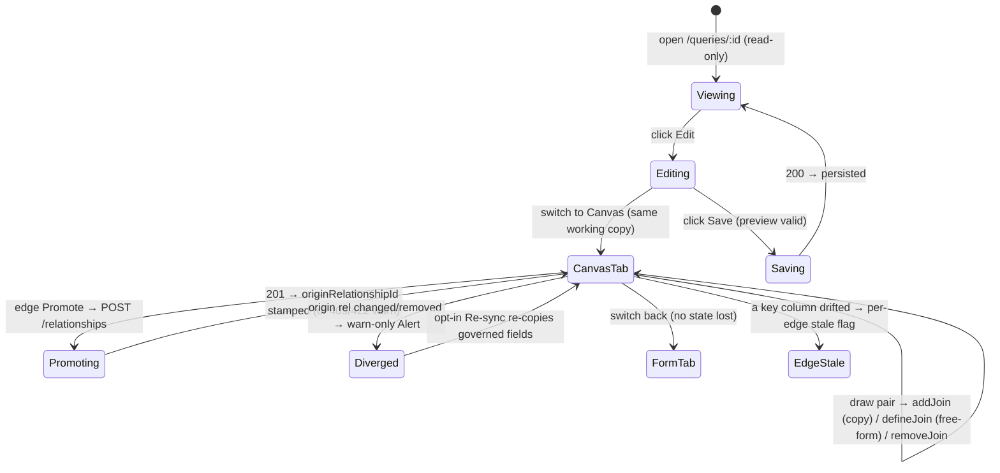

# Query Canvas — the free-form visual source-graph editor (a view/edit mode of the builder)

**Concept**: the **canvas** is a **visual presentation + editing mode** of the [Query](queries.md)
builder. It renders a Query's [`definition.joins`](queries.md#joins-reading-related-datasets-as-one)
**tree** as a **node-link graph** — each dataset (the driving [`sourceId`](queries.md) + every joined
dataset) is a **node**, each [`JoinStep`](queries.md#joins-reading-related-datasets-as-one) is an
**edge** through the query's own relationship — and lets a user read and **edit** that same tree by
direct manipulation: drag nodes, **draw a column-to-column connection** to add a hop (copy-on-pick a
governed edge **or** define a free-form one), promote a useful edge up into the governed ER, and
delete a leaf edge. It is **not a new noun and not a new page**: it reads and writes the
**identical** `definition.relationships[]` + `joins[]` the hop-list
[construction surface](query-construction.md) edits, runs the **same** stateless preview, and saves
through the **same** lifecycle. The canvas is a **second editor over one model**, not a second
model.

**Status**: Accepted.

The builder is two tabs — `Form` (hop list + filters + steps + live preview) and `Canvas` (graph +
status chip) — over one working copy (`QueryBuilderPanel`, AntD `<Tabs>`). The Canvas tab is a
**React Flow editor** (`QueryCanvas`): drag a column handle to another column handle to add a hop,
an edge's info-box promotes / re-syncs / deletes it, and `[+ Add a source]` stages any
not-yet-joined **dataset** to draw to — all bound to `useQueryBuilder`'s ops over the same working
copy. **Every source node is a dataset (`ds_`)**: a Query reads datasets only
([`_noun-model.md`](../_noun-model.md)), so the canvas joins datasets to datasets and nothing else.
The fidelity layer: **per-field column-type glyphs**, **rounded orthogonal edges**, a **draw-time
dtype guard**, **distinct action cursors**, a **one-line top toolbar**, and an in-page **maximize**
overlay.

**Domain folder**: `data-management/queries/` — a **mode** sibling of
[query-construction.md](query-construction.md) (the hop-list builder this re-presents) — **not** a
parallel page.

**Sibling docs**:
[queries.md](queries.md) (the domain anchor; the
[reuse invariant](queries.md#the-reuse-invariant-the-one-rule-this-domain-holds) this obeys; the
query-owned-relationship model this reads/writes),
[query-construction.md](query-construction.md) (the editable hop-list builder — `useQueryBuilder` +
`QueryBuilderPanel` — this adds the Canvas tab to),
[queries.md § Joins](queries.md#joins-reading-related-datasets-as-one) (the connected acyclic
**tree** the canvas reads/writes; the per-hop stale gate it renders),
[relationships.md](../workspaces/relationships.md) (the governed edges the canvas copy-on-picks from
and **promotes** to),
[dataset-detail.md](../datasets/dataset-detail.md) (owns `<PagedRowsView>`, reused for the Form-tab
preview body),
[workspace-shell.target.md](../../_platform/workspace-shell.target.md) (the chrome all surfaces
render inside).

> **Why a mode, not a noun (the noun-vs-mode check).** A canvas introduces **no new
> readable-table-source kind, no new engine, and no new model**. It renders and edits the **same**
> `definition.joins` tree (each hop already names its own left/right via a query-owned relationship
> — a tree, not a path) and previews/saves through the **same** `useQueryBuilder` lifecycle and
> stateless `POST …/queries/preview`. So it **adds a view/edit mode** to the existing builder rather
> than minting a `/canvas` page or a `JoinGraph` noun. What is genuinely new is **only the visual
> rendering + direct-manipulation UX** — including the free-form **define** and **promote**
> gestures, which create and push edges but mint no model field (free-form rides the nullable
> `QueryRelationship.originRelationshipId`; promote reuses the create-relationship endpoint).

---

## The model — unchanged; the canvas renders + edits it

The canvas introduces **no change of its own** to `QueryDefinition`. It is a **read-write
projection** of the same object the hop list edits
([queries.md § Joins](queries.md#joins-reading-related-datasets-as-one)):

```ts
// the canvas renders this as a graph and edits it via the SAME useQueryBuilder ops.
// A hop references a query-OWNED relationship (`queryRelId`), never a governed `rel_`.
type JoinStep = {
  queryRelId: string; // `qrel_…` — the query-owned edge this EDGE consumes
  type: 'inner' | 'left' | 'right' | 'full'; // per-hop join type
};

type QueryRelationship = {
  id: string; // `qrel_…` query-local id
  leftSourceId: string; // `ds_…` — the LEFT dataset; always already in-graph (the tree invariant)
  leftColumn: string;
  rightSourceId: string; // `ds_…` — the RIGHT dataset joined in
  rightColumn: string;
  cardinality: 'one_to_one' | 'one_to_many' | 'many_to_one' | 'many_to_many';
  originRelationshipId?: string | null; // `rel_…` provenance, or null = free-form
};
```

- **Nodes** = the driving `sourceId` (root) plus each hop's right **dataset** (the pure
  `buildSourceGraph` selector, `joinGraph.ts`). A node carries a `Dataset` type **`<Tag>`** and a
  table icon, and renders its columns as connect handles (collapsed behind **"+ N more"** when wide —
  a wide CRM-export dataset needs it). **A hop's LEFT is never its own node** — the tree invariant
  guarantees it is already in the graph. **Edges** = the `joins[]`, each resolved through its
  `queryRelId` to a `QueryRelationship`.
- **Editing maps onto `useQueryBuilder`'s ops** ([query-construction.md](query-construction.md)): a
  drawn connection → `addJoin` (copy-on-pick) **or** `defineJoin` (free-form); a leaf edge's delete →
  `removeJoin`; promote → `promoteRel`; re-sync → `resyncRel`. The canvas cannot express anything the
  model forbids — same connected-acyclic tree, same guards.
- **Layout (node x/y) is view-only.** Positions come from a deterministic depth/row layout plus
  FE-only drag overrides; they are **never** added to the persisted `definition`.

---

## Editing — drawing creates (copy-on-pick · free-form define)

Editing is a **drag from one column handle to another** (React Flow connect): each column row
carries a `target` handle on its left and a `source` handle on its right. The drawn connection is
routed by `resolveConnect` (`joinGraph.ts`, a pure function — no React, no I/O), which orients the
in-graph endpoint as the hop's LEFT and decides:

| Drawn pair                                                                    | Routes to                                                                                                | Result                                                                                                                                                                                                                                                        |
| ----------------------------------------------------------------------------- | -------------------------------------------------------------------------------------------------------- | ------------------------------------------------------------------------------------------------------------------------------------------------------------------------------------------------------------------------------------------------------------- |
| Matches a `valid` governed `rel_` (in-graph → new dataset)                    | **copy-on-pick** → `addJoin(relId)`                                                                      | snapshots the governed rel's fields into a query-owned `QueryRelationship` (`originRelationshipId` = the `rel_`) and appends a `JoinStep`                                                                                                                     |
| No governed match (in-graph → new dataset)                                    | **free-form define** → cardinality `<Modal>` (pre-set to an **inferred** default) → `defineJoin(fields)` | mints a query-owned rel with `originRelationshipId: null` (`freeFormRel`) and appends a `JoinStep`                                                                                                                                                            |
| **Incompatible key pair** (text ↔ number)                                     | **invalid** → `dtype_mismatch`                                                                           | a warn `message`, mints nothing — rejected **before minting**, mirroring the backend `_compatible` rule (equal dtype, or both numeric); **FE-lenient on an unknown dtype** (a not-yet-loaded column isn't blocked — the backend stays the authoritative gate) |
| Self / cyclic (both endpoints in-graph) / disconnected (neither) / incomplete | **invalid**                                                                                              | a warn `message`, mints nothing                                                                                                                                                                                                                               |

**A hop's LEFT is a dataset already in the graph**, which the resolver matches by leaf id — so a
drawn column already names its own leaf and `resolveConnect` passes it straight through. The wire
still carries `ownerSourceId` / `sourceColumn` on resolved columns; the canvas does not need them.

**Drawing creates** is the load-bearing distinction: a pure pick gesture _selects_ an existing
governed edge; **define** makes the drag _produce_ a new edge. That is why the canvas carries a
graph library (§ Surfaces) — the gesture earns it.

**`[+ Add a source]`** stages **any** not-in-graph **dataset** (free-form — not only the
governed-reachable ones) so it can be drawn to. It is a **flat** list of datasets, disabled only when
every dataset is already on the canvas. **A user who reaches for a saved query meets nothing** — no
disabled group, no tooltip, no error: D4's standing rule is _unofferable at the gesture, never an
error at run_, and an explanation would advertise a capability the product does not have. A staged
node is FE-only and ephemeral — it enters `joins[]` only when its column connection is drawn; the
model stays a connected tree rooted at `sourceId`. An unconnected staged node carries a **`[×]`
unstage** control that drops it from the canvas (pure FE state — no `joins[]` / save impact).

**The edge: a compact cardinality badge → an expandable info-box** (rendered on each edge via React
Flow's `EdgeLabelRenderer`). At rest the edge shows only a **small cardinality label** (`1:1` /
`1:many` / `many:1` / `many:many` — the `relationships.cardinality.*` labels; blue when free-form) +
a **warn icon** when diverged/stale. **Clicking it selects the edge** and **expands an info-box**
with labelled rows — **On** (key pair) · **Join type** · **Relationship** (cardinality) ·
**Relationship type** (Free-form / Governed) — and an actions row: **Promote** (when it can
succeed), **Re-sync** (only when diverged), and a leaf **Remove** (a non-leaf delete is disabled
with the `removeJoinBlocked` reason — only leaves are removable, the tree invariant). The box is
lifted above the node cards (`zIndex`) so it never clips behind an adjacent node. Selection is
**canvas-local state** (clicking the pane background deselects).

**Action cursors read distinctly** (CSS-only, scoped to the canvas): the **pane** pans (`grab`), a
**node card** repositions (`move`, held steady while dragging), a **column row** is neutral
(`default`), and a connect **handle** draws a join (`crosshair`). The handle's **grab/hover area is
enlarged** by a transparent `::before` without enlarging the visible dot, plus a hover grow + halo
and a "drag to join" tooltip.

- **Promote** pushes a query-owned rel up into the governed ER via the existing
  `POST /workspaces/{id}/relationships` (`promoteRel` → `useCreateRelationshipMutation`). The
  endpoint dedups (`409 relationship_exists`) and dtype-validates (`422`); on `201` the query-owned
  rel keeps running on its own snapshot but gains the new `rel_` id as its `originRelationshipId`
  (provenance closes the loop, and divergence now tracks it).
  - **Offered only when it can succeed.** `Promote` is **absent** when a governed rel already holds
    this edge's **ordered column pair** — `promoteWouldCollide(qrel, governedById)`, the unique
    index's own predicate (`idx_relationships_pair_unique` = workspace + left dataset + left column
    - right dataset + right column), so the gate is exactly as wide as the `409`. It is
      deliberately **not** "has an `originRelationshipId`", which would miss a free-form edge drawn
      across an already-governed pair and block a `removed`-divergence edge that promotes cleanly;
      `cardinality` is excluded because the index excludes it. Absent rather than disabled, like
      `Re-sync`: the info-box already prints **Relationship type: Governed** two rows above. The one
      case the hiding does not narrate — a _free-form_ edge across an already-governed pair — is left
      as-is: nothing lies, and the action was impossible anyway.
  - **Reuse vs write** is the distinction underneath: **copy-on-pick** _reads_ the governed ER (a
    drawn pair matching a `valid` `rel_` is tagged **Governed**, with warn-only divergence +
    re-sync — the
    [query-owned-relationships](../../../memory/2026-06-19-query-owned-relationships.md) doctrine),
    whereas **promote** _writes_ a new governed rel.
- **Divergence** is a frontend diff: `relDivergence(qrel, governedById)` → `null | 'removed' |
'changed'` — `removed` when the origin `rel_` is gone, `changed` when its join fields/cardinality
  differ from the snapshot, `null` for free-form or in-sync. It is **warn-only**: a `<Alert>` flags
  the edge, and **Re-sync** (`resyncRel`) is the user's **opt-in** choice. The query keeps running on
  its own copy regardless.
- **Per-edge column-drift staleness** (`columnMissing`) flags an edge whose key column no longer
  exists on its dataset's current columns — a frontend check against the snapshot. The backend read
  remains the authoritative gate (`409 relationship_stale`).

---

## Surfaces — layer / reuse / purity declaration

| Surface                                                                                                                                                                                                                                                                                                | Layer                                               | Reusability         | Purity             | Allowed peer deps                                 |
| ------------------------------------------------------------------------------------------------------------------------------------------------------------------------------------------------------------------------------------------------------------------------------------------------------ | --------------------------------------------------- | ------------------- | ------------------ | ------------------------------------------------- |
| `QueryCanvas` (the React Flow node-link render + drag-to-connect editor: copy-on-pick / free-form define / promote / re-sync / leaf delete; per-field dtype glyphs, rounded orthogonal edges, distinct action cursors, one-line toolbar, in-page maximize overlay)                                     | `apps/builder/src/features/data-management/queries` | feature             | feature            | react, antd, @xyflow/react, @phosphor-icons/react |
| `QueryBuilderPanel` (the `Form` / `Canvas` `<Tabs>` over one working copy; hosts the Canvas-tab status chip)                                                                                                                                                                                           | `apps/builder/src/features/data-management/queries` | feature             | feature            | react, antd                                       |
| `useQueryBuilder` (the canvas binds to its `addJoin` / `defineJoin` / `removeJoin` / `promoteRel` / `resyncRel` / Save)                                                                                                                                                                                | `apps/builder/src/features/data-management/queries` | feature             | glue (server-data) | @tanstack/react-query, antd                       |
| `joinGraph.ts` (pure selectors shared by the list + canvas: `graphDatasetIds` / `buildSourceGraph` (the node/edge graph — root + hop rights) / `addEligibleRels` / `isLeafHop` / `resolveConnect` (dtype-guards via the injected `dtypeOf` → `dtype_mismatch`) / `relDivergence` / `inferCardinality`) | `apps/builder/src/features/data-management/queries` | feature             | pure               | none                                              |
| `chain.ts` (working-chain ↔ wire bridge: `readChain` / `readRels` / `writeDef` + `copyGovernedRel` / `freeFormRel`)                                                                                                                                                                                    | `apps/builder/src/features/data-management/queries` | feature             | pure               | none                                              |
| `<PagedRowsView>` (reused, not owned — the Form-tab preview body)                                                                                                                                                                                                                                      | `apps/builder/src/features/data-management/_shared` | shared cross-domain | plain-UI           | react, antd, react-i18next                        |
| `JoinStep[]` + `QueryRelationship[]` (the query-owned edges; frontend + contract type)                                                                                                                                                                                                                 | `.../features/data-management/queries/types.ts`     | feature             | data type          | none                                              |

> **Flagged peer-dep deviation.** `QueryCanvas`'s allowed peer deps are `react, antd,
@xyflow/react, @phosphor-icons/react`. `@xyflow/react` (React Flow v12) is a **deviation** from a
> `react, antd`-only declaration, adopted because drawing **creates** (free-form define), which
> earns a graph library for literal column-drag + pan/zoom; a pure pick gesture did not.
> `@phosphor-icons/react` supplies the per-field column-type glyphs. React Flow's base CSS is
> imported at the app entry (`main.tsx`); no new design token is introduced.

**Boundary check**: the only shared-cross-domain row (`<PagedRowsView>`) is **reused, not owned**
([dataset-detail.md](../datasets/dataset-detail.md)). `QueryCanvas` **binds to** `useQueryBuilder`'s
ops and the stateless preview — it re-implements no validation, engine, predicate editor, or detail
page; the canvas and the list are **two views of one working copy**, sharing the `joinGraph.ts`
selectors and the `chain.ts` bridge.

---

## Token map

The canvas surfaces are AntD primitives (`<Button>`, `<Tag>`, `<Select>`, `<Modal>`, `<Alert>`,
`<Tooltip>`, `<Popover>`, `<Typography>`) plus React Flow's node-link rendering, styled by the
`<ConfigProvider>` tokens derived from the six seeds in
[`themeTokens.ts`](../../../../workspace/packages/ui/src/themeTokens.ts) (the source of truth).
**No new token is introduced**; the map reuses identifiers already cited by
[queries.md](queries.md) and [query-construction.md](query-construction.md). `Value` is
informational.

| Surface                                                  | AntD token (themeTokens.ts) | Value (informational) |
| -------------------------------------------------------- | --------------------------- | --------------------- |
| Canvas pane background                                   | `colorBgLayout`             | `#f5f5f5`             |
| Node card background                                     | `colorBgBase`               | derived               |
| Driving-node border · free-form edge · source handle     | `colorPrimary`              | `#1677ff`             |
| Edge label / cardinality `<Tag>` text                    | `colorTextSecondary`        | derived               |
| Node / governed-edge / non-driving border                | `colorBorderSecondary`      | `#f0f0f0`             |
| Stale-or-diverged edge · stale column · status chip warn | `colorWarning`              | `#faad14`             |
| Canvas status chip — valid (`N rows ↗`) text             | `colorTextSecondary`        | derived               |
| Invalid / unrunnable `<Alert>`                           | `colorError`                | `#ff4d4f`             |
| Per-field column-type glyph                              | `colorTextQuaternary`       | `#bfbfbf`             |
| Border radius (node card, tag, button, modal)            | `borderRadius`              | `6`                   |
| Font family                                              | `fontFamily`                | system stack          |

Identifier parity is enforced by
[`design-token-parity.mjs`](../../../../scripts/lint/design-token-parity.mjs).

---

## Layout — ASCII intent

The canvas is a **view of the builder**, inside the **same** detail shell the hop-list builder uses.
The builder is two top-level tabs over one working copy — **`Form`** (the hop-list builder + filters

- steps + the live `<PagedRowsView>` preview) and **`Canvas`** (the full-width React Flow graph;
  **no preview table** — a **status chip** in the canvas toolbar links to the Form preview). Both tabs
  bind to the same `useQueryBuilder`; Save lives in the shared `PageHeader`. Still a **mode, not a
  route**: switching tabs swaps the rendering of one copy, losing no edit; the preview query keys on
  the working copy and runs regardless of the visible tab, so the Save gate holds on either tab.

```text
Deals × Accounts × Owners                                         [Cancel] [Save]
[ Form ] ( Canvas )   ← top-level tabs; one working copy, shared header Save
┌─ Canvas ──────────────────[ + Add a source ] [👁 1,204 rows ↗] [? Help] ─┐
│ ┌ Controls ┐             ┌───────────────┐    ↑ one-line top toolbar:       │
│ │ + − ⤢ ⤡ │  ┌────────┐ │  Accounts     │  ┌──────────┐  Add · status chip │
│ └──────────┘  │ ◆ Deals│ ○──╮│ #  id     ├○─┤ Owners   │  (→ Form) · Help    │
│  ↑ zoom/fit/  │ # id  ○│   ╰┤ Aa region   │  │ # id   ○ │                    │
│    maximize   │ Aa …  ○│    └───────────────┘  └──────────┘  (╮╰ = rounded   │
│  (TOP-left)   └────────┘   account_id ↔ id     owner_id ↔ id ◄selected  edge)│
│         (driving)            [many:many]          [many:1]                    │
│                                               ┌ info-box + actions ┐         │
│        ┌ Background grid ┐                     └────────────────────┘(on select)│
└──────────────────────────────────────────────────────────────────────────────┘
  (no preview table on the Canvas tab — results live on the Form tab)

[ Form ] tab → the hop-list editor + filter chips + advanced + search + steps, with the
shared <PagedRowsView> preview below.
```

`◆` marks the **driving node** (`sourceId`). `○` marks a per-column connect handle (target-left,
source-right; enlarged hit-area, `crosshair` cursor, hover grow + halo, a "drag to join" tooltip). A
muted **type glyph** precedes each column name (`#` number, `Aa` text, a calendar for dates, a clock
for datetimes, a checkbox for booleans — supplementary to the name). A node carries a `Dataset` type
**`<Tag>`** + a **table** icon in its header and renders its columns behind a **"+ N more"** toggle
when wide. Each edge is a **rounded orthogonal** connector showing, at rest, the compact
cardinality label (+ a warn icon when diverged); **clicking it selects the edge and expands the
info-box**. The canvas's controls live in **one top-right toolbar row** — `[+ Add a source]` · the
preview **status chip** · a `[? Help]` popover (which holds the verbose drag tip) — all uniform
text+icon. The `<Controls>` give zoom/fit/recenter **and a maximize toggle** (an in-page overlay that
fills the browser tab — `Esc` exits — not the OS Fullscreen API, which left the pane unmeasured →
blank), pinned **top-left** so they stay reachable without a scroll on a short viewport. The pane
has a **viewport-relative height** (`clamp(420px, calc(100svh − 280px), 2400px)` — definite, so React
Flow always measures it), and `fitView` (capped at **1× zoom** so a small graph isn't blown up)
re-runs whenever the node set changes or maximize toggles.

**The canvas status chip** (`[ N rows ↗ ]`) is a labelled, keyboard-reachable button that mirrors the
preview gate and links to it. States: _valid_ → `N rows ↗` (`colorTextSecondary`), click switches to
the `Form` tab with the preview expanded; _stale / invalid_ → `⚠ unavailable ↗` (`colorWarning`,
**text + icon**), pointing to the Form tab where the blocked-state alert + the fix live (Save stays
disabled, gated by preview validity regardless of the visible tab).

### Free-form define — cardinality picker (inferred, confirmable default)

```text
  drawn column pair has no governed match →
  ┌─ Define this relationship ──────────────────────────────┐
  │  Deals.owner_id ↔ Owners.id                              │
  │  Cardinality:  [ many:1 ▾ ]   ← inferred from cols       │
  │  Suggested from the join columns — change it if it's     │
  │  not right.                                              │
  │                                  [ Cancel ]  [ Define ]  │
  └─────────────────────────────────────────────────────────┘
  → defineJoin → a query-owned rel (originRelationshipId: null) + a JoinStep
```

The modal opens **pre-set to a cardinality inferred from the drawn column names** — the only pre-run
signal available (`inferCardinality`, `joinGraph.ts`; key-like = `id` / `*_id` / `*_key` / `*_code` /
`uuid`): both key-like → `one_to_one`; only the LEFT key-like (parent-key ↔ child-FK) →
`one_to_many`; only the RIGHT key-like (left-FK → right-PK, the fact→dimension case) →
`many_to_one`; neither → `many_to_many` (a non-key join can fan out — surfaced so the analyst
notices). Cardinality is **advisory** metadata — it does not change the join SQL (the join **type**
does) — so a wrong guess is non-destructive and the user confirms or overrides it before
`defineJoin`.

### Divergence / stale state (warn-only, per edge)

```text
  ⚠  The “Deals ⋈ Accounts” relationship has changed in the workspace.
     [ Re-sync ] re-copies the governed fields — or keep your current snapshot.

  ⚠  The “Deals ⋈ Accounts” join is unavailable — “account_id” no longer exists.
```

---

## Behaviour — states



- **Tab switch is lossless** — `[Form] ⇄ [Canvas]` swaps the **rendering** of one working copy; no
  edit is lost, no model is forked.
- **Preview lives on the `Form` tab only; the Save gate holds on both.** `useQueryBuilder`'s preview
  query keys on the working copy and runs whenever the builder is active, independent of the visible
  tab, so `canSave` is correct on the Canvas tab too; the status chip mirrors that gate.
- **Empty graph** — a Query with no joins renders the lone driving node, a single-node canvas, not a
  blank. The canvas reads the workspace's relationships (`useRelationshipsQuery`) and datasets
  (`useDatasetsQuery`) — node labels, columns, key pairs, and cardinality resolve from those shared
  fetches, no parallel path.
- **Editing** routes each drawn pair through `resolveConnect` (copy / define / invalid), stages
  sources via `[+ Add a source]`, deletes leaves, and exposes Promote / Re-sync on the edge — all
  over the same connected-acyclic guard and eligibility/leaf rules the list uses.
- **Promote** is a single mutation per edge with in-flight (`loading`) and error
  (`409 relationship_exists` / `422`) feedback; success stamps `originRelationshipId`.
- **Divergence is warn-only** — Re-sync is opt-in; the query never auto-mutates its snapshot.
- **Stale gates are flag-don't-crash, per edge** — a drifted key column renders an "edge
  unavailable" `<Alert role="alert">` naming the column ([purpose.md](../../../context/purpose.md)
  #5). An unresolvable hop (a `queryRelId` with no matching rel) is named with a link to the
  workspace relationships, not silently dropped.
- **Preview / Save / discard** are unchanged — the canvas persists nothing new (positions are
  view-only).

### Accessibility

- **The canvas is not the only way to read/edit the tree.** The **`Form` tab is the
  keyboard-and-screen-reader-complete equivalent** and the **assistive-tech default**; the
  `[Form] [Canvas]` `<Tabs>` are a real tablist/tab. React Flow drag is mouse-first, so no capability
  is canvas-only.
- **The canvas status chip** is a labelled, keyboard-reachable **button** (`aria-label`); its
  stale/invalid state reads as **text + icon**, not colour alone.
- **Nodes and edges carry text, not colour/glyph alone** — each node names its dataset in text; the
  driving node is marked with a **text glyph + label** (`◆`); each edge's cardinality is text at rest
  and, on select, the info-box has labelled rows + actions.
- **Editing affordances are labelled** — `[+ Add a source]` (a flat list of datasets), the per-edge
  Promote / Re-sync / Remove; the **disabled non-leaf delete** keeps its label and exposes its reason
  as **text** via tooltip.
- **The "+ N more" disclosure is a keyboard-reachable control** (a real `<Button>`), so a column
  hidden behind it stays focusable and drawable.
- **Warn / stale / promote-error states** are `<Alert role="alert">`s whose reason is **text**.
- The Form-tab preview reuses `<PagedRowsView>`'s table semantics; collision-qualified headers keep
  every column name unique.

---

## Data contract: no new route, no new field

The canvas introduces **no new route, no new error code, and no new field**:

- **Reads/writes** the existing `definition.relationships: QueryRelationship[]` +
  `definition.joins: JoinStep[]` on the existing get / preview / update shapes
  ([queries.md § Joins](queries.md#joins-reading-related-datasets-as-one)). Free-form rides the
  **already-nullable** `QueryRelationship.originRelationshipId` (null = free-form).
- **Previews** through the existing stateless `POST /workspaces/{id}/queries/preview`. The join
  resolver is **origin-agnostic**, so a free-form rel joins exactly like a copied one.
- **Promote** reuses the existing `POST /workspaces/{id}/relationships`
  ([relationships.md](../workspaces/relationships.md)) — its `409 relationship_exists` dedup and
  `422` dtype validation pre-exist.
- **Divergence** is a pure frontend diff (`relDivergence`) against the live workspace rels; there is
  no wire signal for it.
- **Consumes** the per-hop `409 relationship_stale` read gate; the per-edge staleness marker is a
  frontend column-drift check (`columnMissing`).

---

## Acceptance criteria

1. **Canvas renders the tree faithfully** — nodes = `sourceId` + each hop's right dataset; edges =
   `joins[]` resolved through their query-owned rels, shown as a cardinality label (expand for key
   pair · join type · type); a star (one dataset driving 2+ hops) renders correctly; an empty Query
   renders the lone driving node.
2. **Tab switch is lossless** — `[Form] ⇄ [Canvas]` swaps the rendering of one working copy with no
   edit lost and no model fork; the Save gate holds on both tabs.
3. **Drawing a governed pair copies-on-pick** — a drawn column pair matching a `valid` governed
   `rel_` calls `addJoin`, snapshotting it into a query-owned rel + a `JoinStep`.
4. **Drawing a no-match pair defines free-form** — a drawn pair with no governed match opens the
   cardinality picker pre-set to the inferred value, then `defineJoin` mints a query-owned rel with
   `originRelationshipId: null` + a `JoinStep`; it joins with no engine change.
5. **Invalid draws mint nothing** — self / cyclic / disconnected / incomplete / **dtype-incompatible**
   (`dtype_mismatch`) connections are rejected with a warning, leaving the tree unchanged.
6. **Promote pushes an edge up to the governed ER** — offered only when no governed rel holds the
   ordered column pair; POSTs to `…/relationships`, surfacing `409`/`422`; on success the query-owned
   rel gains the new `rel_` id as `originRelationshipId`.
7. **Divergence is warn-only with opt-in re-sync** — a copied edge whose origin changed/was removed
   renders a warning; Re-sync re-copies the governed fields on the user's choice.
8. **Stale flags on the edge, not a crash** — a drifted key column renders the "edge unavailable"
   alert naming the column; Save stays guarded.
9. **Leaf-only delete** — a leaf edge's Remove calls `removeJoin`; a non-leaf delete is disabled with
   a text-reason tooltip.
10. **Form tab stays AT-complete** — every capability is reachable on the keyboard/SR Form tab.
11. **`[+ Add a source]` offers datasets, and only datasets** — a **flat** list, saved queries absent
    with no disabled row and no explanatory tooltip; no gesture on this surface constructs
    `query⋈query`.

---

## Scope boundary

### IN scope

- **The Canvas tab as a React Flow editor** over the one `useQueryBuilder` working copy: a node-link
  render of the join tree plus **drag-to-connect editing** — copy-on-pick a governed edge
  (`addJoin`), **free-form define** an unmatched pair (`defineJoin`), **promote** an edge up to the
  governed ER (`promoteRel`), opt-in **re-sync** a diverged edge (`resyncRel`), and leaf delete
  (`removeJoin`) — the `Form` tab staying the keyboard/SR-complete equivalent.
- **Divergence warn** (`relDivergence`) and **per-edge column-drift staleness** (`columnMissing`).
- **Draw-time dtype guard** — `resolveConnect` rejects an incompatible key pair before minting.
- **Fidelity** — per-field column-type glyphs, rounded orthogonal edges, distinct action cursors with
  an enlarged handle hit-area, a one-line top toolbar, and an in-page maximize overlay.
- **`@xyflow/react`** as the canvas graph engine (the flagged peer-dep deviation) and
  **`@phosphor-icons/react`** for the column-type glyphs.

### OUT of scope (deferred with named triggers)

- **Query sources of any kind** — a Query reads datasets only ([`_noun-model.md`](../_noun-model.md));
  not a deferral.
- **Offer-nothing parity for a cyclic draw** — the free-form draw is node-level, so it can still
  produce a `cyclic_join` that fails at preview/save; tracked as noun-model **D4**.
- **The standalone "New query" empty-canvas create entry** — a `[+ New query]` on the Queries catalog
  opening the builder on an empty graph. Not built: a Query is created from a dataset ("Save filters
  as Query") or by duplicating one, neither of which needs an empty canvas; it would be built clean,
  from the catalog, when a round pulls it.
- **Persisting cosmetic node positions / auto-layout** — the model carries **no** view state.
- **Self-joins / diamonds / general DAGs; composite keys; cross-workspace joins** — the canvas edits
  the **same tree** the model permits
  ([queries.md § Joins](queries.md#joins-reading-related-datasets-as-one)), no more.

### This concept explicitly does NOT cover

- The `joins` tree model + engine ([queries.md § Joins](queries.md#joins-reading-related-datasets-as-one))
  and the builder lifecycle ([query-construction.md](query-construction.md)) — the canvas
  **re-presents + edits** them.
- The governed-edge model (declare / validate / stale) — [relationships.md](../workspaces/relationships.md);
  the canvas **copy-on-picks from** and **promotes to** it.
- The `<PagedRowsView>` component boundary — [dataset-detail.md](../datasets/dataset-detail.md).
- The predicate vocabulary internals — the dataset filter / advanced docs.

---

## Reference materials (read-only)

- [queries.md § Joins](queries.md#joins-reading-related-datasets-as-one) — the connected-acyclic
  **tree** this canvas renders and edits; the query-owned-relationship model; the per-hop stale gate.
- [query-construction.md](query-construction.md) — the hop-list builder (`useQueryBuilder` /
  `QueryBuilderPanel`) this adds the Canvas tab to.
- [relationships.md](../workspaces/relationships.md) — the governed edge copy-on-pick copies from and
  promote pushes to.
- [query-owned-relationships](../../../memory/2026-06-19-query-owned-relationships.md) — the doctrine
  the canvas's copy-on-pick / free-form / promote / warn-only-divergence model implements.
