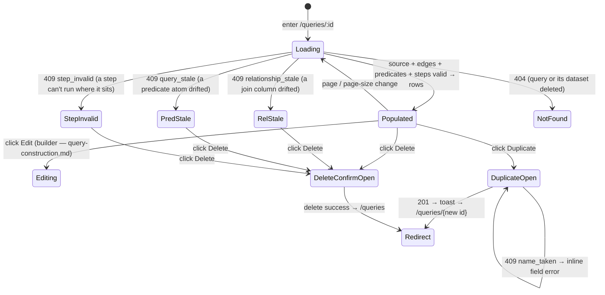

# Queries — the Query domain (noun · model · routes · engine)

**Concept**: a **Query** is a named, saved definition that produces a **virtual
dataset** by re-running a set of predicates — and, optionally, a tree of joins and an
ordered list of transform steps — against a driving dataset. It is the **same
readable-table-source kind** as a [Dataset](../datasets/datasets.md) but a **different
archetype**: it has its own identity (`qr_…`), its own home (the **Queries catalog**), and
its own URL — yet it **reuses the dataset surfaces' layout and components** rather than
duplicating them. A Query stores **only its definition**, never a materialized result:
opening one re-runs it against current data, so the result is always fresh.

This doc is the **domain anchor + spine** of `queries/` — the single home for the Query
**noun**, the **reuse invariant** every surface here obeys, the **trajectory** the domain
grows along, and the Query **model · routes + error codes · execution engine** (single-source
read, the join-tree fold, and the transform-step fold). The interactive builder UX lives in
the sibling [query-construction.md](query-construction.md); the visual source-graph editor is
[canvas.md](canvas.md).

**Status**: Accepted.

> **Read first — the domain noun-model.** [`../_noun-model.md`](../_noun-model.md) is the
> canonical, cross-cluster definition of the five nouns (dataset · query · join · relationship
> · workflow) and the boundaries between them. When it and this doc conflict on a _boundary_,
> the noun-model is the intent; **this doc is current-state truth**. Under that model a Query is
> a live table over **datasets only** — never built on another Query (§ Composed source).

**Sibling docs**:
[query-construction.md](query-construction.md) (the editable builder surface: edit a Query's
definition + preview before save),
[canvas.md](canvas.md) (the visual source-graph editor — the React Flow Canvas tab:
draw-to-connect copy-on-pick + free-form define, promote, and the divergence warn),
[workflows.md](../workflows/workflows.md) (the noun that consolidates saved queries and reads
them through this domain's resolver),
[dashboard-layout.md](../../dashboards/dashboard-layout.md) (the dashboard surfaces that consume
the `aggregate` / `totals` / `export` / unpaged-rows routes below),
[dataset-detail.md](../datasets/dataset-detail.md) (the surface a Query is saved _from_, and
whose extracted `<PagedRowsView>` + standard detail layout this archetype reuses),
[dataset-filters.md](../datasets/dataset-filters.md) +
[advanced-query.md](../datasets/advanced-query.md) (the predicate vocabulary the saved
definition round-trips — `FilterAtom` chips + the advanced DNF),
[datasets.md](../datasets/datasets.md) (the leaf table-source a Query reads from),
[relationships.md](../workspaces/relationships.md) (the governed edge a join copies),
[workspaces.md](../workspaces/workspaces.md) (the container a Query is scoped to),
[crud-hygiene.md](../_shared/crud-hygiene.md) (the delete-confirm modal reused),
[\_paging-and-order.md](../_paging-and-order.md) (which read path guarantees row order, and how),
[workspace-shell.target.md](../../_platform/workspace-shell.target.md) (the chrome all surfaces
render inside).

---

## Why this exists separately from dataset-detail.md

The dataset detail page is the **ephemeral** verb surface: a user filters, searches, and reads
rows, and the URL (`f<N>_*`, `aq`, `q`) is the only durability — it survives a refresh and a
deep-link, nothing more. A Query is the **persisted** view: the same predicate state (possibly
spanning joined sources, possibly shaped by steps), given a name and a `qr_` identity, listed in
a catalog and reopenable.

- `dataset-detail.md` — the **ephemeral view**: build predicates, read rows, share via URL.
- `queries.md` (this file) — the **persisted view + the engine that runs it**. The definition
  lives in a `queries` row; every read re-executes it live.

A Query is **not** a Dataset (no Parquet of its own — see § Execution model) and **not** a new
query language (it reuses the `FilterAtom` / advanced-DNF vocabulary verbatim, and its steps
are a closed, structured, formula-free union).

---

## The reuse invariant (the one rule this domain holds)

`queries/` is a first-class domain because the Query-Builder complexity (joins, steps, the
construction surface) genuinely pulled one — the domain is **discovered, not imposed**. But
**doc-home and UI-duplication are independent axes**: having a `queries/` folder does **not**
license parallel pages that re-implement the row table. Every `queries/` surface is **composed
from existing shared components/layouts**, never a parallel page or a re-invented engine
([specious-model-lock-in](../../../memory/2026-06-13-specious-model-lock-in.md)):

| Concern                 | Reused from                                                                                                                        |
| ----------------------- | ---------------------------------------------------------------------------------------------------------------------------------- |
| Row table               | `<PagedRowsView>` (`data-management/_shared/`, extracted from dataset-detail) — [dataset-detail.md](../datasets/dataset-detail.md) |
| Catalog list            | the Page-List layout (`PageHeader` + `PageCard` + AntD `<Table>`)                                                                  |
| Detail layout           | the standard detail layout (`PageHeader` + `PageCard` + `<PagedRowsView>`)                                                         |
| Predicate (de)serialize | the `FilterAtom` / advanced-DNF serializers + validators, verbatim                                                                 |
| Row execution           | `query_dataset_rows` (single source) — extended, never replaced, by `query_joined_rows` and the step fold                          |

What is genuinely **new** to the Query archetype: persistence (the `queries` table), the `qr_`
identity, the Save-as-Query / Duplicate name modal (one shared `SaveQueryModal`), the Queries
catalog + detail routes, and the multi-source + step **execution engine**. Everything else is
reuse.

---

## Surfaces — layer / reuse / purity declaration

| Surface                                                                                         | Layer                                                                  | Reusability         | Purity             | Allowed peer deps                  |
| ----------------------------------------------------------------------------------------------- | ---------------------------------------------------------------------- | ------------------- | ------------------ | ---------------------------------- |
| `<PagedRowsView>` (reused; declared in dataset-detail.md)                                       | `apps/builder/src/features/data-management/_shared`                    | shared cross-domain | plain-UI           | react, antd, react-i18next         |
| `MetadataPanel` (reused; read-only metadata on the detail view)                                 | `apps/builder/src/features/metadata`                                   | feature             | feature            | react, antd, react-i18next         |
| `SaveQueryModal` (name capture for Save-as-Query + Duplicate)                                   | `apps/builder/src/features/data-management/queries`                    | feature             | feature            | react, antd                        |
| `QueriesPage` (Queries catalog; reuses Page-List layout)                                        | `apps/builder/src/features/data-management/queries`                    | feature             | feature            | react, antd, @tanstack/react-query |
| `QueryDetailPage` (read-only summary + run + inline Edit + Duplicate)                           | `apps/builder/src/features/data-management/queries`                    | feature             | feature            | react, antd, @tanstack/react-query |
| `hooks.ts` (`useQueriesQuery` / `useQueryQuery` / `useQueryRowsQuery` / preview + mutations)    | `apps/builder/src/features/data-management/queries`                    | feature             | glue (server-data) | @tanstack/react-query              |
| `queriesApi` client (CRUD · rows · unpaged rows · preview · aggregate · totals · export)        | `apps/builder/src/api/queriesApi.ts`                                   | builder-only        | glue               | (fetch — no extra peer dep)        |
| `chain.ts` (`readChain` / `writeDef` — working-chain ↔ wire bridge)                             | `apps/builder/src/features/data-management/queries`                    | feature             | pure               | none                               |
| `POST/GET/PUT/DELETE …/queries` + `rows` / `preview` / `aggregate` / `totals` / `export` routes | `workspace/apps/backend/app/routers/queries.py`                        | backend             | feature            | (FastAPI — backend native)         |
| resolver + step planner (`resolve_source` / `_resolve_plan` / `_step_plan`)                     | `workspace/apps/backend/app/query_engine.py`                           | backend             | feature            | (sqlite3 — backend native)         |
| row engines (`query_dataset_rows` / `query_joined_rows` / `build_steps_relation` / `run_steps`) | `workspace/apps/backend/app/ingest/rows_reader.py`                     | backend             | feature            | (duckdb — backend native)          |
| export writers (`build_csv` / `build_xlsx`, `EXPORT_MAX_ROWS`)                                  | `workspace/apps/backend/app/ingest/export.py`                          | backend             | pure               | (openpyxl — backend native)        |
| `Query` Pydantic models (`Query`, `*Body`, the `Step` union, error envelopes)                   | `workspace/apps/backend/app/models/common.py`                          | backend             | data type          | pydantic                           |
| `Query` / `QueryDefinition` / `JoinStep` / `Step` types (frontend)                              | `workspace/apps/builder/src/features/data-management/queries/types.ts` | feature             | data type          | none                               |

**Boundary check**: no query surface re-implements a dataset surface. The row table is the
shared `data-management/_shared/` `<PagedRowsView>` (its boundary lives in
[dataset-detail.md](../datasets/dataset-detail.md)). The catalog and detail are feature-local
pages that **compose** the `@mdd/ui` shells (`PageHeader` / `PageCard` / `PageContainer`). The
engine reuses the predicate fragment builders in
[filters.py](../../../../workspace/apps/backend/app/ingest/filters.py), never re-implementing the
operator vocabulary. The dashboard-facing routes (`aggregate` / `totals` / `export`) live here
because they read a **query's** relation; the widgets that call them are the dashboard domain's.

---

## Token map

The Saved-Query surfaces are AntD primitives (`<Table>`, `<Modal>`, `<Input>`, `<Tag>`,
`<Select>`, `<Alert>`, `<Empty>`, `<Button>`, `<Breadcrumb>`) styled by the AntD
`<ConfigProvider>` tokens derived from the six seeds in
[`themeTokens.ts`](../../../../workspace/packages/ui/src/themeTokens.ts) (the source of truth).
**No new token is introduced**; the map reuses identifiers already cited by
[datasets.md](../datasets/datasets.md) and [dataset-detail.md](../datasets/dataset-detail.md).
`Value` is informational (resolved via `theme.getDesignToken()`, antd 6.x).

| Surface                                                           | AntD token                                  | Value (informational) |
| ----------------------------------------------------------------- | ------------------------------------------- | --------------------- |
| Page background                                                   | `colorBgLayout`                             | `#f5f5f5`             |
| Page card background                                              | `colorBgBase`                               | derived               |
| Table header background                                           | `colorFillQuaternary`                       | derived               |
| Table row border                                                  | `colorBorderSecondary`                      | `#f0f0f0`             |
| Table row hover                                                   | `colorPrimaryBg`                            | `#e6f4ff`             |
| Cell text                                                         | `colorText`                                 | derived               |
| Primary action (`[Edit]`, `[Save]`, base/relationship `<Select>`) | `colorPrimary`                              | `#1677ff`             |
| Read-only predicate / join / cardinality `<Tag>`                  | `colorFillSecondary` / `colorTextSecondary` | derived               |
| Stale / unavailable warning (`⚠`)                                 | `colorWarning`                              | `#faad14`             |
| Invalid predicate / unrunnable `<Alert>`                          | `colorError`                                | `#ff4d4f`             |
| Border radius (card, table, modal, button)                        | `borderRadius`                              | `6`                   |
| Font family                                                       | `fontFamily`                                | system stack          |

Identifier parity against the live AntD registry is enforced by
[`design-token-parity.mjs`](../../../../scripts/lint/design-token-parity.mjs).

---

## Data model

A `Query` persists to the `queries` table; the schema-of-record is the SQLModel `Query` in
[db_models.py](../../../../workspace/apps/backend/app/db_models.py) (Alembic migrates prod;
`create_all_for_tests()` builds the test DB), while the router handlers read/write through
**raw `sqlite3`** (`get_conn()`), not the ORM. The wire shapes live in
[`_shared/query.yaml`](../../../../workspace/packages/contracts/_shared/query.yaml) +
[common.py](../../../../workspace/apps/backend/app/models/common.py) +
[types.ts](../../../../workspace/apps/builder/src/features/data-management/queries/types.ts).

```ts
// frontend — features/data-management/queries/types.ts (abridged)
type Query = {
  id: string; // backend-generated, `^qr_[0-9a-f]{8}$`
  workspaceId: string; // the IA scope
  sourceId: string; // the driving source — always a Dataset (`^ds_[0-9a-f]{8}$` on the wire)
  name: string; // user-supplied, 1–120 chars; unique per workspace
  definition: QueryDefinition;
  resolvedColumns?: ResolvedColumn[]; // effective columns — present when joined and/or stepped
  createdAt: string; // ISO-8601 UTC, backend commit time
};

type QueryDefinition = {
  q?: string | null; // the `?q=` row search (≤200 chars)
  filters: FilterPredicate[]; // chip filters (dataset-filters.md) — wire `FilterAtom`
  advanced: FilterPredicate[][]; // advanced-query DNF (advanced-query.md)
  relationships?: QueryRelationship[]; // the query's OWN join edges; see § Joins
  joins?: JoinStep[]; // ordered join tree; each hop → a query-owned rel
  steps?: Step[]; // ordered transform steps; see § Transform steps (≤24)
};

// FilterAtom = { col: number; dtype; op; val?; min?; max?; vals?; refCol? } — col is the
// 0-based index into the EFFECTIVE columns (the single dataset's columns when there is no
// join). `vals` carries the `in` / `not_in` list (≤500, every dtype but boolean); `refCol`
// compares against another column's index instead of a literal (`equals` / `ne` / `gt` /
// `lt` / `gte` / `lte` / `before` / `after`, same dtype family only).

type QueryRelationship = {
  id: string; // query-local, `^qrel_[0-9a-f]{8}$`
  leftSourceId: string; // `ds_…` — the LEFT dataset of this edge (always in-graph)
  leftColumn: string;
  rightSourceId: string; // `ds_…` — the RIGHT dataset joined in
  rightColumn: string;
  cardinality: 'one_to_one' | 'one_to_many' | 'many_to_one' | 'many_to_many'; // advisory
  originRelationshipId?: string | null; // `rel_…` provenance back-ref (null = free-form)
};

type JoinStep = {
  queryRelId: string; // `qrel_…` — the query-owned rel this hop consumes
  type: 'inner' | 'left' | 'right' | 'full'; // per-hop join type (default 'inner')
};

type ResolvedColumn = {
  name: string; // the effective (collision-qualified) name
  dtype: 'string' | 'integer' | 'float' | 'boolean' | 'date' | 'datetime';
  ownerSourceId?: string; // the leaf `ds_` that owns a 1:1 column; omitted for a derived one
  sourceColumn?: string; // the pre-qualification name on that leaf
};
```

**`resolvedColumns` is computed on read**, never stored: present when the definition joins
(the effective columns, with leaf provenance) and/or has steps (the **post-step** output
columns, which carry no provenance); omitted for a plain single-source query (its columns are
the dataset's) and silently omitted when the graph or a step no longer resolves — `get` /
`list` never error on it.

**`sourceId` is the single canonical source field — there is no `datasetId`.** The
`queries.source_id` column is `TEXT NOT NULL` with **no FK**: the column once held either a
dataset or a query, and dropping the column for a FK is a migration for no behavioural gain now
that the wire is `ds_`-only. The dataset-delete → query cascade a real FK would provide
therefore lives in the **app layer** (`routers/datasets.py`). A legacy persisted single `join`
key is folded to a length-1 `joins` list on read by a `model_validator` (`_fold_legacy_join`);
new writes always use `joins`.

**Persistence (the `queries` table, code-true).** Created by Alembic `0001_baseline`; the later
revisions (`0002`–`0007`) touch other tables only. Query-owned relationships and steps live
inside the opaque `definition_json` blob, so they need no DDL.

```sql
CREATE TABLE queries (
    id TEXT PRIMARY KEY,                                   -- qr_xxxxxxxx
    workspace_id TEXT NOT NULL REFERENCES workspaces(id) ON DELETE CASCADE,
    source_id TEXT NOT NULL,                               -- ds_; no FK, app-level cascade
    name TEXT NOT NULL CHECK (length(name) BETWEEN 1 AND 120),
    definition_json TEXT NOT NULL,                         -- QueryDefinition
    created_at TEXT NOT NULL
);
CREATE INDEX idx_queries_workspace_id ON queries(workspace_id);
CREATE UNIQUE INDEX idx_queries_name_unique ON queries(workspace_id, name);
```

**Definition fidelity (anti-drift).** The FE builds `QueryDefinition` from the live
builder/URL state and the BE re-runs it verbatim; both sides **reuse the same
serializers/validators** — the chip/advanced serializers + `chain.ts`'s `readChain`/`writeDef`
on the FE; `build_definition_predicates` (ingest/filters.py) on the BE. No predicate is
re-derived.

---

## Execution model (live re-run, no materialization)

A Query stores **only its definition**, never a result. Every read re-executes the saved
definition against current data **now**. There is no Parquet of its own, no result cache, no
execution log.

Every read path shares one front half — `_resolve_plan` (driving source + join hops) — then
validates the predicates and steps against the resolved columns, then executes:

```text
read path — routers/queries.py (rows · preview · aggregate · totals · export)
  1. load the Query row (404 not_found if absent); parse definition_json
  2. _resolve_plan(source_id, joins, relationships):
       joins == []  → "single": the dataset's parquet + columns (absent → source_missing)
       joins != []  → "join":   _resolve_chain → relations + join_keys + effective columns
  3. build_definition_predicates(definition, plan.columns)   — drift → 409 query_stale
  4. _step_plan(definition.steps, plan.columns)              — drift → 409 step_invalid (rows, preview)
  5. execute:
       steps            → run_steps / build_steps_relation over the resolved+filtered relation
       join, no steps   → query_joined_rows
       single, no steps → query_dataset_rows
  6. return the SAME RowsPage shape as GET /datasets/{id}/rows
     (+ resolvedColumns / baseColumns on the preview, see § Routes)
```

All paths read through `duck.connect()` (an in-memory DuckDB connection that pins
`preserve_insertion_order`) and the **reused** predicate fragment builders. Which path
guarantees a stable page order, and how, is
[\_paging-and-order.md](../_paging-and-order.md)'s contract: a stepped read orders by
`_page_order_sql` (the last `sort`/`top_n` leads, every column breaks ties), a joined read by the
driving dataset's `file_row_number`.

**The dashboard read paths reuse the same plan, at three altitudes.** `GET …/rows?unpaged=true`
returns one capped response (`DASHBOARD_MAX_ROWS` = 10 000; `total` stays the full count, so
`total > rows.length` flags a capped result). `POST …/aggregate` groups the **pre-step**
relation (resolved + own filters, no steps). `POST …/totals` and `POST …/export` read the
**final, post-step** relation (`_final_relation`) — the rows a table widget actually shows —
so a footer or a file over a shaped query is right where `/aggregate` could not be.

_Trigger to materialize:_ a Query whose live re-run is too slow at real data scale — not built;
the frozen-output need that exists is met by a [Workflow](../workflows/workflows.md).

---

## Joins: reading related datasets as one

When `definition.joins` is non-empty, the Query reads **two or more** datasets as one virtual
table through its **own** join edges — `definition.relationships`, a list of
`QueryRelationship`s the query OWNS. A join is **not a new noun** — it is a `JoinStep` in the
`joins` list referencing a query-owned rel by `queryRelId`; the Query keeps its `qr_` identity,
catalog, detail, and run/preview routes.

**A query owns its relationships (copy-on-pick).** Picking a governed
[Relationship](../workspaces/relationships.md) (`rel_…`) **copies** its current join fields into
the definition as a `QueryRelationship` (a fresh `qrel_` id, the same datasets / columns /
cardinality, `originRelationshipId` recording provenance). The join resolves through that
**embedded copy** — the resolver never re-reads the workspace `relationships` table — so editing
or deleting the governed rel cannot break a saved query (it runs on its own snapshot). The join
**type**, the result projection, and predicate qualification are query-time concerns that live in
the definition. A query-owned rel is seeded either by **copy-on-pick** (`originRelationshipId`
set) or **defined free-form** (`originRelationshipId: null`); a useful one can be **promoted** up
to the governed ER. The free-form / promote / divergence-warn UX lives on the canvas
([canvas.md](canvas.md)); the model supports it via the nullable `originRelationshipId`.

### Join tree (topology)

`joins: JoinStep[]` is an ordered list of edges forming a **connected acyclic tree** (not merely
a linear chain). Resolution (`_resolve_chain` in `query_engine.py`):

- The driving source (`sourceId`) is the root; for each hop `k`, the query-owned rel's left
  dataset (`leftSourceId`) must already be a member of **some source in the graph** (else
  `disconnected_join`), and its right dataset (`rightSourceId`) must be **new** (else
  `cyclic_join` — a diamond or a self-join is rejected). So one dataset can drive **two or
  more** hops (a star).
- Hops are stored in **topological order**; the builder produces this naturally by appending a
  hop onto an existing source. The linear chain is the degenerate **path** case. A single join is
  a length-1 `joins`.
- `join_keys[k] = (left_idx, leftColumn, rightColumn, type)` — the engine joins source `T{k+1}`
  against `T{left_idx}` (its own left, **not** the previous source), so a star resolves
  correctly.

`disconnected_join`, `cyclic_join`, `unknown_relationship` (a hop's `queryRelId` has no matching
`QueryRelationship`) and `relationship_dataset_missing` are **internal reason strings** folded
into a FastAPI `422` `detail[].msg` (loc `["body", "definition", "joins"]`) at create / update /
preview — they are **not** top-level response codes. At run time any resolve failure collapses
to `409 relationship_stale` — including a key column that drifted away from its dataset
(re-checked against current columns on every read).

### Effective columns + predicate qualification

The Query's **effective columns** are the ordered concatenation across every source in the graph
(`build_effective_columns`): names colliding across 2+ sources are qualified `Dataset.col` (e.g.
`Deals.id` / `Accounts.id`); names unique across the graph stay bare. A `FilterAtom`'s `col`
indexes into this combined list; `select_exprs` alias `T{i}."x" AS "effective_name"` so
predicates reference the effective names. Row cells stay a positional `string[][]` aligned to
the effective column order — the `RowsPage` shape is unchanged; only the **header list**
(`resolvedColumns`) is new.

### Join types

`_JOIN_KEYWORDS` maps each hop's `type` to `INNER JOIN` / `LEFT JOIN` / `RIGHT JOIN` /
`FULL OUTER JOIN` (unknown defaults to INNER). A graph may **mix** types per hop. An outer join
keeps unmatched rows, so a relationship can be **expressed**, not just used to filter; the
unmatched side is NULL → an empty cell in `<PagedRowsView>`. The reused predicate builders behave
as standard SQL — `equals` / `contains` / comparisons over a nullable column exclude NULL rows,
and `not_in` excludes NULL rows too (the `ne` rule).

### Cardinality / row multiplication

Each hop is a straight SQL join; a `many:many` edge multiplies rows and a chain of them compounds
(no dedup, no implicit aggregation). The declared `cardinality` on the edge is **advisory** and
does not alter execution. The engine has no row-explosion guard: a multiplied result is the
**truthful** product of the declared relationships. The warning lives at the gesture instead —
the dataset-detail "Join with related" modal reads the governed relationship's self-check and
warns before the join is saved when the hop will multiply rows
([query-construction.md](query-construction.md); the check itself is
[relationships.md](../workspaces/relationships.md)'s).

### Per-hop freshness gate

On every read each edge is re-checked against current schemas
(`_compatible(_dtype_of(left, qrel.leftColumn), _dtype_of(right, qrel.rightColumn))`, reading the
query-owned rel); a missing/incompatible key fails the read with `409 relationship_stale` —
flag-don't-crash, never wrong or empty rows.

---

## Composed source (`qr_`)

A Query reads **datasets only**. Its driving `sourceId` and every join operand are `ds_`, in the
wire (`^ds_[0-9a-f]{8}$`) and in the engine, so a `qr_` `sourceId` or `rightSourceId` is a `422`
from the **request model** — create, update and preview refuse it by construction rather than by
three branches kept in sync. The variant need composition once served is met by
[Duplicate](#duplicate-make-a-variant-without-rebuilding-it); the "compare a row to its group"
need is met by the within-group step family (§ Transform steps).

**What stays in the engine, and why** — each because the code needs it:

| Kept                                          | Why                                                                                                                                                                                                                                                                                                                                                  |
| --------------------------------------------- | ---------------------------------------------------------------------------------------------------------------------------------------------------------------------------------------------------------------------------------------------------------------------------------------------------------------------------------------------------- |
| `resolve_source`'s `qr_` branch               | It is **Workflow's reader**. A Workflow's sources are `qr_`/`wf_`, never `ds_`, and it consolidates them through this resolver (`_resolve_query_source`), which returns what the query **returns** — source + joins + own filters + **own steps**. It is reachable only from a Workflow's driving source.                                            |
| `cyclic_join`                                 | It is the **self-join boundary** — the same dataset twice in one query stays rejected.                                                                                                                                                                                                                                                               |
| the `visited` guard (internal `source_cycle`) | No request can build a cycle, but the DB does not enforce that: a hand-crafted self-referencing row would recurse until the stack gives out. The guard turns it into a refusal with **no wire code of its own**; each consumer maps it through its generic fallback — `409 relationship_stale` on a query read, `409 query_stale` on a workflow run. |

The guard covers a **driving** source only. A right-of-hop operand resolves a dataset leaf
directly, so a crafted `qr_` there reads as `relationship_stale` — truthfully _"this edge does not
name a dataset"_.

---

## Transform steps (workflows) — R120–R141

A `QueryDefinition` carries an optional ordered **`steps`** list applied **after** the
source/join/filter resolve — saved, reusable **data shaping**. A query with no steps is a plain
select. `steps` is a **`kind`-discriminated union** of thirteen kinds, at most **24** per
definition (`too_many_steps`). Every column reference is by **effective name at that position**
(the column space after the prior steps), and every appended column's `name` must not collide
(`column_exists`). Workflows reuse the same union verbatim.

**Collapse or filter rows**

- **`aggregate`** — `GROUP BY (dimensions) → measures` (a list). Measure vocabulary: `sum`/`avg`
  (numeric col), `min`/`max` (numeric or date/datetime), `count_distinct` (any), `count` (no col).
  Output dtypes: `avg` → `float`; `count`/`count_distinct` → `integer`; `sum`/`min`/`max` keep the
  col's dtype; `count` is named `count`, every other measure keeps the col's name. `sum`/`avg`
  coalesce an all-NULL group to `0`; `min`/`max` stay honest `NULL`. Empty `dimensions` = one
  scalar row.
- **`filter`** — keep rows matching all `predicates` (AND), a post-step `WHERE` (HAVING-like),
  distinct from `definition.filters` (which filter the SOURCE rows). Predicates are name-keyed
  `FilterAtom`s: the same operators per dtype, including `in`/`not_in` (`vals`) and a column
  operand (`refCol`).
- **`top_n`** — `ORDER BY col [DESC] LIMIT n`.

**Append a column** (row count unchanged; the source columns stay available to later steps)

- **`derive`** — a new `float` column from a **formula-free** binary op (`name = left <op> right`,
  `op ∈ + − × ÷`, `right` a numeric column or a literal; `÷0 → NULL`).
- **`compute`** — `name = fn(col)` with `fn` from a **closed catalog**. The catalog is one
  function today: **`trim`** — strips leading and trailing whitespace **including the
  non-breaking space U+00A0** that spreadsheet exports carry (DuckDB's `\s` does not match it),
  keeps inner spaces, `string` → `string`; a cell that trims to empty becomes **NULL** (the
  product's blank). It exists so values differing only by edge whitespace group as one. Compiles
  to `NULLIF(regexp_replace(CAST(col AS VARCHAR), '^[\s\x{00A0}]+|[\s\x{00A0}]+$', '', 'g'), '')`.
  `col` must be a `string` column (`wrong_dtype`; unknown → `unknown_column`). `fn` is an enum on
  the wire, so an unlisted function is a request-model `422`; the planner's `unknown_function` is
  the backstop for a saved definition re-planned on every read. A function joins the catalog only
  when a round pulls it — the no-formula rule.
- **`case`** — the formula-free IF/IFS: append the `then` of the **first** branch whose `when`
  (an AND of filter predicates) matches, else `otherwise` (absent → NULL). A value is a literal or
  a column. Output dtype is unified across every `then`/`otherwise` (all strings → `string`; all
  numbers → `integer` when every literal is whole and every column integer, else `float`; one
  temporal dtype kept); a disagreement is `case_type_mismatch`. At most 20 branches
  (`too_many_branches`).
- **`date_bucket`** — `col` (date/datetime, else `bucket_col_not_date`) truncated to a
  **`granularity`** ∈ `day · week · month · quarter · year`, appended as a **`date`** holding the
  period's **start** (week = ISO-8601 Monday). Compiles to
  `CAST(date_trunc('<granularity>', col) AS DATE)` — a sortable data value, not a display label.
- **`date_part`** — an `integer` calendar part of `col` (`part_col_not_date`): `year`, `quarter`,
  `month`, `week` (ISO week), `day` (of month), `dow` (ISO, Monday = 1).
- **`date_diff`** — an `integer` count of `unit` **boundaries** crossed from `start` to `end`
  (DuckDB `datediff`; 31 Aug → 1 Sep is one month); negative when `end` is earlier; both columns
  date/datetime (`diff_col_not_date`). This is how a report says "this month vs last month"
  relative to the data's own cut-off, with no hard-coded date.

**A recipe, not a kind — conversion within N days, read only where it can be read (R203).** A rate
by start period ("of the rows that started in September, how many reached the event within 14
days?") reads low for the newest periods when their rows have not had the full window. No new
step kind is needed; five existing steps say it, and the builder inserts them as one recipe
([query-construction.md § Within N days](query-construction.md#within-n-days-of-a-start-date--a-recipe-r203)):

| #   | Step                                                    | Appends                                                                                    |
| --- | ------------------------------------------------------- | ------------------------------------------------------------------------------------------ |
| 1   | `group_column` `max(start)`, `by: []`                   | **as-of** — the latest non-NULL `start` reaching the step (never later than the cut-off)   |
| 2   | `date_diff` `day` `start → as-of`                       | the row's age in days                                                                      |
| 3   | `date_diff` `day` `start → end`                         | days from start to the event (NULL when no event)                                          |
| 4   | `case` age ≥ N → 1, otherwise 0                         | **observed** — the row has had the full window                                             |
| 5   | `case` observed = 1 ∧ 0 ≤ days-to-event ≤ N → 1, else 0 | **within** — observed and the event fell inside the window (a subset of observed, by rule) |

Days are calendar days (`date_diff` counts day boundaries on the DATE). The as-of is the latest
`start`, not the latest `end` — an `end` past the true cut-off (a typo, a due date) cannot move it;
a `filter` before step 1 lowers it (the rows can only read younger). A NULL `start` reads
observed 0. The rate is `sum(within) ÷ sum(observed)` per period (Group & aggregate, then Computed
column; `÷0 → NULL`); a period whose `sum(observed)` is below its row count is **not yet observable
for the full window** — item 4.5's flag, carried as data, so a table, a chart and an export all
see it. A step kind of its own opens only if the recipe proves hard to keep right after insertion
(trigger: a logged case of a user editing one of the five and breaking the rate).

- **`group_column`** — the **within-group column**: an aggregate over the group of rows this row
  belongs to. Body `{name, agg, col?, by[]}`; `agg`/`col` reuse the collapsing measure's vocabulary,
  dtype rules and output dtypes (validated by the same `_validate_measure`). `by` may be **empty**
  = the whole table (`OVER ()`), which the builder names "Across everything" so it is never a
  silent global window; unknown `by` → `unknown_column`, a repeat → `duplicate_group_column`.
  Compiles to `SELECT *, <expr> OVER (PARTITION BY <by…>) AS name` with **no in-window `ORDER BY`**,
  so the frame is the whole partition and the value is order-independent.
- **`window_column`** — the **ordered-window family**: `group_column`'s shape plus an in-window
  `ORDER BY` and a frame. Body `{op, name, col?, by[], orderBy?[], unit?}`; `by` may be empty.
  Each `op` fixes which fields are **required** and which are **rejected** — a supplied but
  meaningless field is a `422`, never silently ignored:

  | `op`            | `col`                 | `orderBy`                                           | `unit`   | compiles to / output                                                                                                    |
  | --------------- | --------------------- | --------------------------------------------------- | -------- | ----------------------------------------------------------------------------------------------------------------------- |
  | `pct_of_total`  | required, **numeric** | rejected                                            | rejected | `col / NULLIF(SUM(col) OVER (…), 0)` → **`float`**, a ratio in 0..1                                                     |
  | `running_total` | required, **numeric** | ≥1 key, any dtype                                   | rejected | `SUM(col) OVER (… ORDER BY k… ROWS BETWEEN UNBOUNDED PRECEDING AND CURRENT ROW)` → the col's dtype                      |
  | `rank`          | rejected              | ≥1 key, any dtype                                   | rejected | `RANK() OVER (… ORDER BY k…)` → **`integer`**                                                                           |
  | `prior_period`  | required, any dtype   | **exactly 1** key, **`date`/`datetime`**, ascending | required | `FIRST_VALUE(col) OVER (… RANGE BETWEEN INTERVAL 1 <unit> PRECEDING AND INTERVAL 1 <unit> PRECEDING)` → the col's dtype |

  Rejection codes: `window_col_forbidden` / `window_col_required`, `window_order_forbidden` /
  `window_order_required` / `window_order_single` / `window_order_not_date` / `window_order_desc`,
  `window_unit_forbidden`, `unknown_granularity`, `unknown_window_op`. `orderBy` reuses the `sort`
  step's `keys` shape and `unit` reuses `date_bucket`'s granularity enum — one vocabulary each.
  - **`prior_period` walks the calendar, not the rows.** A positional `LAG` reads the previous
    _row_, so on a Jan / Feb / **Apr** axis April would report February's value; the
    `RANGE … INTERVAL` frame reads the previous _period_, so a missing March makes April **NULL**.
    It emits the previous period's **value**, not a delta — the comparison is one `derive` away, so
    a month-over-month tile is two steps.
  - **`rank` is `RANK` only** — ties share a rank and the next rank skips. `ROW_NUMBER` is refused
    on correctness grounds (it invents an order between equal rows, so a tie can reshuffle between
    runs). Named trigger to revisit: a real need for gapless numbering.

**Shape the deliverable**

- **`sort`** — an ordered list of **`keys`** (`{col, descending}`, ≥1; later keys tie-break), any
  dtype, explicit **`NULLS LAST` in both directions**. Order is an **output property**: meaningful
  when `sort` is the last reshaping step — a following `aggregate` discards it. Two chained sorts
  do not compose (the later one wins) — that is what `keys` is for.
- **`select`** — projection + rename + reorder in one body: an ordered list of **`cols`**
  (`{col, name?}`, ≥1); the output is exactly these columns in this order, each keeping its dtype,
  named `name ?? col`. Unknown → `unknown_column`; duplicate output names →
  `duplicate_output_column`. A rename is a real re-binding — later steps and `resolvedColumns` see
  the new names.

**Position carries the meaning** (the ordered-operations rule). A within-group or ordered-window
column placed **before** a collapsing `aggregate` reads the underlying rows (pooled); placed
**after**, it reads the already-grouped values. Both are correct answers to different questions,
so there is deliberately **no `basis` parameter** — the builder makes the reading legible instead
([query-construction.md § The within-group column](query-construction.md#the-within-group-column)).

**Engine** (`build_steps_relation` / `_apply_step` in `rows_reader.py`): a **typed** relation is
threaded through each step and stringified only at the end, so steps **chain** (a `top_n` after an
`aggregate` sorts the measure numerically). Every step compiles to **DuckDB SQL**. Steps are
validated against the **evolving** effective column space (`_step_plan` folds the list, re-checking
every inlined identifier and enum on every plan); a bad step → **`422`** on save, **`409
step_invalid`** on a rows/preview read, **`409 query_stale`** on `totals` / `export`. A query with
steps exposes its **post-step** columns as `resolvedColumns`; the preview additionally returns the
**pre-step** `baseColumns`, so the builder's join/filter editors author against the base while the
steps editor and the table use the result.

**The wall (deferred).** Steps cover every **static-schema, single-table, SQL** transform. A
**pivot/crosstab** (data-dependent output columns), **multi-output**, or **non-SQL** (stats /
fuzzy) transform does not fit the live-query model. Union-consolidation and a frozen output are
the [Workflow](../workflows/workflows.md) noun's; the rest stays unbuilt (§ Scope boundary).

---

## Routes (data contract)

Wire shapes live under
[`workspace/packages/contracts/queries/`](../../../../workspace/packages/contracts/queries/); error
envelopes reuse [api-error.yaml](../../../../workspace/packages/contracts/_shared/api-error.yaml),
and `page_size` ∈ the centralized
[`PageSize`](../../../../workspace/packages/contracts/_shared/pagination.yaml) set
**`10 / 25 / 50 / 100`**. Error `code` strings emitted as top-level envelopes: `not_found`,
`name_taken`, `query_stale`, `step_invalid`, `relationship_stale`, `export_too_large`. Every other
refusal is a FastAPI `422` validation envelope whose `detail[].msg` starts with the reason.

| Method   | Path                                                | Request body                                                | Success                                                                                                                        | Error statuses + `code`                                                                                                                              |
| -------- | --------------------------------------------------- | ----------------------------------------------------------- | ------------------------------------------------------------------------------------------------------------------------------ | ---------------------------------------------------------------------------------------------------------------------------------------------------- |
| `POST`   | `/workspaces/{id}/queries`                          | `{ name, sourceId, definition }`                            | `201` → `Query`                                                                                                                | `409 name_taken`; `422` (a `qr_` sourceId, `unknown_source` — not a dataset in this workspace, bad atom, join reason, or step reason)                |
| `GET`    | `/workspaces/{id}/queries`                          | —                                                           | `200` → `Query[]`, `ORDER BY created_at DESC, id DESC`                                                                         | (none — a per-row resolve failure simply omits `resolvedColumns`)                                                                                    |
| `GET`    | `/queries/{id}`                                     | —                                                           | `200` → `Query`                                                                                                                | `404 not_found`                                                                                                                                      |
| `GET`    | `/queries/{id}/rows?page=&page_size=&unpaged=`      | —                                                           | `200` → `RowsPage {rows, page, pageSize, total}` — shaped rows when stepped; `unpaged=true` → one response ≤ 10 000 rows       | `404 not_found` (query or its dataset gone); `409 query_stale`; `409 step_invalid`; `409 relationship_stale`; `422` (bad `page_size`)                |
| `POST`   | `/workspaces/{id}/queries/preview?page=&page_size=` | `{ sourceId, definition }`                                  | `200` → `RowsPage` **+ `resolvedColumns`** when joined or stepped; a stepped preview also returns **`baseColumns`** (pre-step) | `409 query_stale`; `409 step_invalid`; `409 relationship_stale`; `422` (a `qr_` sourceId, `unknown_source`, structural join reason, bad `page_size`) |
| `POST`   | `/queries/{id}/aggregate`                           | `{ dimensions, measures, filters }`                         | `200` → `{ columns, rows, total }` — a server GROUP BY over the **pre-step** relation, whole result                            | `404 not_found`; `409 query_stale`; `409 relationship_stale`; `422` (bad aggregate spec)                                                             |
| `POST`   | `/queries/{id}/totals`                              | `{ columns (1–64), filters }`                               | `200` → `{ sums: {col: string}, rowCount }` — Σ per column over the **post-step** relation, whole filtered result              | `404 not_found`; `409 query_stale`; `409 relationship_stale`; `422` (a column not in the result, or not numeric)                                     |
| `POST`   | `/queries/{id}/export`                              | `{ format: csv\|xlsx, filters, totals?, percent?, title? }` | `200` → the file as an attachment (`Content-Disposition: attachment; filename="<title>.csv\|xlsx"`)                            | `404 not_found`; `409 query_stale`; `409 relationship_stale`; `422 export_too_large {rows, max}`; `422` (bad totals column)                          |
| `PUT`    | `/queries/{id}`                                     | `{ definition }` only                                       | `200` → updated `Query`                                                                                                        | `404 not_found` (query or its dataset gone); `422` (bad atom / join reason / step reason). **No `name_taken`** (definition-only).                    |
| `DELETE` | `/queries/{id}`                                     | —                                                           | `204` (no body)                                                                                                                | `404 not_found`                                                                                                                                      |

- **`preview` vs `rows`.** `GET /queries/{id}/rows` re-runs a **persisted** definition and returns
  a bare `RowsPage` (never `resolvedColumns` — those come from `GET /queries/{id}`). `POST …/preview`
  runs an **unsaved** body and adds `resolvedColumns` on the joined or stepped branch (a plain
  single-source preview omits it). Both share the same plan and engines.
- **Create vs update.** Create takes `name` + `sourceId` + `definition` and validates the source
  (exists, in-workspace), every atom, every edge and every step at save time (`422` otherwise).
  Update is **definition-only** — name + source are unchanged, so no `name_taken`. Drift after
  save (a source schema that changed) surfaces on a read as `409 query_stale` (a predicate) /
  `409 step_invalid` (a step) / `409 relationship_stale` (an edge).
- **Dashboard filters** (`aggregate` / `totals` / `export`) are name-based one-of filters
  (`{column, values}`, a `null` value matches a blank cell), AND-composed; a filter on a column the
  result lacks is **skipped**, mirroring the client.
- **`totals`** backs a table widget's footer: it returns the **sums**, stringified like
  `/aggregate` (an all-NULL column reads `"0"`), plus the filtered `rowCount`; a `ratio` total
  (Σnum / Σden) is derived by the client from two sums — a rate re-derived from its parts, never
  the mean of row rates. One DuckDB query, no row cap, so the footer is right when the visible rows
  are capped.
- **`export`** writes **every** row of the final, filtered relation (cap **`EXPORT_MAX_ROWS` =
  100 000**; over it → `422 export_too_large` with the count, nothing written) with **typed
  cells** (numbers stay numbers, dates stay dates), the totals row last when `totals` is given
  (sums, then ratios derived from them). CSV is UTF-8 with a BOM so Excel opens it as UTF-8. XLSX
  carries a data sheet named after `title` (default: the query name) and a **`Filters`** sheet
  naming the query, the widget, the export time, the row count and the filters applied. With
  `percent: true` the ratio columns — a `float` column whose values all lie in [-1, 1], and every
  `ratio` total's column — are formatted as percentages. The file name is the sanitized title
  (≤60 characters). The export button and its states are the dashboard domain's
  ([dashboard-layout.md](../../dashboards/dashboard-layout.md)).

---

## IA and navigation

A **Queries** sub-item under the "Data Management" nav group, peer to Workspaces, Datasets and
Workflows. Routes:

- `/data-management/queries` → `QueriesPage` (catalog).
- `/data-management/queries/:id` → `QueryDetailPage` (read-only summary + run + inline Edit +
  Duplicate); `:id` matches `^qr_[0-9a-f]{8}$`.

There is **no create route**. A Query is created from a dataset ("Save filters as Query" on
dataset detail) or by **duplicating** an existing one; both have a complete definition the
moment they exist, so neither needs a create page.

### Duplicate: make a variant without rebuilding it

A **`[Duplicate]`** action on the runnable Query detail header (absent on the stale / unavailable
states, which offer only `[Delete]`) — **and nowhere else**. It copies this Query's **definition**
into a **new** Query over the **same** dataset:

```text
[Duplicate] → name modal (pre-filled "{{name}} (copy)")
           → POST /workspaces/{id}/queries { name, sourceId: <the base's own sourceId>, definition: <deep copy> }
           → 201 → toast naming the copy + navigate to /data-management/queries/{new id}
```

It is the same create rhythm as "Save filters as Query" (a verb on the surface you're on → name +
`POST`) and routes through the **same** `SaveQueryModal` + `useCreateQueryMutation`, so create
logic is never duplicated.

**Header order is `[Edit] [Duplicate] [Delete]` — by descending use, destructive last.** `[Edit]`
is the most reached-for action, `[Duplicate]` is occasional, and `[Delete]`'s distance from both
is what protects it against a mis-click — it is positioned last, not merely styled `danger`. The
rule is stated here beside the picture because an ASCII sketch carries a decision whether or not
it meant to.

**Duplicate is a snapshot, not a link.** The copy has no back-reference to its origin; edit the
original afterwards and the copy does not follow — the same trade copy-on-pick makes for
query-owned edges.

| Rule                                     | Decision                                                                                                                                                                        |
| ---------------------------------------- | ------------------------------------------------------------------------------------------------------------------------------------------------------------------------------- |
| `sourceId`                               | the base's **own** `sourceId`, copied verbatim. A duplicate is a **sibling**, not a child.                                                                                      |
| `definition`                             | a **deep copy, entire** — `q`, `filters`, `advanced`, `relationships`, `joins` **and `steps`**.                                                                                 |
| `relationships[].id` (`qrel_`)           | **reused verbatim, not re-minted.** `qrel_` ids are query-local (`joins[].queryRelId` resolves inside one definition), so re-minting would buy nothing and cost a rewrite pass. |
| **Invariant** — _the copy is identical_. | `copy.sourceId == base.sourceId && copy.definition == base.definition` — a deep equality an acceptance test asserts directly.                                                   |

**Labels** (per display context):

| Context                          | EN                     | VN                           |
| -------------------------------- | ---------------------- | ---------------------------- |
| The verb (detail header only)    | **Duplicate**          | **Tạo bản sao**              |
| The name-capture **modal title** | **Duplicate {{name}}** | **Tạo bản sao của {{name}}** |
| Default name of the copy         | `{{name}} (copy)`      | `{{name}} (bản sao)`         |

- The modal title **names the object** rather than repeating the bare verb.
- **`bản sao`** is already this corpus's word for a copy (the canvas divergence copy says _"Truy
  vấn vẫn dùng bản sao riêng"_); **`nhân bản`** would be a second word for one concept. **`sao
chép`** stays the clipboard verb (`dashboard.builder.jsonCopy`).
- EN avoids `Copy` (clipboard), `Save as` (collides with "Save filters as Query") and `Clone`
  (developer register); `Duplicate` also says _independent_.

**No catalog-row entry.** The Queries catalog has **no per-row action column** — a row is entirely
click-to-open
([QueriesPage.tsx](../../../../workspace/apps/builder/src/features/data-management/queries/QueriesPage.tsx)).
Catalog row actions are a cross-catalog design question, to be designed once for every catalog.

**A second duplicate collides, and that is accepted.** Duplicating the same query twice offers
`{{name}} (copy)` both times, so the second hits `409 name_taken`, rendered as
`SaveQueryModal`'s inline field error, and the user renames. Duplicating a copy suffixes again
(`abc (copy) (copy)`), which does not collide. A free-name suffix rule (`(copy 2)`) was judged not
worth a locale-correct EN + VN suffix parser; **revisit trigger**: hand-use finding that
duplicating twice is common rather than incidental.

**After a successful copy** — `message.success` naming the **copy's** name, then `navigate` to the
new query's detail: the shipped create rhythm "Save filters as Query" uses. The navigation is the
significant event; the destination announces itself through its heading.

---

## Layout — ASCII intent

All surfaces render inside the master-layout chrome
([workspace-shell.target.md](../../_platform/workspace-shell.target.md)).

### Queries catalog — `/data-management/queries`

```text
Home ▸ Data Management ▸ Queries                                  [Workspace: All ▾]
Queries — saved views across your workspaces. Open one to re-run it against fresh data.

┌──────────────────────────────────────────────────────────────────────────────────┐
│   Name                  │ Source             │ Workspace  │ Predicates │ Saved      │
│   🔎 Won deals over $1k │ q1_pipeline_Deals  │ Marketing  │ 2 + 1 aq   │ 14:02      │
│   🔎 Deals × Accounts   │ Deals              │ Marketing  │ 1 filter   │ Yesterday  │
└──────────────────────────────────────────────────────────────────────────────────┘
```

Columns: Name (sortable), Source (links to the driving dataset), Workspace, Predicates (compact
count), Saved (relative date). Workspace filter via `?workspace=` (the "All" view fans out per
workspace with `useQueries`); empty state: _"No saved queries yet. Open a dataset, filter it, and
choose **Save filters as Query**."_ — no drop zone.

### Query detail — `/data-management/queries/:id`

Standard detail layout + the read-only `MetadataPanel` + summary sections (Based-on / Joins /
Applied predicates) + the shared `<PagedRowsView>`; `[Edit]` switches the same page to the builder
([query-construction.md](query-construction.md)), `[Duplicate]` copies the definition (§ Duplicate).

```text
Home ▸ … ▸ Won-deals × Accounts                    [Edit] [Duplicate] [Delete]
Won-deals × Accounts                                 🔎 Query · live re-run · join

  ┌─ Metadata (read-only) ─────────────────────────────────────────────────────┐
  ┌─ Joins (read-only) ────────────────────────────────────────────────────────┐
  │  Deals  ⋈ left ⋈  Accounts      on  account_id ↔ id      many:many           │
  └────────────────────────────────────────────────────────────────────────────┘
  ┌─ Applied predicates (read-only) ───────────────────────────────────────────┐
  │  Deals.stage = won     Accounts.region = APAC                               │
  └────────────────────────────────────────────────────────────────────────────┘
  Matched 1,204 rows   <the shared <PagedRowsView> — effective columns,
                        duplicate names collision-qualified (Deals.id · Accounts.id)>
```

### Unavailable states (flag-don't-crash)

A read that can't execute renders a guided state, never a blank crash
([purpose.md](../../../context/purpose.md) #5):

```text
🔎 Query · ⚠ join unavailable        409 relationship_stale — "account_id" no longer
                                     exists in Deals; fix the relationship or remove the join.
🔎 Query · ⚠ needs attention         409 query_stale — a saved predicate references a
                                     column that no longer exists; re-save from the source.
🔎 Query · ⚠ needs attention         409 step_invalid — a transform step can't run on the
                                     columns available where it sits; open the steps to fix it.
```

Each carries a repair link — `[Open source dataset]` (predicate / step) or `[Open relationships]`
(join) — + `[Delete query]`.

---

## Behaviour — run + lifecycle



- **Run / preview** are idempotent re-executions of the definition; pagination is the only run
  param. Preview runs an unsaved body (the builder's live preview).
- **Caching (TanStack query keys, `hooks.ts`)**: `['queries', {workspaceId}]` (list) ·
  `['query', id]` (single) · `['query-rows', id, {page, pageSize}]` (run) ·
  `['query-preview', workspaceId, sourceId, defKey, {page, pageSize}]` (preview, `retry: false`).
  Create invalidates `['queries']`; update invalidates `['queries']` + `['query', id]` +
  `['query-rows', id]`; delete invalidates `['queries']` and removes `['query', id]` /
  `['query-rows', id]`. The dashboard's aggregate / totals hooks key their own caches
  ([dashboard-layout.md](../../dashboards/dashboard-layout.md)).
- **Delete** reuses `<DeleteConfirmModal>` ([crud-hygiene.md](../_shared/crud-hygiene.md),
  `resourceLabel="query"`). Deleting the source dataset cascades its queries away (the app-layer
  cascade). A delete from another tab surfaces `404` on the next fetch → NotFound. Delete and
  Duplicate have no `onError` branch — both are recoverable by observation (the list refresh
  contradicts them), unlike the builder's Save (query-construction.md).

---

## Acceptance criteria

1. **Save round-trips the exact predicate state** — saving from a dataset POSTs
   `{ name, sourceId, definition }` where `definition` is built from the live filters / advanced /
   `q` via the shared serializers; atoms are byte-for-byte the wire shape.
2. **Create / list / get / delete** — create persists a `queries` row (`qr_` id, per-workspace
   unique name); a duplicate name → `409 name_taken`; an unknown/cross-workspace dataset, a `qr_`
   source, a bad atom or a bad step → `422`. List returns the workspace's queries `created_at`
   desc. Get returns the saved definition (+ `resolvedColumns` when joined or stepped); `404` if
   absent. Delete removes the row and redirects to `/queries`.
3. **Run = live re-run, always fresh** — `GET /queries/{id}/rows` re-executes the saved definition
   against current data; mutating source rows between runs changes the result.
4. **Joins read multiple datasets as one** — a definition with `joins` returns the tree-fold of its
   sources on the validated keys, paged, in effective-column order; predicates resolve
   unambiguously across the combined space (collision-qualified); a star resolves correctly;
   `disconnected_join` / `cyclic_join` are rejected at save (`422`).
5. **Join types** — each hop's `type` (inner/left/right/full) applies per hop; an outer join keeps
   unmatched rows (NULL → empty cell).
6. **A Query never reads a Query** — a `qr_` `sourceId` or `rightSourceId` is a `422` from the
   request model on create / update / preview; `resolve_source`'s `qr_` branch is reachable only as
   a Workflow's reader.
7. **Stale is flagged, not crashed** — a drifted join column → `409 relationship_stale`; a drifted
   predicate atom → `409 query_stale`; an unrunnable step → `409 step_invalid` — each renders a
   guided state.
8. **Steps chain over a typed relation** — every kind in the union validates against the column
   space at its position (`422` at save with a reason-led `msg`), and at most 24 steps are accepted.
9. **Clean text** — a `compute` step with `fn: trim` appends a `string` column with edge
   whitespace (including U+00A0) removed and inner spaces kept; a cell of only spaces becomes
   NULL; the source column is unchanged; a name collision → `column_exists`, a non-string column →
   `wrong_dtype`, an unknown column → `unknown_column`.
10. **Within-group column** — a `group_column` step appends exactly one column and changes no row
    count; its value equals the collapsing aggregate of the same `(agg, col)` over the same `by`
    group (the whole table when `by` is empty); before vs after an `aggregate` yields the pooled vs
    the average-of-groups reading.
11. **Ordered-window family** — `pct_of_total` sums to 1.0 per partition; `running_total`'s last row
    per partition equals the collapsing `sum`; `rank` gives tied rows the same rank and skips the
    next; `prior_period` on a gapped axis (Jan, Feb, Apr) returns NULL for April. A field supplied
    for an op that rejects it → `422`.
12. **Dashboard reads see the right relation** — `rows?unpaged=true` returns ≤ 10 000 rows with the
    full `total`; `aggregate` groups the pre-step relation; `totals` sums the post-step relation over
    the whole filtered result (a non-numeric or unknown column → `422`); `export` writes every row
    of the post-step filtered relation as CSV or XLSX with typed cells, the totals row and (XLSX) a
    `Filters` sheet, and answers `422 export_too_large` above 100 000 rows without writing a file.
13. **Duplicate copies, entire** — the copy's `sourceId` and `definition` deep-equal the base's;
    the second duplicate with the default name shows the inline `name_taken` error.
14. **Reuse, not duplication** — the catalog + detail compose the shared `@mdd/ui` shells +
    `<PagedRowsView>`; the engine reuses the predicate fragment builders; no copy-pasted dataset
    page, no re-implemented operator vocabulary.

---

## The trajectory (what queries grows into)

The domain grows by **adding construction modes, step kinds and consumers**, each obeying the reuse
invariant. What is **built** today is this doc; what is **next** is named with its trigger:

```text
BUILT  → single-source save (filter a dataset, Save as Query) + Duplicate
         · the multi-hop join TREE (connected acyclic; inner/left/right/full)
         · query-OWNED relationships (copy-on-pick / free-form): a query runs on its snapshot
         · the 13-kind step union (collapse · append · shape), ≤24 steps, typed fold
         · the construction surface (query-construction.md) + the canvas (canvas.md)
         · dashboard consumers: unpaged rows, aggregate, totals, export (CSV / XLSX)
NEXT   → a compute-catalog function beyond trim — when a round pulls one
         · a step the static-schema model cannot carry (pivot / multi-output / non-SQL)
           — only with a concrete pull, and not as a Query step
```

Each step is **pulled, not pre-built** (the Evolution Rule + the
[dynamic-equilibrium brake](../../../context/purpose.md#dynamic-equilibrium)).

---

## Scope boundary

### IN scope

- The Query model (`sourceId` — a `ds_`; `definition{q, filters, advanced, relationships, joins,
steps}` with query-owned rels), the `queries` table, and the `qr_` identity + Queries catalog.
- The ten routes (create / list / get / rows / preview / aggregate / totals / export / update /
  delete) with the error codes above; every read is a **live re-run**.
- The execution engine: single-source `query_dataset_rows`; the join-tree fold
  `query_joined_rows`; the typed step fold (`build_steps_relation` / `run_steps`); the CSV / XLSX
  writers.
- The catalog, the read-only detail summary + run, Duplicate, and delete; nav + routes + i18n.

### OUT of scope (deferred with named triggers)

- **Free-form define + promote + the divergence-warn UX** are a **canvas** concern
  ([canvas.md](canvas.md)); this doc owns only the shape that supports them (the nullable
  `originRelationshipId` + the origin-agnostic resolver).
- **Composite / multi-column join keys; cross-workspace joins; a null-matching predicate
  operator (`is_empty` / `is_set`)** → future; the engine joins single-column, within-workspace,
  tree hops. **Self-joins and diamonds are a locked boundary**, not a deferral
  ([`_noun-model.md`](../_noun-model.md)).
- **Result materialization / pinned snapshots of a Query** → when live re-run is too slow at real
  scale; a frozen output today is a [Workflow](../workflows/workflows.md).
- **Pivot/crosstab, multi-output, or non-SQL transforms** → a concrete pull; they do not fit the
  live, static-schema step model.
- **An ORM data-access port** (handlers use raw `sqlite3`; the schema-of-record is SQLModel +
  Alembic) → pulled only when schema churn needs it.

### This concept explicitly does NOT cover

- The interactive builder UX (edit / preview / save lifecycle, `JoinEditor`, `StepsEditor`) —
  [query-construction.md](query-construction.md).
- The dashboard widgets, footer, export button and their caches —
  [dashboard-layout.md](../../dashboards/dashboard-layout.md).
- The dataset detail page's own states / contract — [dataset-detail.md](../datasets/dataset-detail.md);
  this archetype only adds the `[Save filters as Query]` action there.
- The `<PagedRowsView>` component boundary — [dataset-detail.md](../datasets/dataset-detail.md).
- The governed-edge model (declare / validate / self-check / stale) —
  [relationships.md](../workspaces/relationships.md); a join **copies** one edge per hop.
- The predicate vocabulary internals — [dataset-filters.md](../datasets/dataset-filters.md) +
  [advanced-query.md](../datasets/advanced-query.md).
- The metadata entries shown by `MetadataPanel` — [metadata.md](../_shared/metadata.md).

---

## Reference materials (read-only)

- [dataset-detail.md](../datasets/dataset-detail.md) — the `<PagedRowsView>` host + the surface a
  Query is saved from.
- [relationships.md](../workspaces/relationships.md) — the governed edge copy-on-pick copies from;
  the `relationship_stale` gate.
- [\_paging-and-order.md](../_paging-and-order.md) — the row-order contract per read path.
- [specious-model-lock-in](../../../memory/2026-06-13-specious-model-lock-in.md) — the
  noun-vs-mode / reuse-not-duplicate discipline this archetype enforces.
