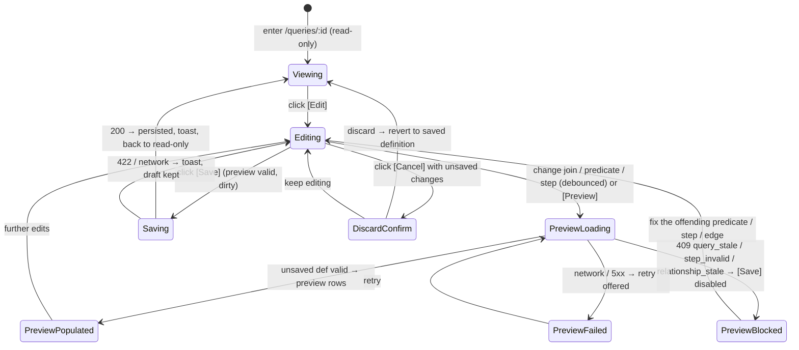

# Query Construction — the interactive builder: edit a Query's definition + preview before save

**Concept**: the **construction surface** is the editable builder for a [Query](queries.md): an
**Edit mode** of the query detail that lets a user edit a Query's definition — its
[join tree](queries.md#joins-reading-related-datasets-as-one), its **predicates** over the combined
column space, and its ordered **transform steps** — and **preview** the resulting rows **before
saving**. It is **not a new noun and not a new engine**: it edits the
[`QueryDefinition`](queries.md#data-model) the spine owns and runs the spine's engines through a
stateless preview. This doc owns the **builder UX** — layout, the edit lifecycle, the live preview,
the steps editor and the in-builder validation — while the model, routes, and engine live in the
[queries.md spine](queries.md).

**Status**: Accepted.
**Sibling docs**:
[queries.md](queries.md) (the domain spine — the `QueryDefinition` model, the step union, all routes

- error codes, the engines + the `query_stale` / `step_invalid` / `relationship_stale` gates this
  builder edits against, and the
  [reuse invariant](queries.md#the-reuse-invariant-the-one-rule-this-domain-holds) this obeys),
  [canvas.md](canvas.md) (the Canvas tab — a second editor over this same working copy),
  [dataset-filters.md](../datasets/dataset-filters.md) +
  [advanced-query.md](../datasets/advanced-query.md) (the chip + advanced-DNF predicate **editors**
  reused verbatim — bound to the Query's effective columns),
  [dataset-detail.md](../datasets/dataset-detail.md) (owns `<PagedRowsView>`, reused for the live
  preview),
  [relationships.md](../workspaces/relationships.md) (the governed edges a join copies, and the
  self-check behind the join-multiplication warning),
  [crud-hygiene.md](../_shared/crud-hygiene.md) (the discard-changes confirm pattern),
  [workflows.md](../workflows/workflows.md) (reuses `StepsEditor` in the workflow builder),
  [workspace-shell.target.md](../../_platform/workspace-shell.target.md) (the chrome all surfaces
  render inside).

---

## Why a mode, not a noun

Building a Query introduces **no new readable-table-source kind** and **no new engine** — it edits
the `QueryDefinition` the spine seals and runs the spine's engines through a stateless preview. So
construction is an **Edit mode** of the existing detail rather than a `/builder` page or a
`QueryBuilder` noun. What is genuinely this doc's: the **edit + preview UX**. The reuse invariant
binds it: the builder **composes** the predicate editors, the relationship `<Select>`s, and
`<PagedRowsView>`; it re-implements no predicate engine, join engine, step engine, or detail page.

---

## What the builder edits (reused vs new)

| Reused verbatim                                                                                                       | New (the edit + preview UX only)                                                            |
| --------------------------------------------------------------------------------------------------------------------- | ------------------------------------------------------------------------------------------- |
| The `QueryDefinition` (`q` / `filters` / `advanced` / `relationships` / `joins` / `steps`) — **edited, not extended** | An **Edit mode** on `/queries/:id` (there is no create mode)                                |
| The chip-filter + advanced-DNF **editors** + their serializers/validators                                             | Those editors **bound to the effective columns** (the combined `joins`-tree space)          |
| The governed-relationship `<Select>`s + per-hop join-type `<Select>`                                                  | The **`JoinEditor`** that mutates the `joins` tree (add/remove hops, per-hop type) in place |
| The step union + the backend `_step_plan` rules                                                                       | The **`StepsEditor`** (ordered cards, client-side column threading in `steps.ts`)           |
| The read engines; the `409 query_stale` / `step_invalid` / `relationship_stale` gates                                 | A **stateless preview** of the **unsaved** definition (`POST …/queries/preview`)            |
| `<PagedRowsView>`, the `RowsPage` shape, `SaveQueryModal`, `useCreateQueryMutation`, the discard-confirm pattern      | A **dirty / Save / discard** lifecycle on the detail                                        |

**No new model. No new engine. No new route beyond the spine's `preview` + `update`.**

---

## Surfaces — layer / reuse / purity declaration

| Surface                                                                                                          | Layer                                                | Reusability         | Purity   | Allowed peer deps                  |
| ---------------------------------------------------------------------------------------------------------------- | ---------------------------------------------------- | ------------------- | -------- | ---------------------------------- |
| `QueryDetailPage` (Edit toggle; header `[Cancel] [Save]`)                                                        | `apps/builder/src/features/data-management/queries`  | feature             | feature  | react, antd, @tanstack/react-query |
| `QueryBuilderPanel` (presentational: `Form` / `Canvas` tabs; Form = Build · Transform · Preview sections)        | `apps/builder/src/features/data-management/queries`  | feature             | feature  | react, antd                        |
| `useQueryBuilder` (working copy + debounced preview + Save lifecycle; edit mode only)                            | `apps/builder/src/features/data-management/queries`  | feature             | glue     | @tanstack/react-query, antd        |
| `JoinEditor` (fixed base + join-tree editor: ≤1-hop single edit; hop rows + add/remove for ≥2)                   | `apps/builder/src/features/data-management/queries`  | feature             | feature  | react, antd                        |
| `StepsEditor` (ordered step cards, `[Add step ▾]` groups; reused by the workflow builder)                        | `apps/builder/src/features/data-management/queries`  | feature             | feature  | react, antd                        |
| `steps.ts` (`threadColumns` / `blankStep` / `STEP_MENU` / `grainAt` / card-state helpers — mirrors `_step_plan`) | `apps/builder/src/features/data-management/queries`  | feature             | pure     | none                               |
| `JoinWithRelatedModal` (minimal join-create entry from a dataset, with the multiplication warning)               | `apps/builder/src/features/data-management/queries`  | feature             | feature  | react, antd, @tanstack/react-query |
| `SaveQueryModal` (reused — name capture for Save-as-Query + Duplicate)                                           | `apps/builder/src/features/data-management/queries`  | feature             | feature  | react, antd                        |
| chip-filter + advanced-DNF editors (reused, not owned)                                                           | `apps/builder/src/features/data-management/datasets` | feature             | feature  | react, antd                        |
| `<PagedRowsView>` (reused; preview body + per-column filter headers)                                             | `apps/builder/src/features/data-management/_shared`  | shared cross-domain | plain-UI | react, antd, react-i18next         |

**Boundary check**: the only shared-cross-domain row (`<PagedRowsView>`) is **reused, not owned**
([dataset-detail.md](../datasets/dataset-detail.md)). The predicate editors are **reused by
reference** from the datasets feature. `steps.ts` mirrors the backend planner so a card offers only
the columns that exist at its position; the backend re-validates on preview/save and stays the
source of truth. No builder surface re-implements a dataset/query page or an engine.

---

## Token map

The builder surfaces are AntD primitives (`<Select>`, `<Button>`, `<Tag>`, `<Alert>`, `<Tabs>`,
`<Radio.Group>`, `<Table>` via `<PagedRowsView>`, the reused chip/advanced editors) styled by the
`<ConfigProvider>` tokens derived from the six seeds in
[`themeTokens.ts`](../../../../workspace/packages/ui/src/themeTokens.ts) (the source of truth).
**No new token is introduced**; the map reuses identifiers already cited by
[queries.md](queries.md). `Value` is informational.

| Surface                                        | AntD token (themeTokens.ts) | Value (informational) |
| ---------------------------------------------- | --------------------------- | --------------------- |
| Page background                                | `colorBgLayout`             | `#f5f5f5`             |
| Builder panel card background                  | `colorBgBase`               | derived               |
| `[Edit]` / `[Save]` / primary action           | `colorPrimary`              | `#1677ff`             |
| Editable join / predicate `<Tag>` text         | `colorTextSecondary`        | derived               |
| Step-card grain line + advisory lines          | `colorTextSecondary`        | derived               |
| Builder section / table border                 | `colorBorderSecondary`      | `#f0f0f0`             |
| Step-card border                               | `colorBorderSecondary`      | `#f0f0f0`             |
| Dirty-state / multiplication warning           | `colorWarning`              | `#faad14`             |
| Invalid predicate / unavailable-edge `<Alert>` | `colorError`                | `#ff4d4f`             |
| Border radius (card, table, tag, button)       | `borderRadius`              | `6`                   |
| Font family                                    | `fontFamily`                | system stack          |

Identifier parity is enforced by
[`design-token-parity.mjs`](../../../../scripts/lint/design-token-parity.mjs).

---

## Layout — ASCII intent

The builder is an **Edit mode** of the query detail — the same standard detail shell (`PageHeader`

- `PageCard`). `[Edit]` (page header) swaps the actions to `[Cancel] [Save]` and reveals the
  builder: two top-level **tabs** over one working copy — **`Form`** (the default and the
  keyboard/screen-reader-complete editor) and **`Canvas`** ([canvas.md](canvas.md)). The Form tab
  holds three independently collapsible sections — **Build** (base + joins + predicates),
  **Transform** (the steps) and **Preview** (the live rows); all open by default.

The preview renders `<PagedRowsView scrollMode="flow">` — a **peek**: the table flows (no inner
scroll), the page scrolls, and the pager sits at the natural end. This is the deliberate opposite
of the **view tables** (dataset detail / query view), which use `scrollMode="contained"` +
`PageContainer fill="bounded"` for a fixed header and a viewport-pinned pager — see
[dataset-detail.md](../datasets/dataset-detail.md).

### View mode (read-only)

```text
Home ▸ Data Management ▸ Queries ▸ Deals × Accounts     [Edit] [Duplicate] [Delete]
Deals × Accounts                                  🔎 Query · live re-run · join
  ┌─ Join (read-only) ─────────────────────────────────────────────────────────┐
  │  Deals  ⋈ inner ⋈  Accounts      on  account_id ↔ id      many:many          │
  └────────────────────────────────────────────────────────────────────────────┘
  ┌─ Applied predicates (read-only) ───────────────────────────────────────────┐
  │  Deals.stage = won     Accounts.region = APAC                               │
  └────────────────────────────────────────────────────────────────────────────┘
  Matched 1,204 rows   <the shared <PagedRowsView> — saved definition's rows>
```

### Edit mode (the builder, Form tab)

```text
Home ▸ Data Management ▸ Queries ▸ Deals × Accounts × Owners        [Cancel] [Save]
Deals × Accounts × Owners                          🔎 Query · editing (unsaved)
[ Form ] ( Canvas )

  ▾ Build
  ┌─ Source ─────────────────────────────────────────────────────────────────────┐
  │  Build on:  [ Deals                                       ▾ ]  (disabled)     │  ← fixed at create
  └───────────────────────────────────────────────────────────────────────────────┘
  ┌─ Joins ──────────────────────────────────────────────────────────────────────┐
  │  Deals  ⋈ [inner ▾]  [ Deals.account_id ↔ Accounts.id  (many:many)     ▾ ]    │
  │  Accounts ⋈ [left ▾] [ Accounts.owner_id ↔ Owners.id  (many:1) ▾ ]  [Remove] │  ← leaf
  │  [ + Add a join ]   Join from: [ Owners ▾ ]   (shown when 2+ sources can branch)│
  └───────────────────────────────────────────────────────────────────────────────┘
  Deals.stage = won  ×    Owners.region = APAC  ×            ← active-filter chips
  Advanced query  [ stage:won AND amount:>1000 ]      Search [ Match any cell… ]

  ▾ Transform                                         ← the steps editor (below)

  ▾ Preview · 1,204 rows   ⟳        [ Preview ]
  ┌────────────────────────────────────────────────────────────────────────┐
  │  Deals.id ⏷  Deals.stage ⏷ … Owners.region ⏷       ← per-col filter funnels │
  │  <the shared <PagedRowsView> — preview of the UNSAVED definition; combined │
  │   columns, duplicate names qualified; items-per-page 10 / 25 / 50 / 100>  │
  └────────────────────────────────────────────────────────────────────────┘
```

The preview re-runs the unsaved copy **debounced** (`[Preview]` flushes it). The **base source is
fixed** after create (`PUT` is definition-only), so its `<Select>` renders disabled — a flat list of
datasets. The `JoinEditor` renders a single-edge affordance for ≤1 hop and hop rows with a
`Join from` `<Select>` + per-hop type + add / leaf-remove for ≥2. When the query has steps the
preview table shows the **post-step** result columns, and the per-column source-filter funnels do
not apply to them.

**Join option labels qualify both sides** — every relationship option and hop label reads
**`<Dataset>.<column> ↔ <Dataset>.<column>`** (`Deals.account_id ↔ Accounts.id`), then the
cardinality. Both sides, because the single-edge `<Select>` has no left prefix and the `Join from`
picker renders only when 2+ sources can branch — so in the common case a one-sided label would hide
the actual decision, _join to what?_. The canvas free-form modal uses the same rule. `optionLabel`
serves both shapes (a governed `Relationship` in the pickers, a query-owned one on the hop row); each
option carries a `title` with the full label, so the visible text may ellipsize in a narrow
`<Select>` while the whole label stays reachable on hover.

**The self-join boundary.** The same dataset may not appear twice in one Query (a locked boundary —
[`_noun-model.md`](../_noun-model.md)). The form `JoinEditor` complies by construction:
`addEligibleRels(rels, graphDatasets)` offers only edges whose right side is not yet in the graph,
so the gesture is absent. The canvas's free-form draw is node-level and can still produce a
`cyclic_join` that fails at preview/save — tracked as noun-model **D4**.

### Join with related (from a dataset)

`JoinWithRelatedModal`, opened from dataset detail, is the minimal create path for a joined query:
pick a governed relationship from this dataset, name the query, `POST`. Before saving it reads the
relationship's self-check (`useRelationshipCheckQuery`) and, when the hop **will multiply rows**
(the right dataset has more than one row per key), shows a warning `<Alert>` naming both datasets,
the observed max rows per key and the observed vs declared cardinality (_"Joining from A to B can
multiply rows: a key has up to N rows on B"_). The direction is always left → right, because the
saved query starts from the relationship's **left** dataset whichever side the modal was opened
from (R191). The engine has no row-explosion guard, so the warning lives at the gesture. It is
advisory; Save stays enabled.

### Transform — the ordered operations editor (`StepsEditor`)

A **`▾ Transform`** section (`steps.section` — VN **Biến đổi**) holds `definition.steps` — the
**ordered** operations applied after the source/join/filter resolve
([queries.md § Transform steps](queries.md#transform-steps-workflows--r120r141)). Each step is a
card: `{n}. {label}` + `[↑] [↓] [🗑]` + a per-kind body. The column space is threaded client-side by
`threadColumns` (`steps.ts`), so **each card's pickers offer exactly the columns that exist at that
position**.

```text
  ▾ Transform
  ┌─ 1. Group & aggregate ──────────────────────────── [↑] [↓] [🗑] ┐
  │  Group by [ agent × ] [ team × ]   Measure [ Count rows ▾ ]      │
  └──────────────────────────────────────────────────────────────────┘
  ┌─ 2. Group value ────────────────────────────────── [↑] [↓] [🗑] ┐
  │  Measure      Within each        New column name                 │
  │  [ Average of ▾ ] [ rate ▾ ]   [ team × ]   [ team_rate      ]   │
  │  ⓘ Each row here is one agent × team. This averages agents —     │
  │     not the rows underneath them.                                │
  └──────────────────────────────────────────────────────────────────┘
  ┌─ 3. Clean text ─────────────────────────────────── [↑] [↓] [🗑] ┐
  │  New column name    Function             of                      │
  │  [ agent_clean ]    [ Trim spaces ▾ ]    [ agent ▾ ]             │
  │  Removes spaces at both ends (incl. non-breaking), so "Ly" and   │
  │  "Ly " count as one. A cell of only spaces becomes blank. The    │
  │  original column is kept.                                        │
  └──────────────────────────────────────────────────────────────────┘
  [ Add step ▾ ]
```

**Labels, not sentence chrome.** Every control carries a **visible `FieldLabel` above** it (the AntD
Data-Entry label-above convention), not an inline reading sentence — e.g. the shared
`steps.measure` **Measure** / VN **Giá trị đo**, `steps.withinEach` **Within each** / VN **Trong
từng nhóm**, `steps.newColumn` **New column name** / VN **Tên cột mới**. A card still _reads_ as a
sentence left-to-right; the labels make it navigable and screen-reader-addressable.

**`[Add step ▾]` is grouped**, because a flat sixteen-entry list is a scan, not a choice. Three AntD
`<OptGroup>`s with **text** headings (`STEP_MENU` in `steps.ts`):

| Group | EN                   | VN                    | contains (in order)                                                                                                                                                                                 |
| ----- | -------------------- | --------------------- | --------------------------------------------------------------------------------------------------------------------------------------------------------------------------------------------------- |
| 1     | **Summarise**        | **Tổng hợp**          | Group & aggregate                                                                                                                                                                                   |
| 2     | **Add a column**     | **Thêm cột**          | Group value · Share of total · Running total · Rank in group · Previous period's value · Computed column · Conditional column (IF) · Clean text · Date bucket · Part of a date · Time between dates |
| 3     | **Shape the result** | **Định hình kết quả** | Filter result · Top N · Sort · Select columns                                                                                                                                                       |

Group 2 leads with the within-group / ordered ops because they are what a user comes looking for;
the mechanical members of the "append a column" family follow.

**Card labels** (EN / VN): `aggregate` **Group & aggregate** / Nhóm & tổng hợp · `derive` **Computed
column** / Cột tính toán · `case` **Conditional column (IF)** / Cột điều kiện (IF) · `compute`
**Clean text** / Làm sạch chữ · `date_bucket` **Date bucket** / Gom theo thời gian · `date_part`
**Part of a date** / Lấy một phần của ngày · `date_diff` **Time between dates** / Khoảng cách giữa
hai ngày · `group_column` **Group value** / Giá trị theo nhóm · `filter` **Filter result** / Lọc kết
quả · `top_n` **Top N** · `sort` **Sort** / Sắp xếp · `select` **Select columns** / Chọn cột. The
`window_column` cards are titled by their **op** (below) — the user never meets the kind name.

**The simpler append cards:**

- **Clean text** (`compute`) — `New column name` · `Function` (`Trim spaces` / VN _Bỏ khoảng trắng
  thừa_ — the only catalog entry) · `of` (only **string** columns are offered). A secondary line
  under the card explains the function in the user's words. A new card defaults to the first string
  column and names the output `<col>_clean`.
- **Computed column** (`derive`) — the second operand is a labelled two-button radio group
  (`Radio.Group optionType="button" buttonStyle="solid"`, under `Second value`): by-column or
  by-number. Boxing both halves makes the control read as a switch from either state (on a white
  card, `Segmented`'s selected thumb is the half that disappears). A fresh card defaults to
  column − column when a second numeric column exists.
- **Conditional column (IF)** (`case`) — condition rows `When … then …` (each `When` is a
  `PredicateList`), `[Add a condition row]`, and `Otherwise`; each value is a literal, a column, or
  blank. A text/number mix shows the inline `caseMismatch` hint.
- **Date bucket / Part of a date / Time between dates** — date/datetime pickers only; `Part of a
date` offers `year · quarter · month · ISO week · day of month · day of week (Mon=1)`; `Time
between dates` reads `Count [unit] from [start] to [end]`.

#### The within-group column

The step kind is **`group_column`** on the wire; the user never sees that word, nor "window
function", nor "partition".

|              | EN                                                   | VN                                                           |
| ------------ | ---------------------------------------------------- | ------------------------------------------------------------ |
| Kind label   | **Group value**                                      | **Giá trị theo nhóm**                                        |
| The sentence | `[Average of ▾] [rate ▾]` **within each** `[team ×]` | `[Trung bình của ▾] [rate ▾]` **trong từng nhóm** `[team ×]` |
| New column   | _New column name_ (reused `steps.newColumn`)         | _Tên cột mới_                                                |

- **The agg picker reuses the measure vocabulary verbatim** — `sumOf` / `avgOf` / `minOf` / `maxOf`
  / `countDistinct` / `countRows`, the same labels the `aggregate` card uses, with the same
  dtype-gated column options (`isNumericCol` / `isOrderableCol`). **"Group & aggregate" collapses
  the rows; "Group value" keeps them.**
- **`within each`** is a multi-`<Select>` over the columns at this step. **Empty renders the explicit
  "Across everything" / VN "Trên toàn bộ" state** (the whole table) — a named state a screen reader
  can announce, never a silent global window.
- **Output** appends one column; the row count is visibly unchanged in the preview.

#### How the surface answers "pooled or per-member?" — without asking

The two readings of _"the team's average"_ (all the underlying rows pooled, vs the average of the
already-grouped values) differ by **where the step sits**, not by a parameter — so there is **no
`basis` field**: a parameter would give two ways to say one thing.

What makes the choice legible instead is a **grain line** on every within-group and ordered-window
card — one sentence naming _what one row means at this position_, derived from the step list alone
(`grainAt` / `narrowedBy` in `steps.ts`; no data, no wire field):

- If a collapsing `aggregate` precedes this step, one row is one of its `dimensions`: **"Each row
  here is one `agent × team`. This averages agents — not the rows underneath them."** (VN: _"Mỗi
  dòng ở đây là một `agent × team`. Phép này lấy trung bình theo agent — không phải các dòng bên
  dưới."_)
- If none does, one row is one source row: **"Each row here is one row of your source data."** (VN:
  _"Mỗi dòng ở đây là một dòng dữ liệu gốc."_)
- **Row-narrowing steps above the card are named too** (`filter`, `top_n`, by the columns they
  narrow on): **"… Rows were already filtered by `status`, so this covers only those rows."** (VN:
  _"… Các dòng đã được lọc theo `status`, nên phép này chỉ tính trên những dòng đó."_) — because a
  filter above a within-group column silently collapses its denominator (a rate of 100.0% looks
  plausible).

Moving a card with `[↑]`/`[↓]` past an `aggregate` or a `filter` **rewrites the grain line**, so the
readings are one keystroke apart and each is named in business words at the moment of choosing. The
column pickers reinforce it: before the aggregate only raw columns are offered, after it only the
grouped ones. No clause is added about ordering — the ordered cards already show an **In order of**
control.

#### Card states (declared so the build carries them, not infers them)

The reorder gesture is the affordance, so **its failure mode is part of the affordance.** The states
are computed by `groupColumnIssues()` / `windowColumnIssues()` in `steps.ts` from the threaded
column space; each mirrors a server guard rather than inventing a second vocabulary.

| State                   | When                                                                                      | What the card shows                                                                                                                                                                                                                                                          |
| ----------------------- | ----------------------------------------------------------------------------------------- | ---------------------------------------------------------------------------------------------------------------------------------------------------------------------------------------------------------------------------------------------------------------------------- |
| **Normal**              | every reference resolves at this position                                                 | the fields + the grain line                                                                                                                                                                                                                                                  |
| **Orphaned by a move**  | `[↑]` past an `aggregate` leaves `col` / `In order of` / a group column non-existent here | the move still happens (never trap the user mid-thought); the card renders `<Alert role="alert">` naming the column(s) — _"`rate, team` doesn't exist this early. Move this card back down, or pick a column that does."_ — and **`[Save]` is disabled** (the preview fails) |
| **Nothing to offer**    | no column at this position satisfies the chosen agg's dtype rule                          | the column `<Select>` is disabled with a guiding tooltip naming why (`noEligibleColumn`)                                                                                                                                                                                     |
| **Name collision**      | `name` already exists at this position (`column_exists`)                                  | inline field error on the name `<Input>`, tied via `aria-invalid` + `aria-errormessage` — never a page-level alert                                                                                                                                                           |
| **Repeat group column** | the same column twice in `within each` (`duplicate_group_column`)                         | unreachable by construction — the multi-`<Select>` cannot repeat a value; the backend check stays as the wire-level backstop                                                                                                                                                 |

**Why the card-level alert earns its place:** the **preview** answers any bad step with one code,
`409 step_invalid` (the page-level _"A step can't run on the columns available where it sits — see
the highlighted card above."_); only the **save** path returns the precise `422` reason
(`column_exists: 'agent' is already a column`). Without the card state a user who reorders into an
invalid position would never be told _which_ column moved out of reach.

### The ordered-window family — share · running total · rank · previous period

The wire kind is **`window_column`** with an **`op`** discriminator. **The user never picks the
kind.** `[Add step ▾]` lists **four entries**, one per op, each a business phrase; the card's title
is that op's label, and a `[What ▾]` picker on the card switches between them — so a user looking
for _"running total"_ finds those words, not a category that contains them.

```text
  ▾ Transform
  ┌─ 3. Previous period's value ────────────────────── [↑] [↓] [🗑] ┐
  │  What            Value      In order of      per                │
  │  [ Previous ▾ ]  [ calls ▾ ] [ month ▾ ]    [ Month ▾ ]         │
  │  Within each              New column name                       │
  │  [ agent × ]              [ prev_calls              ]           │
  │  ⓘ Each row here is one agent × month. Rows were already        │
  │     filtered by status, so this covers only those rows.         │
  └──────────────────────────────────────────────────────────────────┘
```

| op              | EN                          | VN                      | fields shown                                                              |
| --------------- | --------------------------- | ----------------------- | ------------------------------------------------------------------------- |
| `pct_of_total`  | **Share of total**          | **Tỷ trọng**            | Value · Within each · New column name                                     |
| `running_total` | **Running total**           | **Lũy kế**              | Value · In order of · Within each · New column name                       |
| `rank`          | **Rank in group**           | **Xếp hạng trong nhóm** | In order of · Within each · New column name                               |
| `prior_period`  | **Previous period's value** | **Giá trị kỳ trước**    | Value · In order of (a date column) · per · Within each · New column name |

Field labels: **In order of** / VN **Theo thứ tự**; **Across everything** / VN **Trên toàn bộ** for
the empty-group state; the **per** control reuses `date_bucket`'s `granularity_*` labels verbatim —
one period vocabulary, two steps.

- **Share of total emits a ratio (0..1), so it is not called "% of total".** Percent _formatting_ is
  presentation and belongs to the widget; a control labelled "% of total" that produced `0.19` would
  ship a name that lies about its contents.
- **Previous period walks the calendar, not the rows** — on a Jan / Feb / **Apr** axis, April reads
  **blank**, the correct answer to "what was the previous month" when there was none, and the only
  reading that cannot put a confident wrong number on a dashboard.
- **It emits the previous period's value — not the delta.** The comparison is one `derive` away, so
  the `prior_period` card carries **one advisory line under the grain line** (`colorTextSecondary`,
  ⓘ + text, `role="status"`, **not** an `<Alert>` — nothing is wrong): _"This column holds last
  month's `calls`. To compare, add a **Computed column**: `calls − prev_calls`."_ (VN _"Cột này chứa
  `calls` của tháng trước. Để so sánh, hãy thêm **Cột tính toán**: `calls − prev_calls`."_). It names
  the next step in the menu's own words with the real column names, never blocks Save, never
  auto-inserts the step, and stops asking once a later `derive` already consumes the column
  (`consumedByDerive`).
- **Rank offers exactly one ranking** — ties share a rank and the next rank skips; consecutive
  numbering is refused on correctness grounds (queries.md).
- **Default names describe the operation** — `<col>_share`, `<col>_running`, `rank`, `prev_<col>` —
  a default that already carries a claim, not a rule; no name validator.
- **Offer-nothing at the gesture** (noun-model **D4**): an op the columns at this position cannot
  satisfy is **disabled in `[Add step ▾]` and in `[What ▾]`, with a tooltip naming why**
  (`windowOpAvailable`) — never an error at run. `prior_period` needs a date/datetime column (its
  producer is `date_bucket`); `pct_of_total` / `running_total` need a numeric one; `rank` accepts
  any.

#### Card states — the ordered family

| State                             | When                                                                                      | What the card shows                                                                                                                                           |
| --------------------------------- | ----------------------------------------------------------------------------------------- | ------------------------------------------------------------------------------------------------------------------------------------------------------------- |
| **Normal**                        | every reference resolves at this position                                                 | the fields + the grain line                                                                                                                                   |
| **Orphaned by a move**            | `[↑]` past an `aggregate` leaves `col` / `In order of` / a group column non-existent here | the same `<Alert role="alert">` as the "Group value" card; `[Save]` disabled                                                                                  |
| **Name collision**                | `name` already exists here (`column_exists`)                                              | inline field error on the name `<Input>` (`aria-invalid` + `aria-errormessage`)                                                                               |
| **No date axis**                  | `prior_period` where no `date`/`datetime` column exists                                   | the op is **unofferable** (disabled + tooltip), so there is no error state to render                                                                          |
| **No previous period**            | the row's previous period has no rows                                                     | the cell reads **blank** — the correct answer, not an error                                                                                                   |
| **Gaps exist in the period axis** | at least one row has no previous period                                                   | the advisory line gains a clause: _"3 rows have no previous `month` — those cells are blank."_ / VN _"3 dòng không có `month` trước đó — các ô đó để trống."_ |

**Why the gap state earns a row — blank means two things.** _"There was no previous period"_ and
_"the previous value was itself empty"_ render identically. Rather than mark the cell (presentation
inside a compute step, and a per-cell wire signal the response does not carry), the **card counts
them** (`nullCountOf`) from the preview it already holds — saying whether the count covers the
whole result or only the current page. A distinct in-cell rendering for the two cases is a
`<PagedRowsView>`-level concern for every nullable column, not this step's to invent.

### Predicate rows: a value list or another column

Every `PredicateList` row (the `filter` card and each `case` `When`) offers **`in` / `not_in`** on
every dtype except boolean; the operand becomes a **tag select** (type a value and press Enter, or
paste a comma-separated list; numbers are coerced as a single operand is). The comparison operators
(`equals` … `lte`, `before` / `after`) carry an operand-kind switch, **Compare with `[ Value |
Column ]`**; Column mode replaces the text input with a picker offering only the columns of a
compatible dtype **at that position**. The backend re-validates both.

```text
  WHERE [ TRẠNG THÁI CUỘC GỌI ▾ ] [ in ▾ ] [ Chưa kết nối được × ][ Quan tâm × ][ … ]
  AND   [ Ngày hết hạn ▾ ]        [ gte ▾ ] [ Column ▾ ] [ Ngày hiệu lực ▾ ]
```

### Invalid-edit / preview-blocked states (flag-don't-crash)

```text
  ⓧ  This predicate references "amount", which isn't in the joined columns.
     Remove it or pick a current column.                         (predicate invalid / query_stale)

  ⚠  This join is unavailable — "account_id" no longer exists in Deals.
     Pick a different relationship, or remove the join.          (relationship_stale)

  ⓧ  A step can't run on the columns available where it sits —
     see the highlighted card above.                             (step_invalid)
```

`[Save]` is **disabled** while any predicate is invalid, an edge is stale, a step is invalid, or the
preview has not yet reflected the current draft — you save what you previewed, so a user can't save
a definition that wouldn't run.

**A failed preview is its own state, and it is not about the query.** An unreachable backend
produces the same symptoms as a rejected step — no rows, `Save` off — so the panel carries its own
sentence (_"Couldn't reach the server, so there is nothing to preview. Your query is unchanged —
this isn't a problem with it."_) and, alone among these states, a **retry**: re-asking is the next
action here and useless for the others, where the query itself needs the edit.

**A failed Save keeps the work.** `Save` is a mutation; on error it toasts _"Couldn't save — your
changes are still here, and nothing was written. Check the server and press Save again."_ and
**stays in edit mode with the draft intact**, so retrying is one click — a save that never landed
must not close edit mode and let the user navigate away believing the work is stored. (The detail
page's delete and Duplicate mutations have no error branch; both are recoverable by observation —
[queries.md § Behaviour](queries.md).)

---

## Behaviour — states



- **Enter Edit** — `[Edit]` flips the read-only summaries into the `JoinEditor`, the reused predicate
  editors and the `StepsEditor`, seeded from the **saved** definition; the row body switches to a
  **preview** of the working copy.
- **Edit the joins** — the base is fixed; `JoinEditor` adds a hop from any in-graph dataset
  (`Join from` `<Select>` when 2+ can branch), removes any leaf, and sets each hop's type. **Adding a
  hop is copy-on-pick**: picking a governed relationship copies its current join fields into the
  working copy as a query-owned `QueryRelationship` (with an `originRelationshipId` back-ref) and the
  new `JoinStep` references it by `queryRelId` (see
  [queries.md § Joins](queries.md#joins-reading-related-datasets-as-one)). Editing the tree recomputes
  the effective columns, so the predicate editors re-bind; a predicate over a now-absent column flags
  invalid **in the builder** (`invalidAtomCount`).
- **Edit predicates** — the chip + advanced editors operate over the effective columns
  (collision-qualified when joined), reusing the serializers/validators verbatim.
- **Edit steps** — cards author against the **pre-step** `baseColumns` the preview reports, threaded
  forward by `threadColumns`; the preview table shows the post-step `resolvedColumns`.
- **Live preview** — the working copy runs through the stateless
  `POST /workspaces/{id}/queries/preview` (auto-run on change, **debounced 300 ms**; `[Preview]`
  flushes it), persisting nothing. Preview is paged (`10 / 25 / 50 / 100`).
- **Save** — persists the working copy via `PUT /queries/{id}` (**definition only** — name + source
  unchanged, so no `name_taken`); the server re-validates (a bad atom / edge / step → `422`).
  Success returns to Viewing.
- **Discard** — `[Cancel]` with unsaved changes confirms (the
  [crud-hygiene](../_shared/crud-hygiene.md) pattern), then reverts to the saved definition — no
  partial writes.

There is **no create mode**: a new Query comes from a dataset ("Save filters as Query", or "Join with
related") or from **Duplicate** ([queries.md § Duplicate](queries.md#duplicate-make-a-variant-without-rebuilding-it)),
each of which has a complete definition the moment it exists; `[Edit]` then reaches the builder
through the ordinary edit path. `useQueryBuilder` is therefore edit-only.

---

## Accessibility (declared so the build carries it, not infers it)

- `[Edit]` / `[Save]` / `[Cancel]` / `[Duplicate]` are keyboard-reachable with **visible text
  labels**; the editing state is announced (`role="status"`). `[Duplicate]` opens the name modal,
  which takes focus on its **name field** with the default `{{name}} (copy)` **selected**.
- The `[Form] [Canvas]` `<Tabs>` are a real tablist; the **Form tab is the keyboard/screen-reader
  complete editor** and the default ([canvas.md](canvas.md)).
- The **base `<Select>`** and **`JoinEditor` `<Select>`s** (relationship, `Join from`, per-hop type)
  carry visible labels (label-above); options name the edge / source / type in **text**
  (`Deals.account_id ↔ Accounts.id`, `inner`), never colour/glyph alone. The base picker is a
  **flat** list of datasets — a group of one would be chrome, not structure. A disabled non-leaf
  `[Remove]` keeps its label and exposes its reason via tooltip (`aria-disabled`).
- The **predicate editors** inherit the chip/advanced accessibility; column options read as **text**
  (`Deals.id` / `Accounts.id`) so duplicate names stay unique.
- The **live-preview status** ("Preview · N rows", loading, updated) is a `role="status"` live
  region; the invalid-predicate, stale-edge, step-invalid and preview-failed blocks are
  `role="alert"` whose reason is **text**; `[Save]`-disabled has an accessible reason.
- The **step cards**: each card is a labelled group (`{n}. {label}`); the icon-only reorder/remove
  buttons carry `aria-label`s (`steps.up` / `steps.down` / `steps.remove`). Every step control has a
  **visible `FieldLabel`** and an accessible name; no control relies on reading-sentence order.
- The **grain line is a live region** (`role="status"`, `aria-live="polite"`), so moving a card past
  an `aggregate` or a `filter` is announced, not discovered in the result. Icon + text, advisory,
  **not** an `<Alert>`. The `prior_period` advisory line shares that contract.
- The **ordered-window cards**: every control carries a visible `FieldLabel` (**What** / **Value** /
  **In order of** / **per** / **Within each** / **New column name**); the empty-group state renders
  the **text** "Across everything" (also on the "Group value" card); an unofferable op is
  `aria-disabled` with its reason in a tooltip.
- The **`[Add step ▾]` groups** are AntD `<OptGroup>`s with **text** headings, so membership is
  announced, never conveyed by indentation or colour.
- The **orphaned-by-a-move** state is `<Alert role="alert">` naming the offending column in text.
- The **name-capture modal** reuses `SaveQueryModal`'s semantics: labelled `<Input>`, autofocus, an
  accessible `name_taken` error tied to the field.

---

## Acceptance criteria

1. **Edit mode is a mode, not a page** — `[Edit]` on `/queries/:id` reveals the builder in place;
   there is **no** `/builder` route, **no** create route and **no** copy-pasted detail page.
2. **The join tree is editable in place; the base is fixed** — the base `<Select>` shows the driving
   dataset disabled; `JoinEditor` adds a hop from any in-graph dataset, removes any leaf, and sets
   each hop's type; editing re-binds the predicate columns; a source with no eligible edge disables
   the add control with a guiding tooltip; a self-join is never offered.
3. **Predicates compose over the effective space** — the reused chip + advanced editors bind to the
   effective columns when joined (collision-qualified) and to the single dataset's columns when not;
   `in`/`not_in` and the column operand are offered per the dtype rules.
4. **Live preview runs the unsaved definition** — editing updates the previewed rows via
   `POST …/queries/preview` **without** persisting; paged; reuses `<PagedRowsView>`.
5. **Invalid edits block save, flag-don't-crash** — a predicate over an absent column, a stale edge,
   or an unrunnable step renders its in-builder state and **disables `[Save]`**; the server `422`s a
   bad definition on save — never a saved-but-unrunnable query.
6. **Save mutates the existing Query and survives failure** — `[Save]` persists via `PUT
/queries/{id}` (definition-only); a failed save toasts and keeps the draft in edit mode.
7. **One create rhythm** — "Save filters as Query", "Join with related" and Duplicate all route
   through `useCreateQueryMutation` (the first and last through `SaveQueryModal`).
8. **The join warns before it multiplies** — "Join with related" shows the multiplication warning
   when the chosen relationship's self-check says the hop multiplies rows left → right (the saved
   query's direction, whichever dataset the modal was opened from) (R191).
9. **Steps author in business words** — `[Add step ▾]` lists the sixteen entries in three text
   groups; no control reads "window", "partition", "frame", "compute", or a wire kind; an op whose
   columns don't exist at this position is disabled with a reason.
10. **Clean text** — the "Clean text" card offers only string columns, defaults the output name to
    `<col>_clean`, and the preview shows a new column with edge spaces (incl. U+00A0) removed and the
    source column unchanged.
11. **The within-group column reads by placement** — the "Group value" card's grain line names what
    one row means and **changes** when the card moves past a `Group & aggregate` or a `filter`; an
    empty `within each` reads "Across everything"; there is no `basis` control.
12. **"Previous period" is blank on a gap** — on a Jan / Feb / Apr axis April's previous-month column
    reads blank, and the card counts the gaps.
13. **Reuse, not duplication** — the builder composes the predicate editors, the relationship
    `<Select>`s, `StepsEditor` and `<PagedRowsView>`; it re-implements no engine or page.

---

## Scope boundary

### IN scope

- An **Edit mode** on `/queries/:id`: the `JoinEditor` (the full `joins` tree over a fixed base) + the
  reused chip/advanced predicate editors bound to the effective columns + the `StepsEditor`; a
  dirty / Save / discard lifecycle via `PUT /queries/{id}`.
- The **`▾ Transform` steps editor** (`StepsEditor` + `steps.ts` column threading): ordered cards
  with reorder/remove, every kind of the step union, the grain line with its filter clause, the card
  states, and the ordered-window family.
- **Live preview** of the unsaved definition + its blocked / failed states.
- The **"Join with related"** entry from dataset detail, with its multiplication warning.

### OUT of scope (deferred with named triggers)

- **Renaming a Query from the builder** → the builder edits the **definition** only; a separate
  rename affordance is its own pull.
- **Changing a Query's base dataset** → fixed at create (definition-only `PUT`); Duplicate + edit is
  the variant path.
- **Composite keys; cross-workspace joins; a null-matching predicate operator** → spine-level
  triggers ([queries.md § Scope boundary](queries.md#scope-boundary)). **Self-joins are a locked
  boundary**, not a deferral; canvas offer-nothing parity is D4.
- **More compute functions** → each joins the closed catalog when a round pulls it.
- **A larger preview** (maximize / a dedicated tab) → a separate concern.

### This concept explicitly does NOT cover

- The `QueryDefinition` model, the step semantics, the routes + error codes, and the engines —
  [queries.md](queries.md); this **edits + previews** them.
- The Canvas tab's rendering and gestures — [canvas.md](canvas.md).
- The predicate vocabulary internals — [dataset-filters.md](../datasets/dataset-filters.md) +
  [advanced-query.md](../datasets/advanced-query.md).
- The governed-edge model and its self-check — [relationships.md](../workspaces/relationships.md).

---

## Reference materials (read-only)

- [queries.md](queries.md) — the Query model, step union, routes, engines, and gates this builder
  edits + previews; the domain anchor + reuse invariant.
- [canvas.md](canvas.md) — the visual source-graph editor that re-presents this builder.
- [specious-model-lock-in](../../../memory/2026-06-13-specious-model-lock-in.md) — the noun-vs-mode /
  honest-split discipline this doc applies.
