# Workflows — the Workflow domain (noun · consolidation · materialize · surfaces)

**Concept**: a **Workflow** (`wf_…`) is a named, workspace-scoped noun that **consolidates what ≥1
saved query RETURNS** (and/or another workflow's output) via `UNION ALL BY NAME`, applies **its
own** transform `steps` — the same step union a query uses — over that union, and **materializes a
FROZEN typed output** on run. Unlike a [Query](../queries/queries.md) — which is a _live_ re-run and
stores only its definition — a Workflow **freezes** its result (a committed parquet + captured
schema), so it can be read back as a stable source; each run is **stamped** with what it read, so
the frozen output can say when its sources have moved since. It consolidates the recurring "many
exports → one table" pain the `queries ⇒ workflows` module exists for.

**Two shaping altitudes, one per noun.** Per-source shaping belongs to the **Query** and arrives
already applied — a source contributes the rows its own detail page shows. Post-union shaping
belongs to the **Workflow** and is the only shaping a Query cannot express, because a Query cannot
union. They stack; they do not compete.

This doc is the **domain anchor** of `workflows/` — the home for the Workflow **noun**, its **model
· routes**, the **consolidation + materialize + staleness** semantics, and its three **FE surfaces**
(catalog · builder · detail/Run). It reuses the query engine (`app/query_engine.py`) and the
query/dataset FE components rather than duplicating them.

**Status**: Accepted.

> **Read first — the domain noun-model.** [`../_noun-model.md`](../_noun-model.md) defines the five
> nouns and the boundaries between them. Its Workflow debt (**D3**) is closed: the noun stands, it
> is **not** a live/frozen toggle on a Query, and it exists for exactly two things a Query cannot
> express (§ The noun, settled). This doc is the **current-state** truth.

**Sibling docs**:
[queries.md](../queries/queries.md) (the source a Workflow consolidates; the resolver, the `Step`
union, the catalog + detail layout, and `PagedRowsView` this domain reuses),
[query-construction.md](../queries/query-construction.md) (the `StepsEditor` reused in the builder),
[\_paging-and-order.md](../_paging-and-order.md) (the row-order contract the materialized write
follows), [datasets.md](../datasets/datasets.md) (leaf table-source; the `dataVersion` a run stamps;
catalog conventions), [crud-hygiene.md](../_shared/crud-hygiene.md) (the delete-confirm modal),
[workspaces.md](../workspaces/workspaces.md) (the container a Workflow is scoped to).

---

## Surfaces — layer / reuse / purity declaration

| Surface                                                                              | Layer                                                  | Reusability  | Purity             | Allowed peer deps                                    |
| ------------------------------------------------------------------------------------ | ------------------------------------------------------ | ------------ | ------------------ | ---------------------------------------------------- |
| `WorkflowsPage` (catalog) route                                                      | `apps/builder/src/features/data-management/workflows/` | feature      | feature            | react, antd, @tanstack/react-query, react-router-dom |
| `WorkflowCreatePage` (builder) route                                                 | `.../features/data-management/workflows/`              | feature      | feature            | react, antd, react-router-dom                        |
| `WorkflowDetailPage` (detail + Run + run tag + stale alert + edit mode) route        | `.../features/data-management/workflows/`              | feature      | feature            | react, antd, react-router-dom                        |
| `WorkflowForm` component (name + sources + steps; shared by create + edit)           | `.../features/data-management/workflows/`              | feature      | plain-UI (glue)    | react, antd                                          |
| `WorkflowSourcePicker` component                                                     | `.../features/data-management/workflows/`              | feature      | plain-UI (glue)    | react, antd                                          |
| `sourceErrorText` (`sourceErrors.ts` — a save-time source refusal as one sentence)   | `.../features/data-management/workflows/`              | feature      | pure               | i18next (type only)                                  |
| `useWorkflows*` / `useSourceColumns` hooks                                           | `.../features/data-management/workflows/`              | feature      | glue (server-data) | @tanstack/react-query                                |
| `workflowsApi` client + `WorkflowSourceError`                                        | `apps/builder/src/api/`                                | builder-only | glue               | (fetch — no extra peer dep)                          |
| `Workflow` / `WorkflowDefinition` / `WorkflowRun` / `WorkflowStaleSource` types (FE) | `.../features/data-management/workflows/types.ts`      | feature      | data type          | none                                                 |
| `MetadataPanel` (reused; read-only metadata on the detail view)                      | `apps/builder/src/features/metadata`                   | feature      | feature            | react, antd, react-i18next                           |
| `POST/GET/PUT/DELETE /workflows…` + `/run` + `/rows`                                 | `apps/backend/app/routers/workflows.py`                | backend      | feature            | (FastAPI — backend native)                           |
| `build_consolidated_relation` / `_resolve_query_source` / `_resolve_workflow_leaf`   | `apps/backend/app/query_engine.py`                     | backend      | pure               | (DuckDB SQL)                                         |
| `stamp_sources` / `stale_sources` / `new_run_id` (run stamps)                        | `apps/backend/app/workflow_runs.py`                    | backend      | feature            | (sqlite3 — backend native)                           |
| `Workflow` SQLModel + `0003_workflows` / `0007_workflow_runs` migrations             | `apps/backend/app/db_models.py`                        | backend      | data type          | (SQLModel/Alembic)                                   |

**Boundary check**: no new `@mdd/ui` primitive — the catalog/detail reuse the
`PageContainer`/`PageCard`/`PageHeader` shells + `PagedRowsView`, and the builder reuses the query
`StepsEditor`. `WorkflowSourcePicker` is a feature-local AntD `Select` wrapper (no cross-domain reuse
yet). No router/query/zod leaks into `@mdd/ui`.

---

## Token map

| Surface                                               | Source                                                   | Value (informational) |
| ----------------------------------------------------- | -------------------------------------------------------- | --------------------- |
| Page background                                       | AntD seed `colorBgLayout` (themeTokens.ts)               | derived               |
| Primary action ([New workflow] · [Run] · [Save])      | AntD seed `colorPrimary` (themeTokens.ts)                | `#1677ff`             |
| Border / summary panel                                | AntD seed `colorBorderSecondary` + `colorFillQuaternary` | derived               |
| "Materialized" badge                                  | AntD `Tag color="processing"` (seed `colorPrimary`)      | derived               |
| "Never run" badge · source/step counts · "Run #N" tag | AntD `Tag color="default"`                               | derived               |
| Never-run icon · out-of-date `<Alert type="warning">` | AntD seed `colorWarning` (themeTokens.ts)                | `#faad14`             |

Values come from [`themeTokens.ts`](../../../../workspace/packages/ui/src/themeTokens.ts); the
dataset/query surfaces' token map is inherited verbatim (same `PageCard`/`Table`/`PagedRowsView`); no
invented inline values.

---

## Layout — ASCII intent

```text
CATALOG  /data-management/workflows
┌──────────────────────────────────────────────────────────────┐
│ Home ▸ Data Management ▸ Workflows          [ + New workflow ] │
│ [Workspace ▾]  [Search name…]                                   │
│  Name                  Sources  Steps  Workspace  Last run      │
│  Consolidated leads       2        3     Marketing  never run   │
└──────────────────────────────────────────────────────────────┘

BUILDER  /data-management/workflows/new  (edit mode reuses the same WorkflowForm)
┌──────────────────────────────────────────────────────────────┐
│ ▸ Workflows ▸ New workflow                      [Cancel] [Save] │
│ Workspace [ Marketing ▾ ]                                       │
│ Name      [ Consolidated leads            ]                     │
│ SOURCES (stacked by union, in pick order) ── WorkflowSourcePicker│
│ STEPS ── reused StepsEditor over the FIRST source's columns ──  │
└──────────────────────────────────────────────────────────────┘   (NO live preview)

DETAIL / OUTPUT  /data-management/workflows/:id
┌──────────────────────────────────────────────────────────────┐
│ ▸ Workflows ▸ Consolidated leads [Materialized]                 │
│                                        [Re-run] [Edit] [Delete] │
│ ┌ Metadata (read-only) ┐                                        │
│ DEFINITION [2 source(s)] [3 step(s)] [Run #4] Materialized …   │
│ ⚠ This output is out of date — re-run to refresh it. It still  │
│   shows the numbers from the last run.                          │
│   • “Leads Q3” was edited after this run.                       │
│ ── PagedRowsView (the frozen output) ──                         │
│ (never-run state + [Run] before the first materialize)          │
└──────────────────────────────────────────────────────────────┘
```

The header's run action reads **Run** before the first materialize and **Re-run** after. The stale
alert renders only when `staleSources` is present, one line per moved source, **above** the frozen
rows — which stay on screen.

---

## Model + persistence

```ts
// frontend — features/data-management/workflows/types.ts (abridged)
type WorkflowDefinition = {
  sources: string[]; // ≥1 `qr_…` / `wf_…`, each at most once; consolidation order = list order
  steps?: Step[]; // the query step union, verbatim; empty = passthrough
};

type Workflow = {
  id: string; // `^wf_[0-9a-f]{8}$`
  workspaceId: string;
  name: string; // 1–120 chars, unique per workspace
  definition: WorkflowDefinition;
  resolvedColumns?: Column[]; // the frozen output's captured columns — once run
  materializedAt?: string; // ISO-8601 UTC of the last run — once run
  run?: WorkflowRun; // the last run's stamp — absent before a stamped run / after a definition change
  staleSources?: WorkflowStaleSource[]; // computed on every read; absent when nothing moved
  createdAt: string;
};

type WorkflowRun = {
  id: string; // `run_<8 hex>`, new on every run
  number: number; // per-workflow counter 1, 2, 3 … — never reset
  definitionHash: string; // the workflow definition's version at run time
  sources: { id: string; definitionHash?: string; dataVersions?: Record<string, number>; runId?: string }[];
};

type WorkflowStaleSource = {
  sourceId: string;
  name?: string; // current name; omitted when the source no longer exists
  reason: 'source_missing' | 'definition_changed' | 'data_refreshed' | 'source_rerun';
};
```

**The `workflows` table** (SQLModel `Workflow` in
[db_models.py](../../../../workspace/apps/backend/app/db_models.py); raw `sqlite3` in the handlers):
`id` (PK), `workspace_id` (FK → workspaces, `ON DELETE CASCADE`), `name`
(`CHECK length 1–120`, `UNIQUE (workspace_id, name)`), `definition_json`, `output_columns_json` +
`materialized_at` (NULL until the first run), `created_at`, and the run stamp — `run_id` (NULL
before the first run and after a definition change), `run_number` (`INTEGER NOT NULL DEFAULT 0`,
+1 per run, never reset) and `run_json` (what the run read). Created by `0003_workflows`; the stamp
columns are added by `0007_workflow_runs` (workflows materialized before it carry no stamp until
their next run — their freshness cannot be judged retroactively). The frozen output is
`output.parquet` under the workflow's storage directory (`workflow_dir`).

---

## Routes (data contract)

Wire shapes live under
[`workspace/packages/contracts/workflows/`](../../../../workspace/packages/contracts/workflows/) and
[`_shared/workflow.yaml`](../../../../workspace/packages/contracts/_shared/workflow.yaml).

| Method   | Path                                             | Request body           | Success                                                                                | Error statuses + `code`                                                                                                  |
| -------- | ------------------------------------------------ | ---------------------- | -------------------------------------------------------------------------------------- | ------------------------------------------------------------------------------------------------------------------------ |
| `POST`   | `/workspaces/{id}/workflows`                     | `{ name, definition }` | `201` → `Workflow` (never run)                                                         | `409 name_taken`; `422` source refusal (`unknown_source` / `unresolved_source` / `duplicate_source` / `sources_diverge`) |
| `GET`    | `/workspaces/{id}/workflows`                     | —                      | `200` → `Workflow[]`, `ORDER BY created_at DESC, id DESC` (each with `staleSources`)   | —                                                                                                                        |
| `GET`    | `/workflows/{id}`                                | —                      | `200` → `Workflow` (`run` + `staleSources` computed on read)                           | `404 not_found`                                                                                                          |
| `PUT`    | `/workflows/{id}`                                | `{ name, definition }` | `200` → `Workflow` — a **definition** change clears the output and the stamp           | `404 not_found`; `409 name_taken`; `422` source refusal (as on create)                                                   |
| `DELETE` | `/workflows/{id}`                                | —                      | `204`                                                                                  | `404 not_found`                                                                                                          |
| `POST`   | `/workflows/{id}/run`                            | —                      | `200` → `Workflow` with `resolvedColumns` + `materializedAt` + a new `run`             | `404 not_found`; `409 query_stale` (a source no longer resolves or the shapes diverged); `409 step_invalid` (a step)     |
| `GET`    | `/workflows/{id}/rows?page=&page_size=&unpaged=` | —                      | `200` → `RowsPage` over the frozen output; `unpaged=true` → one response ≤ 10 000 rows | `404 not_found` (absent **or never run**); `422` (bad `page_size`)                                                       |

- **Save-time refusals use the validation envelope.** `detail[0].loc` ends at the offending
  source's **index** (`["body", "definition", "sources", i]`) and `msg` **starts with the code**:
  `unknown_source` (not a query/workflow in this workspace), `unresolved_source` (deleted, drifted,
  or a workflow never run), `duplicate_source` (listed twice), `sources_diverge` (not the first
  source's shape — the msg names the missing / extra / clashing columns). The client lifts these
  into a typed `WorkflowSourceError {code, index, detail}`.
- **Steps are not validated on save** — they are validated at **run** against the consolidated
  column space (the output materializes on run, not live), so a bad step saves and fails the run
  with `409 step_invalid`. The last materialized output is kept as it was on any run failure.
- **Run failures collapse to two codes.** Any consolidation problem at run time — a source deleted
  or drifted, a workflow source with no output, a shape that diverged after save, an internal
  `source_cycle` — is `409 query_stale`; a step the engine refuses is `409 step_invalid`.

---

## Consolidation

`build_consolidated_relation` resolves each source through `resolve_source` and stacks the results
with `UNION ALL BY NAME`:

- **A query source contributes what it returns** — `_resolve_query_source` bakes its source + joins +
  own filters **and its own steps** into a sub-relation, so the consolidation's column space is each
  source's **post-step** columns (the same `resolvedColumns` the builder offers).
- **A workflow source is a frozen leaf** — `_resolve_workflow_leaf` reads that workflow's
  already-materialized `output.parquet` and never resolves its definition, so a self-reference reads
  the prior frozen rows rather than looping. A workflow with no output cannot be a source
  (`unresolved_source` on save, `409 query_stale` on run). The builder's picker excludes the workflow
  being edited.
- **Each source at most once** (`duplicate_source`) — listing one twice can only double every row.
- **Every source has the first source's shape** (`sources_diverge`) — the same column **names** (any
  order; the union aligns by name) with equal dtypes, except that `integer` and `float` **widen to
  `float`**. Heterogeneous schemas are refused, not silently narrowed to the first source.
- **Provenance with ≥2 sources** — every row gains a final `string` column **`Source.Query`** whose
  value is the name of the source it came from (suffixed `Source.Query1`, `Source.Query2`, … off a
  collision with a source column — a user's same-named column is never clobbered). A stacked total
  can then be split by source instead of silently double-counting overlapping sources. A
  single-source workflow gets no provenance column.
- **Validated twice.** Save runs the same consolidation check (422 with the index); run re-runs it,
  because a source edited after save can diverge (409).

The declared column space is the first source's columns in order, numeric dtypes widened, plus the
provenance column. The workflow's own steps are then planned against it (`_step_plan`) and folded by
the same typed engine a query uses.

---

## Materialize + the run stamp

**Run materializes explicitly** — editing defines, Run produces; there is no live preview. On a
successful run the router:

1. consolidates the sources and plans the steps (above);
2. writes the **typed** final relation to `output.parquet` (`materialize_steps` — an integer stays
   integer, so the output reads back as a typed source). The write is **ordered** by the same
   `_page_order_sql` keys a stepped query read uses (the last `sort`/`top_n` leads, every column
   breaks ties), so a workflow and the query it was built from agree on what the first row is; the
   rows path then reads file order back verbatim — see
   [\_paging-and-order.md](../_paging-and-order.md) for why that read is stable;
3. records `output_columns_json` (post-step columns) + `materialized_at`;
4. writes the **run stamp**: a new `run_id` (`run_<8 hex>`), `run_number + 1`, and `run_json` =
   `{definitionHash, sources}`, captured from the same connection that resolved the sources
   (`stamp_sources`). Per source: a **query** records its definition hash and the `dataVersion` of
   every leaf dataset it reads; a **workflow** records the `runId` it read. The definition hash is
   `definition_version` — the same value a metadata entry on the noun anchors to as
   `definitionVersion`.

**Staleness is computed on every read** (`stale_sources`) — metadata lookups only, no data scanned —
by comparing the stamp with the database now. Each moved source gets the **first** reason that
applies, in order:

| Reason               | When                                                                                                  |
| -------------------- | ----------------------------------------------------------------------------------------------------- |
| `source_missing`     | the source, or a leaf dataset it reads, no longer exists; or a workflow source has no output any more |
| `definition_changed` | the source query's definition hash moved                                                              |
| `data_refreshed`     | a leaf dataset's `dataVersion` moved (it was refreshed)                                               |
| `source_rerun`       | a workflow source was run again (its `run_id` moved)                                                  |

**A flag, never a block.** The stale output stays readable — an archive is a feature — and
re-running is the remedy. `staleSources` is omitted when nothing moved and when there is no stamp to
judge.

**A definition change invalidates; a rename does not.** `PUT` with a changed definition clears
`output_columns_json`, `materialized_at`, `run_id` and `run_json` (the view returns to the never-run
state) but **keeps `run_number`**, so the next run continues the count. A name-only `PUT` keeps the
output and the stamp.

---

## Behaviour

```mermaid
stateDiagram-v2
    [*] --> Draft: POST (sources validated; steps not)
    Draft --> Materialized: POST /run (consolidate → steps → parquet + schema + stamp)
    Draft --> Draft: POST /run → 409 query_stale / step_invalid
    Materialized --> Materialized: re-run (new run id, number + 1)
    Materialized --> Stale: a source moved (staleSources on read)
    Stale --> Materialized: re-run
    Materialized --> Materialized: PUT name only (output + stamp kept)
    Stale --> Stale: PUT name only
    Materialized --> Draft: PUT definition changed (output + stamp cleared, counter kept)
    Stale --> Draft: PUT definition changed
    Draft --> [*]: DELETE
    Materialized --> [*]: DELETE
    Stale --> [*]: DELETE
```



- **Builder** — the workspace `<Select>` (create only; changing it clears sources and steps), the
  name, the multi-select `WorkflowSourcePicker` (saved queries, then other workflows' outputs, in two
  option groups; selection order = consolidation order) and the reused `StepsEditor`. Steps author
  against the **first** source's columns (`useSourceColumns`: a query's `resolvedColumns`, else its
  dataset's columns; a workflow's materialized `resolvedColumns`). Save is enabled with a name and
  ≥1 source; a refusal toasts one sentence naming the source by its 1-based position and the reason
  (`sourceErrorText`, e.g. _"Source 2 doesn't have the same columns as source 1, so they can't be
  stacked."_ + the server's detail), or the `name_taken` message.
- **Detail** — `[Run]`/`[Re-run]` · `[Edit]` · `[Delete]`; the summary shows the source/step counts,
  **`Run #N`** when stamped, and the materialize time; the stale `<Alert>` lists each moved source
  (_"“{name}” was edited after this run."_ …); the frozen rows render in `PagedRowsView`, or the
  never-run state with its own `[Run]`. A run error toasts `step_invalid` (_"a transform step can't
  run on the columns available where it sits"_) distinctly from `query_stale` (_"a source query
  drifted or hasn't been run yet"_).
- **Edit** — `[Edit]` swaps the view for the shared `WorkflowForm` over a working copy (name +
  sources + steps); `[Save]` `PUT`s and returns to view; after a definition change the view shows the
  never-run state.
- **Caching (`hooks.ts`)** — `['workflows', {workspaceId}]` · `['workflow', id]` ·
  `['workflow-rows', id, {page, pageSize}]` (enabled only once materialized). Create invalidates the
  lists; run and update invalidate the lists + the single + its rows; delete invalidates the lists
  and removes the single + rows.

---

## The noun, settled

### Consolidating a query means consolidating what it RETURNS

A source contributes the rows and columns its own detail page shows — its steps included. The
competing reading ("the workflow shapes the source's raw rows") is not self-consistent: a `wf_`
source already resolves to its post-step output, the builder already offers a query's post-step
`resolvedColumns` to author workflow steps, and reading a query's un-shaped rows would route
_around_ the query as the single shaping surface. The resolver's `qr_` branch therefore applies the
source's own steps (`_resolve_query_source`), so the contract _"what the query returns"_ is true for
every consumer of it.

### A workflow source is resolved FROZEN

Frozen is the noun's distinction: live resolution would collapse Query and Workflow into one live
noun and pull an upstream-re-run / DAG concept the product does not have. The run stamp is how a
frozen output stays honest about it — it does not re-resolve upstream, it **says** upstream moved.

### What the noun is for, that a Query with `steps` is not

|                 | The Workflow does                                                     | A Query cannot                                                          |
| --------------- | --------------------------------------------------------------------- | ----------------------------------------------------------------------- |
| **Consolidate** | `UNION ALL BY NAME` over ≥1 saved query / workflow output             | There is no `query ∪ query`; a Query has one driving source + join hops |
| **Materialize** | freeze a typed parquet + captured schema, readable as a stable source | A Query is live-only — it stores a definition and re-runs               |

Its `steps` are **not** a third thing — the same union, borrowed, justified by **post-union
shaping** (consolidate twelve monthly queries, _then_ total them). Shaping expressible on one source
belongs upstream, in the Query.

### Workflow owns the polymorphic source resolver

`resolve_source`'s `qr_` branch is **Workflow's, and nothing else's**: a Query's driving source and
every join operand are `ds_`, so the branch is reachable only from a Workflow supplying a driving
source. Its `visited` guard turns a hand-crafted self-referencing row into an internal
`source_cycle` reason (no wire code), which the run maps to `409 query_stale`
([queries.md § Composed source](../queries/queries.md#composed-source-qr_)).

---

## Acceptance criteria

**User journey** — as a basic-Excel leader, I consolidate several saved queries into one table,
shape it with steps, run it to freeze the result, read the output, and see when it has gone out of
date — without writing a formula.

1. **Catalog** — lists a workspace's workflows with source/step counts and a last-run time or a
   "never run" tag; row → detail.
2. **Create** — `POST` refuses a source that is not a query/workflow in the workspace, does not
   resolve now, is listed twice, or differs in shape from the first source (`422`, `loc` ending at
   its index, `msg` led by the code); duplicate names → `409 name_taken`. The builder names the
   source by position and the reason.
3. **Run → materialize** — consolidates each source **as that source returns it** (its own steps
   applied), applies the workflow's own steps over the union, writes TYPED, ordered parquet, captures
   `resolvedColumns` + `materializedAt`, and stamps `run` (`run_<8hex>`, number + 1, definition hash,
   per-source hashes / data versions / run ids).
4. **Consolidation** — ≥2 same-shaped sources stack via union with a final `Source.Query` column
   naming each row's source (suffixed off a collision); integer + float widen to float; a single
   source adds no provenance column.
5. **Run-time drift** — a source deleted / drifted / diverged after save → `409 query_stale`; a bad
   step → `409 step_invalid`; the previous output is untouched either way.
6. **Output-as-source** — a materialized `wf_` reads back as a source from its frozen parquet; an
   un-run one is refused on save.
7. **Rows** — `GET /rows` pages the materialized output; `404` before the first run; `unpaged=true`
   returns one capped response.
8. **Staleness** — after a run, editing a source query → `definition_changed`; refreshing a dataset
   it reads → `data_refreshed`; deleting it → `source_missing`; re-running a workflow source →
   `source_rerun`; the detail shows the out-of-date alert above the still-visible rows; re-running
   clears it.
9. **Edit** — `PUT` edits name + definition; a definition change clears the output and the stamp
   (rows → 404, must re-run) but the next run's number continues the count; a name-only edit keeps
   both.
10. **Delete** — `DELETE` → 204; subsequent `GET` → 404.

---

## Scope boundary

### IN scope

- The Workflow noun (CRUD + run/rows + update), consolidation via union with its save/run guards and
  provenance column, transform steps (reused), materialize/freeze, the run stamp + computed
  staleness, output-as-source, the three FE surfaces, and the detail-page **edit mode**.

### OUT of scope (deferred with named triggers)

- **Value-out deliverable** (CSV/XLSX download of the materialized output) — the export route is a
  query route today; pull once a real value-out need for a workflow output appears.
- **A dashboard bound to a workflow output** — `rows?unpaged=true` exists, but no widget consumes a
  workflow; pull with a real dashboard need.
- **Automatic refresh** — staleness is a flag; re-running is manual. An upstream-triggered re-run is
  a DAG concept the product does not have.
- **Authoring a step over the provenance column** — the builder's `StepsEditor` offers the first
  source's columns, so `Source.Query` (added at run) is not offered while authoring; pull when a
  split-by-source step is needed.
- **YAML import/edit of the spec** — PARKED; a raw-spec editor cuts against the "Excel-with-extra-
  steps" ease value. Pull only on a real power-user or AI-loop need.
- **Heterogeneous-schema consolidation** (a column mapper) — refused today (`sources_diverge`); pull
  when a real divergent-schema consolidation appears.
- **Join-based consolidation** — union only; a join across sources is a later pull if union can't
  express a real consolidation.

### This concept explicitly does NOT cover

- The step semantics and the query resolver internals — [queries.md](../queries/queries.md).
- The `StepsEditor` card UX — [query-construction.md](../queries/query-construction.md).
- Dataset refresh and `dataVersion` — [datasets.md](../datasets/datasets.md).
- The metadata entries shown by `MetadataPanel` — [metadata.md](../_shared/metadata.md).

---

## Reference materials (read-only)

- [`_noun-model.md`](../_noun-model.md) — the five nouns; D1 / D3 (closed) explain why a source
  contributes what it returns and why the noun is consolidate + materialize.
- [\_paging-and-order.md](../_paging-and-order.md) — the ordered materialized write and the stable
  frozen read.
- Brainstorm: [2026-07-01-queries-to-workflows-module](../../../plan/brainstorms/2026-07-01-queries-to-workflows-module.md)
  (the reframing that pulled the module).
