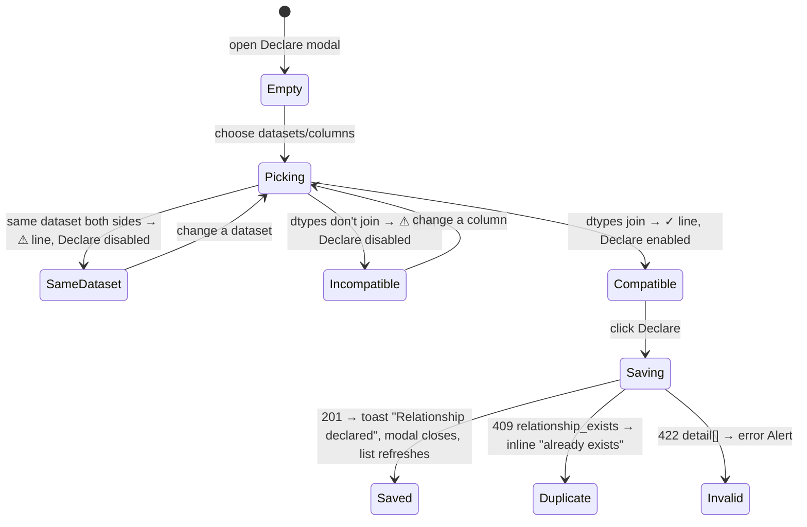
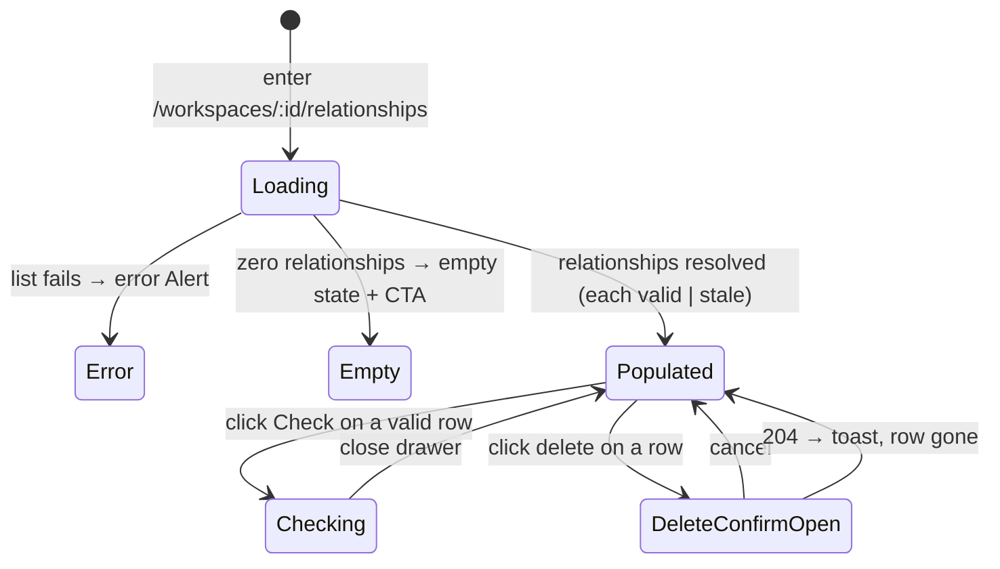

# Relationships — govern and check the joins between a workspace's datasets

**Concept**: a **Relationship** is a **governed edge** between two Datasets in the same
Workspace — a column pair `left.col ↔ right.col` with a declared **cardinality** and a
validated **dtype compatibility**. It is an _edge_, **not a table-source**: Datasets are the
table-sources it connects, and a [Query](../queries/queries.md) is what joins them. Its
**home is the Workspace** that owns those datasets (joins are within-workspace). A user
**declares** an edge, the system **validates** it (both columns exist, dtypes join-compatible),
**stores and lists** it, keeps it honest against schema drift (`status: stale` — _flag, don't
reject_, [purpose.md](../../../context/purpose.md) #5), and can **check** it against the data on
demand: how much of each side finds a partner, what cardinality the data actually shows, and
whether a join will multiply rows. It produces **no joined rows** — the Query does.

**Status**: Accepted — shipped. Declare / list / get / delete, `status` computed on read, the
on-demand self-check (`GET /relationships/{id}/check`) with its drawer, and the join-time
"multiplies rows" warning. Relationship governance is a stated product requirement
([purpose.md](../../../context/purpose.md) #4: _"Relationships are central and not fixed…
relationship governance is a product requirement"_) and the middle step of the critical path
(`data → relationships → dashboards`).

**Domain folder**: `data-management/workspaces/` — a Relationship is owned by the
**Workspace** whose datasets it connects; a sibling of [workspaces.md](workspaces.md), **not**
a top-level catalog and **not** a dataset-detail section. The feature code lives in
`apps/builder/src/features/data-management/relationships/`.

**Sibling docs**:
[`../_noun-model.md`](../_noun-model.md) (the domain noun-model; defines the **governed `rel_`
(asset) vs query-owned `qrel_` (snapshot)** boundary this entity sits on),
[workspaces.md](workspaces.md) (the container; this view is reached from the workspace card),
[datasets.md](../datasets/datasets.md) + [dataset-detail.md](../datasets/dataset-detail.md)
(the column / `dtype` metadata the compatibility rule reads; the page that hosts the
**Join with related dataset** modal),
[queries.md](../queries/queries.md) + [canvas.md](../queries/canvas.md) (the **consumers** —
copy-on-pick into a query-owned edge, and promote back),
[metadata.md](../_shared/metadata.md) (the read-only notes panel the check drawer carries),
[crud-hygiene.md](../_shared/crud-hygiene.md) (the delete-confirm modal),
[workspace-shell.target.md](../../_platform/workspace-shell.target.md) (the chrome).

> **Why an edge, not a mode or a table-source.** Unlike a Query (a virtual dataset), a
> Relationship has no rows of its own; it _relates_ two row-sources. So it earns its own
> entity — but its **surfaces** still reuse rather than duplicate: the declare flow is a
> **modal**, the list **reuses the Page-List layout**, validation **reuses the dataset `dtype`
> metadata**, the check is a **drawer** over the list — never a parallel page or a re-invented
> engine ([specious-model-lock-in](../../../memory/2026-06-13-specious-model-lock-in.md)).

---

## Surfaces — layer / reuse / purity declaration

| Surface                                                                                         | Layer                                                                        | Reusability         | Purity             | Allowed peer deps                  |
| ----------------------------------------------------------------------------------------------- | ---------------------------------------------------------------------------- | ------------------- | ------------------ | ---------------------------------- |
| `WorkspaceRelationshipsPage` (reuses Page-List; Check + delete row actions)                     | `apps/builder/src/features/data-management/relationships`                    | feature             | feature            | react, antd, @tanstack/react-query |
| `DeclareRelationshipModal` (+ exported `dtypeCompatible`)                                       | `apps/builder/src/features/data-management/relationships`                    | feature             | feature            | react, antd                        |
| `RelationshipCheckDrawer` / `RelationshipCheckView` (+ exported `checkFlags`)                   | `apps/builder/src/features/data-management/relationships`                    | feature             | feature            | react, antd, @tanstack/react-query |
| `useRelationshipsQuery` / `useRelationshipQuery` / `useRelationshipCheckQuery` / `use*Mutation` | `apps/builder/src/features/data-management/relationships/hooks.ts`           | feature             | glue (server-data) | @tanstack/react-query              |
| `relationshipsApi` client (`create` · `list` · `get` · `check` · `delete`)                      | `apps/builder/src/api/relationshipsApi.ts`                                   | builder-only        | glue               | (fetch — no extra peer dep)        |
| `Relationship` / `RelationshipCheck` / `CreateRelationshipRequest` types                        | `apps/builder/src/features/data-management/relationships/types.ts`           | feature             | data type          | none                               |
| `JoinMultipliesWarning` (an `<Alert>` inside `JoinWithRelatedModal` — a consumer)               | `apps/builder/src/features/data-management/queries/JoinWithRelatedModal.tsx` | feature             | feature            | react, antd                        |
| `MetadataPanel` (reused, owned by [metadata.md](../_shared/metadata.md))                        | `apps/builder/src/features/metadata`                                         | feature             | feature            | react, antd, @tanstack/react-query |
| `<DeleteConfirmModal>` (reused)                                                                 | `apps/builder/src/features/data-management/_shared`                          | feature             | feature            | react, antd                        |
| Page-List shells `PageHeader` / `PageCard` (reused)                                             | `@mdd/ui`                                                                    | shared cross-domain | plain-UI           | react, antd                        |
| `POST/GET …/relationships`, `GET/DELETE /relationships/{id}`, `GET /relationships/{id}/check`   | `apps/backend/app/routers/relationships.py`                                  | backend             | feature            | (FastAPI — backend native)         |
| `check_relationship` (one DuckDB query over both parquets)                                      | `apps/backend/app/ingest/relationship_check.py`                              | backend             | feature            | duckdb                             |
| `_dtype_of` / `_compatible` (the J-4 rule, shared with the query engine)                        | `apps/backend/app/routers/_shared.py`                                        | backend             | pure               | (stdlib)                           |
| `Relationship` SQLModel table + `Relationship` / `CreateRelationshipBody` Pydantic models       | `apps/backend/app/db_models.py` · `apps/backend/app/models/common.py`        | backend             | data type          | sqlmodel, pydantic                 |

**Boundary check**: the only `@mdd/ui` rows (`PageHeader` / `PageCard`) are **reused, not
owned**, and stay within the permanent allow-list. `<DeleteConfirmModal>` is reused from
`data-management/_shared` ([crud-hygiene.md](../_shared/crud-hygiene.md)) and `MetadataPanel`
from `features/metadata` ([metadata.md](../_shared/metadata.md)). `WorkspaceRelationshipsPage`
**composes** the shared Page-List layout, adding only its column config, the declare action
and the check drawer. The dataset `dtype` metadata is **read**, never re-modeled.

---

## Token map

The relationships surfaces are AntD primitives (`<Table>`, `<Modal>`, `<Select>`,
`<Segmented>`, `<Tag>`, `<Empty>`, `<Button>`, `<Alert>`, `<Drawer>`, `<Progress>`,
`<Descriptions>`) styled by the `<ConfigProvider>` tokens derived from the seeds in
[`themeTokens.ts`](../../../../workspace/packages/ui/src/themeTokens.ts) (the source of
truth). **No new token is introduced.** `Value` is informational.

| Surface                                                | AntD token (themeTokens.ts) | Value (informational) |
| ------------------------------------------------------ | --------------------------- | --------------------- |
| Page background                                        | `colorBgLayout`             | `#f5f5f5`             |
| Page / modal / drawer background                       | `colorBgBase`               | derived               |
| Table header background                                | `colorFillQuaternary`       | derived               |
| Table row border                                       | `colorBorderSecondary`      | `#f0f0f0`             |
| `[+ Declare relationship]` / primary action            | `colorPrimary`              | `#1677ff`             |
| Compatible-keys line ✓, `Valid` tag, full coverage bar | `colorSuccess`              | `#52c41a`             |
| Incompatible / stale / mismatch / multiplies warnings  | `colorWarning`              | `#faad14`             |
| Coverage bar with unmatched rows; delete icon          | `colorError`                | derived               |
| Cardinality `<Tag>` text, check side summaries         | `colorTextSecondary`        | derived               |
| Border radius (card, table, modal, drawer)             | `borderRadius`              | `6`                   |
| Font family                                            | `fontFamily`                | system stack          |

Identifier parity is enforced by
[`design-token-parity.mjs`](../../../../scripts/lint/design-token-parity.mjs).

---

## Layout — ASCII intent

All surfaces render inside the master-layout chrome
([workspace-shell.target.md](../../_platform/workspace-shell.target.md)). There is no
workspace _detail_ page (only the card grid), so this surface is a thin workspace-scoped
sub-route **`/data-management/workspaces/:id/relationships`**, reached from the
**Relationships** item in the workspace card's overflow menu.

### Relationships list — `/data-management/workspaces/:id/relationships`

Reuses the **standard Page-List layout** (`PageHeader` + `PageCard` + AntD `<Table>`) — the
same shell as [datasets.md](../datasets/datasets.md), with a relationships column config.

```text
Home ▸ Data Management ▸ Workspaces ▸ Marketing ▸ Relationships        [+ Declare relationship]
Relationships
Govern how this workspace's datasets join. The Query Builder uses these to combine sources.

┌────────────────────────────────────────────────────────────────────────────────────────┐
│ PageCard                                                                                │
│ ┌─────────────────────────────────────────────────────────────────────────────────────┐ │
│ │ Left   │ Right    │ Keys              │ Cardinality │ Status    │          │        │ │
│ ├─────────────────────────────────────────────────────────────────────────────────────┤ │
│ │ Deals  │ Accounts │ account_id ↔ id   │ many:1      │ ✓ Valid   │ [⚗ Check] │  🗑    │ │
│ │ Deals  │ Owners   │ owner_id ↔ id     │ many:1      │ ⚠ Stale ⓘ │ [⚗ Check]░│  🗑    │ │
│ └─────────────────────────────────────────────────────────────────────────────────────┘ │
└────────────────────────────────────────────────────────────────────────────────────────┘
                                                     ░ = disabled on a stale row
```

- **Breadcrumb**: Home ▸ Data Management ▸ Workspaces ▸ _workspace name_ ▸ Relationships.
  The header action is hidden while the list is loading or failed.
- **Columns**: Left and Right (the dataset **name**, plain text; the id when the dataset is
  not in the loaded list), Keys (`left.col ↔ right.col` in code style — the derived label;
  there is **no** user name), Cardinality (`<Tag>`: `1:1` · `1:many` · `many:1` ·
  `many:many`), Status (`Valid` success tag / `Stale` warning tag with a tooltip _"A referenced
  column no longer exists. Re-declare or delete."_), then two row actions: **Check** (opens
  the drawer; disabled on a stale row) and **delete** (danger icon button with an accessible
  name naming the edge).
- **Order** is the server's: `created_at` desc, then `id` desc. Pages of 20; no pager on a
  single page. Rows are not editable — re-declare and delete to change one.
- **States**: loading skeleton; error alert _"Couldn't load relationships"_; empty state
  _"No relationships yet — Declare how two datasets join so the Query Builder can combine
  them."_ + the declare CTA.

### Declare modal — pick two columns, validate, save

```text
        ┌──────────────── Declare relationship ─────────────────────┐
        │  Left dataset   [ Deals                ▾ ]                 │
        │  Left column    [ account_id (integer) ▾ ]                 │
        │  Right dataset  [ Accounts             ▾ ]                 │
        │  Right column   [ id (integer)         ▾ ]                 │
        │  Cardinality    ( 1:1 )(•1:many)( many:1 )( many:many )    │
        │  ──────────────────────────────────────────────────────    │
        │  ✓ Keys are join-compatible (integer ↔ integer)            │
        │                               [ Cancel ] [ Declare ]       │
        └────────────────────────────────────────────────────────────┘
```

- Dataset selects list **this workspace's** datasets; a column select is disabled until its
  dataset is chosen and lists that dataset's columns **with their `dtype`**. Changing a
  dataset clears its column. Cardinality defaults to `1:many`. Every field resets when the
  modal reopens.
- A **live compatibility line** (`role="status"`, `aria-live="polite"`): ✓ _"Keys are
  join-compatible (a ↔ b)"_, ⚠ _"These keys can't join (a ↔ b)"_, or — when both sides are the
  same dataset — ⚠ _"Pick two different datasets."_ **Declare is disabled** until both columns
  are chosen, the datasets differ, and the dtypes are compatible.
- A duplicate pair shows an inline danger line _"This relationship already exists in this
  workspace."_; any other failure an error `<Alert>` _"Couldn't declare the relationship"_.

### Check drawer — the edge measured against its data

Opened by a row's **Check**; a right-hand `<Drawer>` (460 px) titled
`Left.col ↔ Right.col` (dataset names).

```text
┌ Deals.account_id ↔ Accounts.id ───────────────────────── ✕ ┐
│ Deals                                                       │
│ ███████████████████████████████████████░░░  94.2%            │
│ 1,130 of 1,200 rows have a partner · 70 without ·           │
│ 1,130 keys, up to 1 rows per key                            │
│ Accounts                                                    │
│ ██████████████████████████████████░░░░░░░░  88.2%            │
│ 300 of 340 rows have a partner · 40 without ·               │
│ 300 keys, up to 3 rows per key                              │
│ ┌──────────┬──────────────────────────────────────────────┐ │
│ │ Declared │ [1:1]                                        │ │
│ │ Observed │ [1:many] ⚠ differs from the declaration —     │ │
│ │          │            flagged, not blocked              │ │
│ └──────────┴──────────────────────────────────────────────┘ │
│ ⚠ Joining from Deals to Accounts can multiply rows: a key   │
│   has up to 3 rows on Accounts.                             │
│ Measured 2026-10-15T09:00:00Z over the committed data;      │
│ read again to refresh.                                      │
│ ▸ Metadata  (read-only panel — see metadata.md)             │
└─────────────────────────────────────────────────────────────┘
```

- Per side: the coverage bar (red when any row is unmatched, green otherwise), matched / total
  / unmatched rows, distinct keys and the most rows any one key has.
- Declared vs observed cardinality; the observed tag is green when it matches, amber with the
  mismatch note when not.
- One amber alert per direction that multiplies rows. When nothing is flagged, a green
  _"As declared: every row has a partner, no key repeats."_
- Below the result, the relationship's [metadata](../_shared/metadata.md) panel
  (`alwaysShow`, so an empty panel shows "Nothing written here yet.").
- Loading: skeleton. `409 relationship_stale`: amber _"A key column is gone or no longer joins
  — fix the relationship first."_ Any other failure: red _"Could not measure this
  relationship."_ (no metadata panel in either case).

### Join warning — in the Query's "Join with related dataset" modal

`JoinWithRelatedModal` (opened from the dataset detail page; owned by
[queries.md](../queries/queries.md)) lists the **valid** edges involving the dataset. When the
selected edge's check says a join would multiply **this dataset's** rows (`multipliesLeft` if
the dataset is the edge's left side, else `multipliesRight`), an amber `JoinMultipliesWarning`
alert reads _"This join can multiply rows: a key has up to N rows on the other side (X
observed, Y declared)."_ It never blocks saving; a failed check shows nothing.

---

## Data model

The `Relationship` entity persists to the `relationships` table in `app.sqlite`. The **schema
of record is the SQLModel `Relationship` table**
([db_models.py](../../../../workspace/apps/backend/app/db_models.py)), migrated by Alembic
(`0001_baseline` creates it; `0004_many_to_one_cardinality` rebuilds it to widen the
cardinality `CHECK`). Request **handlers use raw `sqlite3`** (`db.get_conn()`, hand-written
SQL, `PRAGMA foreign_keys = ON` per connection).

```ts
// Frontend type — features/data-management/relationships/types.ts
type Cardinality = 'one_to_one' | 'one_to_many' | 'many_to_one' | 'many_to_many'; // direction by side order
type RelationshipStatus = 'valid' | 'stale'; // COMPUTED at read vs current schemas — not stored

type Relationship = {
  id: string; // server-generated, `^rel_[0-9a-f]{8}$`
  workspaceId: string; // FK → Workspace.id (the governance scope)
  leftDatasetId: string; // FK → Dataset.id
  leftColumn: string; // a column name in leftDataset.columns[]
  rightDatasetId: string; // FK → Dataset.id (same workspace)
  rightColumn: string; // a column name in rightDataset.columns[]
  cardinality: Cardinality; // declared
  status: RelationshipStatus; // 'stale' iff a dataset is gone, a column is gone, or the dtypes no longer join
  createdAt: string; // ISO-8601 UTC
};
```

```sql
CREATE TABLE relationships (
    id TEXT PRIMARY KEY,                                        -- rel_xxxxxxxx
    workspace_id     TEXT NOT NULL REFERENCES workspaces(id) ON DELETE CASCADE,
    left_dataset_id  TEXT NOT NULL REFERENCES datasets(id)   ON DELETE CASCADE,
    left_column      TEXT NOT NULL,
    right_dataset_id TEXT NOT NULL REFERENCES datasets(id)   ON DELETE CASCADE,
    right_column     TEXT NOT NULL,
    cardinality TEXT NOT NULL
        CHECK (cardinality IN ('one_to_one','one_to_many','many_to_one','many_to_many')),
    created_at TEXT NOT NULL
);
CREATE INDEX idx_relationships_workspace_id ON relationships(workspace_id);
-- one governed edge per ordered column-pair, per workspace (no user name)
CREATE UNIQUE INDEX idx_relationships_pair_unique
    ON relationships(workspace_id, left_dataset_id, left_column, right_dataset_id, right_column);
```

**Status is not a column** — it is recomputed on every read by checking both columns against
the current dataset schemas (always fresh, like `query_stale`). A dataset **refresh** keeps the
dataset id, so edges survive it; if the refresh drops or retypes a key column the edge reads
`stale`.

**Cardinality is a declared label.** It never changes the join SQL (the join _type_ does).
Direction is by side order (left → right); `many_to_one` is the truthful label for a
fact(left) → dimension(right) join, the inverse of `one_to_many`. When a pair is drawn
free-form in the query canvas, the canvas's `inferCardinality` proposes a default from the
column names (both key-like → `one_to_one`; only left → `one_to_many`; only right →
`many_to_one`; neither → `many_to_many`) and the user confirms or overrides it. The **check**
reports what the data actually shows next to the declaration; it never rewrites it.

**Compatibility rule (J-4).** Two columns are **join-compatible** iff their `dtype`s (closed
enum `string` / `integer` / `float` / `boolean` / `date` / `datetime`) are equal, **with
`integer` ↔ `float` allowed**. The rule is `_compatible` in `routers/_shared.py` (used by
declare, by status, and by the query engine) and mirrored client-side as `dtypeCompatible`.

**The check is not stored.** `RelationshipCheck` is computed per request from the two
committed parquets and stamped `checkedAt`; nothing persists.

---

## Behaviour

### Declare flow



- The client check is advisory; the **server re-validates** on `POST`, in this order: same
  dataset on both sides (`self_join`) → each dataset exists **in this workspace**
  (`unknown_dataset`) → each column exists (`unknown_column`) → dtypes join
  (`incompatible_join_keys`). Each is a `422` whose reason is a text prefix in `msg`.
- The `422` body is FastAPI's `detail[]` (no `code`), which the client does not parse — the
  error `<Alert>` shows a generic _"Request failed: 422 …"_ description, not the server's
  reason. Only `relationship_exists` is special-cased.
- Self-joins (same dataset, any columns) are refused; see Scope.
- **Promote target.** The same `POST …/relationships` is the **promote** endpoint for a
  query-owned relationship: the query canvas ([canvas.md](../queries/canvas.md)) posts a
  query-local edge's join fields here to lift it into the governed set, reusing the whole
  rulebook (dedup `409`, dtype / self `422`). On success the query-owned edge records the new
  `rel_` id as its provenance back-ref.

### List, check and delete



- Each listed edge carries `status` **computed at read**. Stale rows are flagged, never
  removed, and cannot be checked (the button is disabled; the server would answer
  `409 relationship_stale`).
- **Delete** reuses `<DeleteConfirmModal>` ([crud-hygiene.md](../_shared/crud-hygiene.md),
  `resourceLabel="relationship"`, the keys label as the name). Deleting a **dataset** or a
  **workspace** cascades its relationships away (FK `ON DELETE CASCADE`). A saved query holds
  its own snapshot of an edge (copy-on-pick), so deleting a governed edge cannot break it.

### What the check measures

`check_relationship` runs one DuckDB query over both datasets' `parsed.parquet`:

- Keys are compared **as text** (`CAST(col AS VARCHAR)`, the same cast the join uses); a
  `NULL` or empty key never matches and is not counted as a key.
- Per side: total rows, **matched** rows (key present on the other side), **unmatched** rows,
  **coverage** = matched ÷ rows (6 decimals; `0` for an empty side), **distinct keys**, and
  **max rows per key**.
- **Observed cardinality**: a side is `one` when its max rows per key ≤ 1, else `many` →
  `<left>_to_<right>`. `cardinalityMatches` = observed equals declared.
- **`multipliesLeft`** = some key repeats on the **right** (a left → right hop can duplicate
  left rows); **`multipliesRight`** = some key repeats on the left.
- The route adds `declaredCardinality`, `cardinalityMatches` and `checkedAt`. A mismatch is a
  **flag, never a block** — the join still runs. Because it reads the committed parquet, the
  next check after a dataset refresh measures the new rows.

### Accessibility

- The live compatibility line is a polite live region, so its change is announced — it is the
  learnability affordance for the non-obvious "which columns can join" rule.
- Status is **icon + text** (`Valid` / `⚠ Stale`), never colour alone; cardinality is a
  labelled `<Tag>`. Check-drawer flags are text alerts, not colour-only bars.
- Declare controls are AntD `<Select>` / `<Segmented>` with **visible labels above** and are
  keyboard-reachable; the delete button has an accessible name naming the edge; `Esc` closes
  the modal and the drawer.

### Caching (TanStack query keys)

- `['relationships', { workspaceId }]` — a workspace's edges (also read by the dataset detail
  page, the query canvas, the join editor and the join modal).
- `['relationship', id]` — one edge (`useRelationshipQuery`).
- `['relationship-check', id]` — the check; `retry: false`, `staleTime` 15 s, fetched only while
  the drawer (or the join modal with a selection) is open.
- Create and delete invalidate the whole `['relationships']` prefix; delete also removes
  `['relationship', id]`.

---

## Data contract

Contracts: [`workspace/packages/contracts/relationships/`](../../../../workspace/packages/contracts/relationships/)
— `post` · `get` · `detail-get` · `delete` · `check-get` `.contract.yaml`, the
`_shared/relationship.yaml` entity, and `_shared/api-error.yaml`.

| Route                                 | Purpose | Success                                              | Errors                                                                                                                                             |
| ------------------------------------- | ------- | ---------------------------------------------------- | -------------------------------------------------------------------------------------------------------------------------------------------------- |
| `POST /workspaces/{id}/relationships` | declare | `201` `Relationship` (`status: valid`)               | `409 relationship_exists` (duplicate ordered pair); `422 detail[]` — self-join, unknown/cross-workspace dataset, unknown column, incompatible keys |
| `GET /workspaces/{id}/relationships`  | list    | `200` `Relationship[]`, `created_at` desc, `id` desc | —                                                                                                                                                  |
| `GET /relationships/{id}`             | get     | `200` `Relationship`                                 | `404 not_found`                                                                                                                                    |
| `GET /relationships/{id}/check`       | check   | `200` `RelationshipCheck`                            | `404 not_found`; `409 relationship_stale` (a key column is gone or no longer joins)                                                                |
| `DELETE /relationships/{id}`          | delete  | `204`                                                | `404 not_found`                                                                                                                                    |

`CreateRelationshipBody` is `{ leftDatasetId, leftColumn, rightDatasetId, rightColumn,
cardinality }` (`extra="forbid"`). `RelationshipCheck` is `{ leftRows, rightRows,
leftMatchedRows, rightMatchedRows, leftUnmatchedRows, rightUnmatchedRows, leftCoverage,
rightCoverage, leftDistinctKeys, rightDistinctKeys, leftMaxPerKey, rightMaxPerKey,
observedCardinality, declaredCardinality, cardinalityMatches, multipliesLeft,
multipliesRight, checkedAt }` (`additionalProperties: false`).

- **Governance reads never error on stale** — list and get annotate it.
  **`409 relationship_stale` is for consumers that need the edge to work**: the check, and a
  query run whose join key drifted.
- **Error envelopes.** `relationship_exists` / `relationship_stale` / `not_found` are the
  code-first envelope (`{ "code": … }`). The declare `422` carries **no** machine code — it is
  FastAPI's `detail: [{ loc, msg, type: "value_error" }]`, with the reason as a text prefix in
  `msg`.
- There is **no `/rows` route** — joining is the Query's job.

---

## Acceptance criteria (Design gate exit)

**User journey** — as a user I open a workspace's **Relationships**, declare that a column in
one dataset joins a column in another, the system confirms the keys are compatible and
remembers the edge, I see it listed (and flagged if a column later drifts), I can check how
well the data actually matches it and whether joining will multiply rows, so that the Query
Builder can combine those datasets without my re-explaining how they relate — and without
surprising me with duplicated rows.

1. **Declare affordance + live compatibility** _(FE)_ — the modal lists the workspace's
   datasets / columns (with `dtype`), shows the live ✓/⚠ line (including same-dataset), and
   **disables Declare** until two columns on different datasets are chosen and compatible.
2. **Compatibility validation** _(pytest + FE)_ — incompatible dtypes → `422`; equal dtypes
   and `integer` ↔ `float` succeed; the server re-validates independently.
3. **Declare persists + guards** _(pytest)_ — `POST` persists a `rel_` row and returns it; a
   duplicate ordered pair → `409 relationship_exists`; unknown column / cross-workspace dataset
   / same dataset → `422`.
4. **List with computed status** _(pytest + FE)_ — the workspace's edges, newest first, each
   `valid | stale`, rendered through the shared Page-List layout and reached from the workspace
   card.
5. **Get one** _(pytest)_ — `GET /relationships/{id}` returns the edge; `404` if absent.
6. **Stale is flagged, not crashed** _(pytest + FE)_ — a removed / retyped column makes reads
   return `stale`; the row shows the warning tag; the edge is not auto-deleted.
7. **Check measures the data** _(pytest + FE)_ — `GET /relationships/{id}/check` returns
   coverage, unmatched rows, distinct keys and max rows per key per side, the observed
   cardinality beside the declared one, and the two `multiplies*` flags; blank keys never
   match; `404` absent; `409 relationship_stale` on a stale edge. The drawer renders each
   finding and the clean state.
8. **Join warning** _(FE)_ — in the join modal, an edge whose check says this dataset's rows
   would multiply shows `JoinMultipliesWarning`; saving stays allowed.
9. **Delete + cascade** _(pytest + FE)_ — deleting an edge removes it; deleting a source
   dataset or the workspace cascades its relationships away.
10. **Empty state** _(FE)_ — zero relationships renders the "declare how two datasets join"
    copy + CTA.
11. **Reuse, not duplication** _(FE)_ — the view composes the shared Page-List layout,
    `<DeleteConfirmModal>` and `MetadataPanel`; no parallel page.
12. **Governance only** _(scope assertion)_ — no joined rows and no `/rows` route here.

---

## Scope boundary

### IN scope

- Declaring a single-column edge `(left.col ↔ right.col)` between two different datasets in
  one workspace, with a declared cardinality and server-side dtype validation; the
  `relationships` table and `rel_` identity.
- Declare / list / get / delete; `status` computed on read; the on-demand check and its
  drawer; the join modal's multiplies warning; the relationship's metadata panel in the
  drawer.

### OUT of scope (deferred with named triggers)

- **Join execution** — producing joined rows, the table-source resolver and the run-time
  `409 relationship_stale` are the **Query's** ([queries.md](../queries/queries.md)).
- **Composite / multi-column join keys** (`(a,b) ↔ (c,d)`). _Trigger: a real CRM export needs a
  two-column key._
- **Self-joins** (same dataset on both sides). _Trigger: a hierarchy / parent-child within one
  dataset._
- **Cross-workspace relationships** — governance stays within a workspace.
- **Suggesting or correcting the declared cardinality from the check** — the check reports the
  observed cardinality but never changes the declaration or pre-fills the declare modal.
  _Trigger: users repeatedly re-declare to match the check._
- **Storing check results / history** — every check is fresh. _Trigger: someone needs to see
  how coverage moved across refreshes._
- **Editing an edge in place** — re-declare and delete. _Trigger: users churn near-identical
  edges to fix one side._
- **A relationship graph / ER visualization** — a later presentation concern.

### This concept explicitly does NOT cover

- The dataset column / `dtype` model ([datasets.md](../datasets/datasets.md),
  [dataset-detail.md](../datasets/dataset-detail.md)); this doc only **reads** it.
- How a Query consumes an edge (copy-on-pick, hops, join types, per-hop freshness) —
  [queries.md](../queries/queries.md).
- The metadata entry model and its write path — [metadata.md](../_shared/metadata.md).

---

## Reference materials (read-only)

- [queries.md](../queries/queries.md) — the consumer that joins through a query-owned copy of
  a governed edge, and whose run returns `409 relationship_stale` on a drifted key.
- [specious-model-lock-in](../../../memory/2026-06-13-specious-model-lock-in.md) — the
  noun-vs-mode / reuse-not-duplicate lesson the edge model honours.
- `apps/backend/tests/test_relationships.py`, `test_relationship_check.py` — the behaviour the
  acceptance criteria map to.
